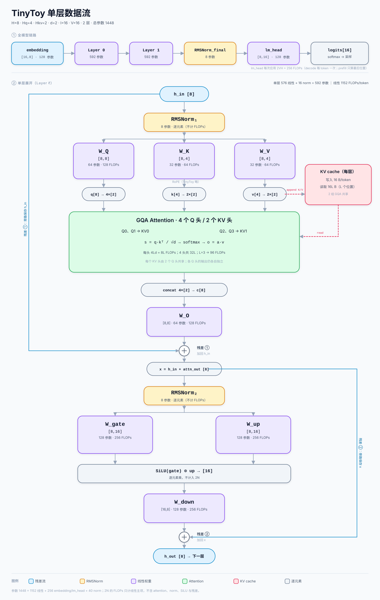

# LLM 推理全链路：从玩具模型到 GPU 水位

> 一份自底向上的软硬件笔记。从「一个 8 维向量」出发，一路走到「集群离满载还有多远」。
> 全文用一个可手算的玩具模型贯穿，每章配真实模型（Llama-3-70B on H200）对照。

---

## 第 0 章 导读

### 0.1 这份文档要回答的原始问题

运维大盘上想知道：**h200-c 组离满载还有多远？**

直觉答案是「看有没有排队，有排队就是满了」。但这个直觉是错的，而且错得很具体：

- 有一组请求排死了队，Tensor Core 却只用了 **1.8%**
- 有两组流量 TPM 完全相同，算力需求却差 **19 倍**
- 有一张卡显存水位显示 **100%**，但其实还能继续接请求

要解释清楚这些反直觉现象，必须一路下钻到硅片：HBM 的带宽、SM 里的 Tensor Core、KV cache 的每一个字节、vLLM 调度器的每一道闸门。

这份文档就是这条下钻路径的**反向重建**——从最小的零件开始，一层层搭回到容量水位。

### 0.2 为什么是这个顺序

章节按「最近追问 → 最早追问」排列，而这恰好等于**自底向上**：

```
第1章  注意力的头与维度      ← 零件：一个向量怎么切成头
第2章  一个 token 的两张账单  ← 度量：计算量与存储量
第3章  KV cache 的物理存储    ← 数据：算出来的东西放哪
第4章  GPU 硬件与 Roofline    ← 硬件：谁在算、谁在搬（结论版）
第5章  Prefill 与 Decode      ← 过程：两种截然不同的阶段
第6章  cached token 的真实成本 ← 账目：省了什么、没省什么
第7章  vLLM 调度器与排队      ← 系统：请求为什么进不来
第8章  水位                   ← 容量：离满载还有多远
```

先有零件和度量，才谈得上硬件；先懂硬件，才看得懂 prefill/decode 的区别；先懂区别，才算得清缓存的账；先算清账，才明白排队的原因；最后才轮到水位。

**倒着读（从第 8 章开始）也可以**，但会在每个「为什么」处需要往前翻。

> 第 4 章是**结论版**（只留 `412`、`206`、decode 下界这些后面要用的数字）。torch → CUDA → SM → HBM 的完整机理、以及线上排障的 `ncu` 判据，单独成篇：[GPU硬件与Roofline-从torch到CUDA到SM.md](./GPU硬件与Roofline-从torch到CUDA到SM.md)。两篇数字完全一致。

### 0.3 贯穿全文的玩具模型：TinyToy

为了让每一步都能手算，全文用一个极小的模型：

| 配置项 | 值 | 说明 |
|---|---|---|
| `hidden_size` `H` | **8** | 每个 token 的隐藏状态是 8 维向量 |
| `num_attention_heads` `H_q` | **4** | Q 头数 |
| `num_key_value_heads` `H_kv` | **2** | K/V 头数（GQA） |
| `head_dim` `d` | **2** | = 8 / 4 |
| `num_hidden_layers` | **2** | 两层 transformer block |
| `intermediate_size` `I` | **16** | MLP 中间宽度 |
| `vocab_size` | **16** | 词表 |
| dtype | **BF16（2 字节）** | 权重与 KV 同精度 |
| GQA 分组大小 | **2** | = 4 / 2 |

它小到了荒谬的程度——但**所有公式与真实模型完全一致**，只是数量级不同。

### 0.4 真实模型对照

每章末尾有一个「真实模型对照」框，用这套参数落地：

| | 值 |
|---|---|
| 模型 | Llama-3-70B（80 层，H=8192，H_q=64，H_kv=8，d=128，I=28672，V=128256） |
| 权重精度 | FP8（1 字节） |
| KV 精度 | BF16（2 字节） |
| 硬件 | 单张 H200 SXM：141 GB HBM3e / 4.8 TB/s / 132 SM |
| 峰值算力 | FP8 dense 1979 TFLOPS |
| 有效算力 | 取 MFU 40% → **792 TFLOPS** |
| 有效带宽 | 取 80% 效率 → **3.84 TB/s** |
| KV 池 | **50 GiB** |

### 0.5 玩具模型的边界（重要）

TinyToy 一次 forward 只有 2304 FLOPs，在 H200 峰值算力下是 `2304 / 1979e12 = 1.16e-12 s`，约 **1.2 皮秒**。而一次 kernel launch 的 CPU 开销约 **5 微秒**——是计算时间的 **430 万倍**。

**所以玩具模型的绝对时间毫无意义，它只用于验证公式和比例关系。** 任何关于「多少毫秒」「多少 tok/s」的结论，一律以真实模型对照框为准。

### 0.6 全文的手算约定

为了让数字可手算，以下省略项在正文中会反复声明：

1. 第 1.9 节和附录 A 的 attention 数值**保留 $1/\sqrt{d}$ 缩放**（TinyToy 约 0.7071，真实模型约 0.0884），并使用稳定 softmax。数值模型的简化设定和舍入口径见 1.9 节第零步；成本表只统计矩阵乘主项，逐元素操作另行说明。
2. 忽略 kernel launch 开销、忽略 TP 的 all-reduce 通信、忽略 L2 命中。
3. 带宽效率统一取 80%，MFU 统一取 40%。这是量级估算，不是实测。
4. `×` 表示乘法，代码块内的 `*` 也是乘法，两者不混用于同一表达式。
5. 显存单位用 **KiB / MiB / GiB（1024 进制）**，硬盘式 KB / MB / GB（1000 进制）只在带宽等场合出现，会标注。

---

## 第 1 章 注意力的头与维度

> 对应追问：「不是 8 个 KV 吗，为什么 head 是 64？」「为什么是 8192/64？」「128 是什么？」

这一章解决三个数字的来源：**头数、head_dim、以及为什么 Q 和 KV 的头数可以不相等。**

### 1.1 三个配置项的关系

```
hidden_size          = 8      ← 隐藏状态宽度
num_attention_heads  = 4      ← 切成几个头
head_dim             = 8 / 4 = 2   ← 每个头多宽
```

在 TinyToy 采用 `W_Q 输出宽度 = hidden_size`、并均分为 4 个 Q 头的设定下，`head_dim` 是这样除出来的。有些模型会独立指定它，见 1.6 节；下一节先说明本例的形状约束。

### 1.2 宽度守恒：除法是被两个约束夹出来的

走一遍完整的形状链（TinyToy，layer 0，一个 token）：

```
h = [8]                        ← 输入隐藏状态

q = h @ W_Q                    ← W_Q 形状 [8, 8]
  = [8]                        ← 输出 8 个数字

q.reshape(4, ?)                ← 要切成 4 个头
                                  reshape 不改变元素总数：4 × ? = 8
                                  → ? = 2   ★ 除法在这里发生

每个头独立做 attention → 输出 [2]

concat(4 个 [2]) = [8]         ← 拼回来

out = concat @ W_O             ← W_O 形状 [8, 8]
    = [8]

h = h + out                    ← 残差相加，两边必须都是 8 维
```

**两个约束：**

| 约束 | 内容 | 后果 |
|---|---|---|
| ① reshape 元素守恒 | `头数 × head_dim = W_Q 输出宽度` | 不能随便定 head_dim |
| ② 残差连接宽度一致 | `W_O 输出 = hidden_size` | 投影后必须等于 8；拼接宽度本身不必等于 8 |

所以准确的公式是：

```
head_dim = W_Q 的输出宽度 / Q 头数
```

而 **「W_Q 输出宽度 = hidden_size」是一个设计约定，不是数学定律**。8/4=2 只是这个约定下的结果。1.6 节给一个打破约定的真实反例。

### 1.3 多头为什么要切：64 种关注模式 vs 1 种

一个 token 的隐藏状态是 8 维（真实模型 8192 维）。做 attention 时不是拿整体去算一个相似度，而是**切成 4 份，每份 2 维，各自独立做一套 attention**：

```
hidden state [8]
      ↓ 切分
head_0 [2]   head_1 [2]   head_2 [2]   head_3 [2]
      ↓           ↓           ↓           ↓
   独立算      独立算      独立算      独立算
   softmax     softmax     softmax     softmax
      ↓           ↓           ↓           ↓
   输出[2]     输出[2]     输出[2]     输出[2]
      └───────────┴───── concat ─┴───────────┘
                     [8]
```

**为什么切？** 一个 softmax 只能产生一种注意力分布。切成 4 个头就有 4 个独立分布——有的头盯语法结构，有的盯位置邻近，有的盯语义指代。单头 8 维只能表达一种「关注模式」，多头能同时表达 4 种。

真实模型是 64 种。`head_dim` 就是**每一种关注模式所在子空间的维度**。

### 1.4 多头为什么「免费」：FLOPs 完全相同

这是 Transformer 原论文（Vaswani et al., 2017）的原始动机。论文里那句话的意思是：**把每个头的维度缩小，使总计算量与单头全维度 attention 相同。**

**TinyToy 验算**（历史长度 L=3）：

方案 A：单头，8 维
```
QK^T:  q[1,8] · K[3,8]ᵀ  → 2 × 3 × 8 = 48 FLOPs
AV:    w[1,3] · V[3,8]   → 2 × 3 × 8 = 48 FLOPs
合计 = 96 FLOPs
```

方案 B：4 头，每头 2 维
```
每头:  4 × L × d = 4 × 3 × 2 = 24 FLOPs
× 4 头 = 96 FLOPs
```

**完全相同。** 投影层也一样：W_Q 都是 `[8,8]`，W_O 都是 `[8,8]`，参数量分毫不差。

> **真实模型对照**（L=2048）
> - 单头 8192 维：`4 × 2048 × 8192 = 67.1 MFLOP`
> - 64 头 128 维：`64 × (4 × 2048 × 128) = 67.1 MFLOP`
>
> 同样完全相同。

所以多头注意力干的事是：**把同一个大点积拆成多个小点积，各自独立 softmax。计算量没变，表达能力从 1 种分布变成 64 种。**

### 1.5 不除以头数会怎样

如果 4 个头都用 8 维（不除）：

```
W_Q 变成 [8, 32]     → 参数量 256，是原来的 4 倍
attention FLOPs      → 4 × (4 × 3 × 8) = 384，是原来的 4 倍
```

真实模型就是 **×64**：W_Q 变成 `[8192, 524288]`，attention 计算量 ×64。

那就不是「多头」，是「64 个独立的完整 attention 层」，成本爆炸。**除法就是让多头白嫖的那个关键。**

### 1.6 约定可以被打破：Gemma-2 反例

有些模型显式指定 `head_dim`，不再等于 hidden/heads：

```json
// Gemma-2-2B
"hidden_size": 2304,
"num_attention_heads": 8,
"head_dim": 256          ← 显式指定，不是 2304/8=288
```

```
8 × 256 = 2048 ≠ 2304

W_Q: [2304, 2048]        ← 投影到一个更窄的宽度
W_O: [2048, 2304]        ← 再投回 2304
```

它选择了「每头更宽、总宽度更窄」的组合。

**实践规则：看到 head_dim 先查 config 有没有显式指定；没有才是 `hidden_size / num_attention_heads`。** Llama 系和 Qwen 系都遵循约定。

### 1.7 两套头数：Q 是 4 个，K/V 是 2 个

现在回答那个最直接的困惑：**「不是 2 个 KV 吗，为什么 head 是 4？」**

因为 config 里其实是**两个字段**：

```json
"num_attention_heads":     4,   ← 这个说的是 Q 头数
"num_key_value_heads":     2,   ← 这个说的是 K/V 头数
"head_dim":                2
```

`num_attention_heads` 这个名字有历史包袱：原始 Transformer 是 MHA，Q/K/V 头数全都一样，一个字段就够了。后来 GQA 把 K/V 头数砍下来，新增了 `num_key_value_heads`，但老字段名没改，仍然指 Q 头数。

**「4 个头」和「2 个 KV 头」说的是不同的张量，不矛盾。**

三个张量的形状并排看（TinyToy，一个 token，layer 0）：

```
q = h @ W_Q    W_Q: [8, 8]  →  q = [8]  →  reshape [4, 2]
k = h @ W_K    W_K: [8, 4]  →  k = [4]  →  reshape [2, 2]
v = h @ W_V    W_V: [8, 4]  →  v = [4]  →  reshape [2, 2]
                                                     ↑   ↑
                                                   头数  每头维度
```

**Q 产出 8 个数，K/V 各产出 4 个数。投影矩阵的宽度就不一样，这是源头。**

> **真实模型对照**
> ```
> q: W_Q [8192, 8192] → [8192] → reshape [64, 128]
> k: W_K [8192, 1024] → [1024] → reshape [ 8, 128]
> v: W_V [8192, 1024] → [1024] → reshape [ 8, 128]
> ```
> W_Q 有 67.1 M 参数，W_K 只有 8.4 M——**8 倍差距，因为 K 只需产出 8 个头而不是 64 个。**

### 1.8 GQA 分组：4 个 Q 头怎么用 2 个 KV 头

分成 2 组，每组 2 个 Q 头，共用一个 KV 头：

```
Q head 0 ─┐
          ├───→  KV head 0
Q head 1 ─┘

Q head 2 ─┐
          ├───→  KV head 1
Q head 3 ─┘
```

`4 / 2 = 2`，每组 2 个 Q 头。

> **真实模型对照**：`64 / 8 = 8`，每组 8 个 Q 头。
> ```
> Q head  0..7   →  KV head 0
> Q head  8..15  →  KV head 1
> ...
> Q head 56..63  →  KV head 7
> ```

### 1.9 完整数值追踪：一个 token 在 layer 0 的一生

这一节从给定的隐藏状态出发，把 **Q/K/V 投影 → 分头 → 写 cache → 缩放点积 → softmax → 加权求和 → 拼头 → 输出投影 → 第一次残差 → gated MLP → 第二次残差** 全部算完。所有权重矩阵都完整列出，**每个权重都非零，使用普通稠密矩阵乘法**。

#### 第零步：先固定输入、记号和计算边界

当前正在处理序列 `A → B → C` 中的 C。A、B 已经处理过；本次只算 C，C 可以关注 A、B 和自己。

| 项 | 本次取值 | 含义 |
| --- | --- | --- |
| batch | 1 | 只追踪一条序列 |
| 当前 token 数 | 1 | 只对 C 做投影和 MLP |
| `H` | 8 | 隐藏状态宽度 |
| `H_q` | 4 | Q 头数 |
| `H_kv` | 2 | KV 头数 |
| `d` | 2 | 每头宽度 |
| `I` | 16 | MLP 中间宽度 |
| `L` | 3 | 追加 C 后，可关注的位置总数，**包含 C** |

本节采用以下明确的教学设定：

1. 七个线性层都没有 bias；权重是为手算挑选的数值，不是训练所得。
2. 本节的数值模型不加入 RMSNorm、RoPE 和 dropout；**缩放、softmax、SiLU 和两次残差都实际计算**。真实 Llama 的归一化与位置旋转会改变数值，因此这里不是 Llama 某一层的逐位复现。
3. 数值按实数公式计算，内部保留未舍入值，展示通常保留 6 位小数；`≈` 表示近似。用展示值继续手算，末位可能有几单位误差。
4. BF16 只用于本节的**存储字节核算**，数值过程不模拟 BF16 每一步的舍入。不能把这里的小数位数理解为 BF16 的有效精度。
5. `q[j]` 表示投影后向量的第 j 个标量，`q_head[r]` 表示第 r 个二维头，二者分开命名。所有下标从 0 开始。

输入是一个行向量，先保存原值供第一次残差使用：

```text
h_in = [1, 0, 1, 1, 0, 1, 0, 1]
下标     0  1  2  3  4  5  6  7

h_in 的形状：[1, 8]
```

所有矩阵统一采用 **行 = 输入维、列 = 输出维** 的方向。以 Q 为例：

$$
q[j]=\sum_{i=0}^{7}h_{\mathrm{in}}[i]W_Q[i,j].
$$

也就是：**算第 j 个输出，要把输入 8 个数与矩阵第 j 列的 8 个数逐项相乘，再相加。** 别把矩阵的一行直接当成一个输出。后面的 `W_O`、`W_gate`、`W_up`、`W_down` 都按同一方向读取。

#### 第一步：用三个稠密矩阵，逐项算出 Q、K、V

##### 1.1 Q 投影：`[1,8] @ [8,8] → [1,8]`

完整的 `W_Q` 如下。输入虽然含有 0，矩阵本身没有 0；下面仍把与 0 相乘的项写出来。

```text
        j0  j1  j2  j3  j4  j5  j6  j7
i0  [    1   1   2   1  -1   1   1  -1 ]
i1  [    1  -1   1  -1   1  -1   1  -1 ]
i2  [    1   1  -1  -1   1   1  -1   1 ]
i3  [    1  -1   1   1   1  -1   1  -1 ]
i4  [   -1   1  -1   1  -1   1  -1   1 ]
i5  [   -1   1  -1   1   1  -1  -1   1 ]
i6  [    2   1   1  -1   1   1  -1   2 ]
i7  [   -1  -2  -1  -1  -1   1   1  -1 ]
```

八个输出，每个都使用完整的一列：

```text
q[0] = 1×1 + 0×1 + 1×1 + 1×1 + 0×(-1) + 1×(-1) + 0×2 + 1×(-1)
     = 1 + 0 + 1 + 1 + 0 - 1 + 0 - 1 = 1

q[1] = 1×1 + 0×(-1) + 1×1 + 1×(-1) + 0×1 + 1×1 + 0×1 + 1×(-2)
     = 1 + 0 + 1 - 1 + 0 + 1 + 0 - 2 = 0

q[2] = 1×2 + 0×1 + 1×(-1) + 1×1 + 0×(-1) + 1×(-1) + 0×1 + 1×(-1)
     = 2 + 0 - 1 + 1 + 0 - 1 + 0 - 1 = 0

q[3] = 1×1 + 0×(-1) + 1×(-1) + 1×1 + 0×1 + 1×1 + 0×(-1) + 1×(-1)
     = 1 + 0 - 1 + 1 + 0 + 1 + 0 - 1 = 1

q[4] = 1×(-1) + 0×1 + 1×1 + 1×1 + 0×(-1) + 1×1 + 0×1 + 1×(-1)
     = -1 + 0 + 1 + 1 + 0 + 1 + 0 - 1 = 1

q[5] = 1×1 + 0×(-1) + 1×1 + 1×(-1) + 0×1 + 1×(-1) + 0×1 + 1×1
     = 1 + 0 + 1 - 1 + 0 - 1 + 0 + 1 = 1

q[6] = 1×1 + 0×1 + 1×(-1) + 1×1 + 0×(-1) + 1×(-1) + 0×(-1) + 1×1
     = 1 + 0 - 1 + 1 + 0 - 1 + 0 + 1 = 1

q[7] = 1×(-1) + 0×(-1) + 1×1 + 1×(-1) + 0×1 + 1×1 + 0×2 + 1×(-1)
     = -1 + 0 + 1 - 1 + 0 + 1 + 0 - 1 = -1

q = [1, 0, 0, 1, 1, 1, 1, -1]
```

##### 1.2 K 投影：`[1,8] @ [8,4] → [1,4]`

```text
W_K：   j0  j1  j2  j3
i0  [    1   1   1   2 ]
i1  [   -1   2   1  -1 ]
i2  [    1  -1   1  -1 ]
i3  [    1   1  -1   1 ]
i4  [    2  -1   1   1 ]
i5  [   -1   1   1   1 ]
i6  [    1   1  -1   2 ]
i7  [   -1  -1  -2  -2 ]

k[0] = 1×1 + 0×(-1) + 1×1 + 1×1 + 0×2 + 1×(-1) + 0×1 + 1×(-1)
     = 1 + 0 + 1 + 1 + 0 - 1 + 0 - 1 = 1

k[1] = 1×1 + 0×2 + 1×(-1) + 1×1 + 0×(-1) + 1×1 + 0×1 + 1×(-1)
     = 1 + 0 - 1 + 1 + 0 + 1 + 0 - 1 = 1

k[2] = 1×1 + 0×1 + 1×1 + 1×(-1) + 0×1 + 1×1 + 0×(-1) + 1×(-2)
     = 1 + 0 + 1 - 1 + 0 + 1 + 0 - 2 = 0

k[3] = 1×2 + 0×(-1) + 1×(-1) + 1×1 + 0×1 + 1×1 + 0×2 + 1×(-2)
     = 2 + 0 - 1 + 1 + 0 + 1 + 0 - 2 = 1

k = [1, 1, 0, 1]
```

##### 1.3 V 投影：`[1,8] @ [8,4] → [1,4]`

```text
W_V：   j0  j1  j2  j3
i0  [    1  -1   1   1 ]
i1  [    1   2  -1   1 ]
i2  [   -1   1  -1   1 ]
i3  [    1   1   1  -1 ]
i4  [   -1   1   2  -1 ]
i5  [    1   1  -1   1 ]
i6  [    2  -1   1   1 ]
i7  [   -1  -1   1  -1 ]

v[0] = 1×1 + 0×1 + 1×(-1) + 1×1 + 0×(-1) + 1×1 + 0×2 + 1×(-1)
     = 1 + 0 - 1 + 1 + 0 + 1 + 0 - 1 = 1

v[1] = 1×(-1) + 0×2 + 1×1 + 1×1 + 0×1 + 1×1 + 0×(-1) + 1×(-1)
     = -1 + 0 + 1 + 1 + 0 + 1 + 0 - 1 = 1

v[2] = 1×1 + 0×(-1) + 1×(-1) + 1×1 + 0×2 + 1×(-1) + 0×1 + 1×1
     = 1 + 0 - 1 + 1 + 0 - 1 + 0 + 1 = 1

v[3] = 1×1 + 0×1 + 1×1 + 1×(-1) + 0×(-1) + 1×1 + 0×1 + 1×(-1)
     = 1 + 0 + 1 - 1 + 0 + 1 + 0 - 1 = 1

v = [1, 1, 1, 1]
```

##### 1.4 分头：只重新组织元素，不做新的乘法

```text
q.reshape(4,2)：
  q_head[0] = [q[0], q[1]] = [1,  0]
  q_head[1] = [q[2], q[3]] = [0,  1]
  q_head[2] = [q[4], q[5]] = [1,  1]
  q_head[3] = [q[6], q[7]] = [1, -1]

k.reshape(2,2)：
  k_head[0] = [k[0], k[1]] = [1, 1]
  k_head[1] = [k[2], k[3]] = [0, 1]

v.reshape(2,2)：
  v_head[0] = [v[0], v[1]] = [1, 1]
  v_head[1] = [v[2], v[3]] = [1, 1]
```

四个 Q 头有各自的查询向量。K/V 只有两个头，不需要为了配齐 Q 而额外生成两组 K/V。

#### 第二步：追加 C 的 KV，明确哪些数字来自缓存

A、B 的缓存是本次 decode 的**给定输入**，由此前步骤产生；本次不重算它们的隐藏状态、投影和 MLP。下表按 token 列出所有缓存元素：

| token | head 0 的 K | head 0 的 V | head 1 的 K | head 1 的 V | 来源 |
| --- | --- | --- | --- | --- | --- |
| A | [1,0] | [1,0] | [1,1] | [2,0] | 已在缓存中 |
| B | [0,1] | [0,1] | [1,-1] | [0,2] | 已在缓存中 |
| C | [1,1] | [1,1] | [0,1] | [1,1] | 刚由第一步算出 |

按头排列后，本层 K/V 的逻辑形状均为 `[H_kv,L,d] = [2,3,2]`：

```text
KV head 0：                  KV head 1：
K[0] = [[1,0],  ← A          K[1] = [[1, 1],  ← A
        [0,1],  ← B                  [1,-1],  ← B
        [1,1]]  ← C                  [0, 1]]  ← C

V[0] = [[1,0],  ← A          V[1] = [[2,0],   ← A
        [0,1],  ← B                  [0,2],   ← B
        [1,1]]  ← C                  [1,1]]   ← C
```

C 的位置是 2，能看的位置为 0、1、2，因此 causal mask 在本次三个位置上都是 0；若有未来位置，则要在 softmax 前给其分数加上 $-\infty$，使其权重为 0。

先把三种字节量分开：

```text
本层每个 token 的 K = 2头 × 2维 × 2 B = 8 B
本层每个 token 的 V = 2头 × 2维 × 2 B = 8 B
合计                 = 16 B/token/层

追加前 A、B 的 KV 存量 = 2 × 16 B = 32 B
本次追加 C 的 KV 写入  = 1 × 16 B = 16 B
追加后 A、B、C 的存量  = 3 × 16 B = 48 B
本次 attention KV 读取 = 3 × 16 B = 48 B（理想地每个元素读一次）
```

这里的 48 B 包含 C，不能写成「3 个历史 token」。它也是一个**理想 HBM 流量模型**：组内复用充分、忽略缓存命中和额外重读，并假定 C 写回后再读；融合实现可以直接复用 C，实际流量以 kernel 为准。

#### 第三步：四个 Q 头分别算 attention，保留缩放和稳定 softmax

分组规则是 `kv_head = floor(q_head / 2)`：Q 头 0、1 用 KV 头 0；Q 头 2、3 用 KV 头 1。

每个头完整执行同一条公式：

$$
r_t=q_{\mathrm{head}}\cdot k_t,\qquad
s_t=\frac{r_t}{\sqrt{2}},\qquad
\alpha_t=\frac{\exp(s_t-m)}{\sum_{u\in\{A,B,C\}}\exp(s_u-m)},\qquad
m=\max(s_A,s_B,s_C),\qquad
o=\sum_{t\in\{A,B,C\}}\alpha_t v_t.
$$

$r_t$ 是原始点积，$s_t$ 是缩放后的分数，$\alpha_t$ 是权重。减去同一个最大值是稳定 softmax 的写法，不改变结果：分子分母共同多了因子 $e^{-m}$，约掉即可。

缩放系数为 $1/\sqrt{2}\approx0.707106781$。下面每个头都按 **点积 → 缩放 → 减最大值 → 指数 → 求和 → 除法 → 对 V 加权** 的顺序计算。

##### 3.1 Q head 0：`q_head[0]=[1,0]`，使用 KV head 0

```text
原始点积：
  r_A = 1×1 + 0×0 = 1
  r_B = 1×0 + 0×1 = 0
  r_C = 1×1 + 0×1 = 1

缩放：
  s_A = 1 / √2 ≈ 0.707106781
  s_B = 0 / √2 = 0
  s_C = 1 / √2 ≈ 0.707106781

最大值 m = 0.707106781
  s_A - m = 0
  s_B - m ≈ -0.707106781
  s_C - m = 0

取指数：
  e_A = exp(0) = 1
  e_B = exp(-0.707106781) ≈ 0.493068691
  e_C = exp(0) = 1

求和 Z = 1 + 0.493068691 + 1 ≈ 2.493068691

逐项归一化：
  α_A = 1 / 2.493068691 ≈ 0.401112093
  α_B = 0.493068691 / 2.493068691 ≈ 0.197775815
  α_C = 1 / 2.493068691 ≈ 0.401112093
  α_A + α_B + α_C ≈ 1

对 V[0] 的两个坐标分别加权：
  out_head[0][0] = α_A×1 + α_B×0 + α_C×1
                ≈ 0.401112093 + 0 + 0.401112093
                ≈ 0.802224185
  out_head[0][1] = α_A×0 + α_B×1 + α_C×1
                ≈ 0 + 0.197775815 + 0.401112093
                ≈ 0.598887907

out_head[0] ≈ [0.802224, 0.598888]
```

##### 3.2 Q head 1：`q_head[1]=[0,1]`，仍使用同一份 KV head 0

```text
原始点积：
  r_A = 0×1 + 1×0 = 0
  r_B = 0×0 + 1×1 = 1
  r_C = 0×1 + 1×1 = 1

缩放：
  s_A = 0 / √2 = 0
  s_B = 1 / √2 ≈ 0.707106781
  s_C = 1 / √2 ≈ 0.707106781

最大值 m = 0.707106781
  s_A - m ≈ -0.707106781
  s_B - m = 0
  s_C - m = 0

取指数：
  e_A = exp(-0.707106781) ≈ 0.493068691
  e_B = exp(0) = 1
  e_C = exp(0) = 1

求和 Z = 0.493068691 + 1 + 1 ≈ 2.493068691

逐项归一化：
  α_A = 0.493068691 / 2.493068691 ≈ 0.197775815
  α_B = 1 / 2.493068691 ≈ 0.401112093
  α_C = 1 / 2.493068691 ≈ 0.401112093
  α_A + α_B + α_C ≈ 1

对同一份 V[0] 加权：
  out_head[1][0] = α_A×1 + α_B×0 + α_C×1
                ≈ 0.197775815 + 0 + 0.401112093
                ≈ 0.598887907
  out_head[1][1] = α_A×0 + α_B×1 + α_C×1
                ≈ 0 + 0.401112093 + 0.401112093
                ≈ 0.802224185

out_head[1] ≈ [0.598888, 0.802224]
```

##### 3.3 Q head 2：`q_head[2]=[1,1]`，使用 KV head 1

```text
原始点积：
  r_A = 1×1 + 1×1 = 2
  r_B = 1×1 + 1×(-1) = 0
  r_C = 1×0 + 1×1 = 1

缩放：
  s_A = 2 / √2 ≈ 1.414213562
  s_B = 0 / √2 = 0
  s_C = 1 / √2 ≈ 0.707106781

最大值 m = 1.414213562
  s_A - m = 0
  s_B - m ≈ -1.414213562
  s_C - m ≈ -0.707106781

取指数：
  e_A = exp(0) = 1
  e_B = exp(-1.414213562) ≈ 0.243116734
  e_C = exp(-0.707106781) ≈ 0.493068691

求和 Z = 1 + 0.243116734 + 0.493068691 ≈ 1.736185426

逐项归一化：
  α_A = 1 / 1.736185426 ≈ 0.575975345
  α_B = 0.243116734 / 1.736185426 ≈ 0.140029245
  α_C = 0.493068691 / 1.736185426 ≈ 0.283995410
  α_A + α_B + α_C ≈ 1

对 V[1] 加权，注意 A、B 的 V 分别是 [2,0]、[0,2]：
  out_head[2][0] = α_A×2 + α_B×0 + α_C×1
                ≈ 1.151950690 + 0 + 0.283995410
                ≈ 1.435946100
  out_head[2][1] = α_A×0 + α_B×2 + α_C×1
                ≈ 0 + 0.280058489 + 0.283995410
                ≈ 0.564053900

out_head[2] ≈ [1.435946, 0.564054]
```

##### 3.4 Q head 3：`q_head[3]=[1,-1]`，仍使用同一份 KV head 1

```text
原始点积：
  r_A = 1×1 + (-1)×1 = 0
  r_B = 1×1 + (-1)×(-1) = 2
  r_C = 1×0 + (-1)×1 = -1

缩放：
  s_A = 0 / √2 = 0
  s_B = 2 / √2 ≈ 1.414213562
  s_C = -1 / √2 ≈ -0.707106781

最大值 m = 1.414213562
  s_A - m ≈ -1.414213562
  s_B - m = 0
  s_C - m ≈ -2.121320344

取指数：
  e_A = exp(-1.414213562) ≈ 0.243116734
  e_B = exp(0) = 1
  e_C = exp(-2.121320344) ≈ 0.119873250

求和 Z = 0.243116734 + 1 + 0.119873250 ≈ 1.362989985

逐项归一化：
  α_A = 0.243116734 / 1.362989985 ≈ 0.178370155
  α_B = 1 / 1.362989985 ≈ 0.733681106
  α_C = 0.119873250 / 1.362989985 ≈ 0.087948739
  α_A + α_B + α_C ≈ 1

对同一份 V[1] 加权：
  out_head[3][0] = α_A×2 + α_B×0 + α_C×1
                ≈ 0.356740309 + 0 + 0.087948739
                ≈ 0.444689048
  out_head[3][1] = α_A×0 + α_B×2 + α_C×1
                ≈ 0 + 1.467362212 + 0.087948739
                ≈ 1.555310952

out_head[3] ≈ [0.444689, 1.555311]
```

四个头到此全部算完。下表中的权重顺序均为 `[A,B,C]`，分数列是**缩放之后**的值：

| Q 头 | KV 头 | 原始点积 | 缩放后分数（约） | softmax 权重（约） | 输出（约） |
| --- | --- | --- | --- | --- | --- |
| 0 | 0 | [1,0,1] | [0.707107,0,0.707107] | [0.401112,0.197776,0.401112] | [0.802224,0.598888] |
| 1 | 0 | [0,1,1] | [0,0.707107,0.707107] | [0.197776,0.401112,0.401112] | [0.598888,0.802224] |
| 2 | 1 | [2,0,1] | [1.414214,0,0.707107] | [0.575975,0.140029,0.283995] | [1.435946,0.564054] |
| 3 | 1 | [0,2,-1] | [0,1.414214,-0.707107] | [0.178370,0.733681,0.087949] | [0.444689,1.555311] |

可以检查：每行权重都非负、和为 1，因此每个输出都是该 KV 头三个 V 向量的凸组合。本例 head 0 的输出坐标都在 `[0,1]` 内；head 1 的输出坐标和都为 2，因为它的三个 V 向量坐标和都是 2。

#### 第四步：拼接四个头，完整计算输出投影

##### 4.1 拼接只排列，不求和、不取平均

```text
c = concat(out_head[0], out_head[1], out_head[2], out_head[3])
  ≈ [0.802224, 0.598888, 0.598888, 0.802224,
     1.435946, 0.564054, 0.444689, 1.555311]

c[0],c[1] 来自 Q head 0
c[2],c[3] 来自 Q head 1
c[4],c[5] 来自 Q head 2
c[6],c[7] 来自 Q head 3
形状：[1,8]
```

##### 4.2 `o = c @ W_O`：`[1,8] @ [8,8] → [1,8]`

完整的 `W_O` 如下。写成一个整体因子乘整数矩阵，是为了少写小数：**每个实际权重为表中数值除以 4，即 +0.25 或 -0.25**；这仍是普通稠密矩阵。

```text
W_O = (1/4) ×
        j0  j1  j2  j3  j4  j5  j6  j7
i0  [    1   1   1   1   1   1   1   1 ]
i1  [    1  -1   1  -1   1  -1   1  -1 ]
i2  [    1   1  -1  -1   1   1  -1  -1 ]
i3  [    1  -1  -1   1   1  -1  -1   1 ]
i4  [    1   1   1   1  -1  -1  -1  -1 ]
i5  [    1  -1   1  -1  -1   1  -1   1 ]
i6  [    1   1  -1  -1  -1  -1   1   1 ]
i7  [    1  -1  -1   1  -1   1   1  -1 ]
```

八个输出全部展开；分母 4 已经包含在权重中，不是额外一层操作：

```text
o[0] ≈ (0.802224 + 0.598888 + 0.598888 + 0.802224
        + 1.435946 + 0.564054 + 0.444689 + 1.555311) / 4 ≈ 1.700556

o[1] ≈ (0.802224 - 0.598888 + 0.598888 - 0.802224
        + 1.435946 - 0.564054 + 0.444689 - 1.555311) / 4 ≈ -0.059682

o[2] ≈ (0.802224 + 0.598888 - 0.598888 - 0.802224
        + 1.435946 + 0.564054 - 0.444689 - 1.555311) / 4 ≈ 0.000000

o[3] ≈ (0.802224 - 0.598888 - 0.598888 + 0.802224
        + 1.435946 - 0.564054 - 0.444689 + 1.555311) / 4 ≈ 0.597297

o[4] ≈ (0.802224 + 0.598888 + 0.598888 + 0.802224
        - 1.435946 - 0.564054 - 0.444689 - 1.555311) / 4 ≈ -0.299444

o[5] ≈ (0.802224 - 0.598888 + 0.598888 - 0.802224
        - 1.435946 + 0.564054 - 0.444689 + 1.555311) / 4 ≈ 0.059682

o[6] ≈ (0.802224 + 0.598888 - 0.598888 - 0.802224
        - 1.435946 - 0.564054 + 0.444689 + 1.555311) / 4 ≈ 0.000000

o[7] ≈ (0.802224 - 0.598888 - 0.598888 + 0.802224
        - 1.435946 + 0.564054 + 0.444689 - 1.555311) / 4 ≈ -0.393960

o ≈ [1.700556, -0.059682, 0.000000, 0.597297,
     -0.299444, 0.059682, 0.000000, -0.393960]
```

每个输出都混合了所有头的坐标。个别结果为 0 是本次求和抵消的结果，不代表矩阵用了零权重。

#### 第五步：第一次残差，逐坐标相加

第一次残差加回的是**进入本层的 `h_in`**，不是 Q，也不是拼接向量 c：

```text
x = h_in + o

x[0] = 1 + 1.700556 ≈ 2.700556
x[1] = 0 + (-0.059682) ≈ -0.059682
x[2] = 1 + 0.000000 ≈ 1.000000
x[3] = 1 + 0.597297 ≈ 1.597297
x[4] = 0 + (-0.299444) ≈ -0.299444
x[5] = 1 + 0.059682 ≈ 1.059682
x[6] = 0 + 0.000000 ≈ 0.000000
x[7] = 1 + (-0.393960) ≈ 0.606040

x ≈ [2.700556, -0.059682, 1.000000, 1.597297,
     -0.299444, 1.059682, 0.000000, 0.606040]
```

这是 attention 子层之后的状态，**还不是整个 layer 0 的输出**。接下来还有 MLP 和第二次残差。

#### 第六步：MLP 的 gate/up 两路投影，每个输出都展开

本例使用 gated MLP，形状和 Llama 的 SwiGLU 路径相同：

$$
g=xW_{\mathrm{gate}},\qquad
u=xW_{\mathrm{up}},\qquad
z=\operatorname{SiLU}(g)\odot u,\qquad
m=zW_{\mathrm{down}}.
$$

这里 $\odot$ 是**逐元素相乘**。gate 和 up 都以同一个 x 为输入；不是 gate 的输出再进入 up。

##### 6.1 完整的 `W_gate [8,16]`

表中每个数除以 8 才是实际权重，所以前 8 列是 ±0.25，后 8 列是 ±0.125，所有 128 个权重均非零：

```text
W_gate = (1/8) ×
       j0 j1 j2 j3 j4 j5 j6 j7 | j8 j9 j10 j11 j12 j13 j14 j15
i0 [    2  2  2  2  2  2  2  2 |  1  1   1   1   1   1   1   1 ]
i1 [    2 -2  2 -2  2 -2  2 -2 |  1 -1   1  -1   1  -1   1  -1 ]
i2 [    2  2 -2 -2  2  2 -2 -2 |  1  1  -1  -1   1   1  -1  -1 ]
i3 [    2 -2 -2  2  2 -2 -2  2 |  1 -1  -1   1   1  -1  -1   1 ]
i4 [    2  2  2  2 -2 -2 -2 -2 |  1  1   1   1  -1  -1  -1  -1 ]
i5 [    2 -2  2 -2 -2  2 -2  2 |  1 -1   1  -1  -1   1  -1   1 ]
i6 [    2  2 -2 -2 -2 -2  2  2 |  1  1  -1  -1  -1  -1   1   1 ]
i7 [    2 -2 -2  2 -2  2  2 -2 |  1 -1  -1   1  -1   1   1  -1 ]
```

竖线只帮助区分列，不代表分组 attention。16 个 gate 输出如下，每一行都包含 8 个输入项：

```text
g[0] ≈ (2×2.700556 + 2×(-0.059682) + 2×1.000000 + 2×1.597297
        + 2×(-0.299444) + 2×1.059682 + 2×0.000000 + 2×0.606040) / 8 ≈ 1.651112

g[1] ≈ (2×2.700556 - 2×(-0.059682) + 2×1.000000 - 2×1.597297
        + 2×(-0.299444) - 2×1.059682 + 2×0.000000 - 2×0.606040) / 8 ≈ 0.049444

g[2] ≈ (2×2.700556 + 2×(-0.059682) - 2×1.000000 - 2×1.597297
        + 2×(-0.299444) + 2×1.059682 - 2×0.000000 - 2×0.606040) / 8 ≈ 0.049444

g[3] ≈ (2×2.700556 - 2×(-0.059682) - 2×1.000000 + 2×1.597297
        + 2×(-0.299444) - 2×1.059682 - 2×0.000000 + 2×0.606040) / 8 ≈ 0.651112

g[4] ≈ (2×2.700556 + 2×(-0.059682) + 2×1.000000 + 2×1.597297
        - 2×(-0.299444) - 2×1.059682 - 2×0.000000 - 2×0.606040) / 8 ≈ 0.967973

g[5] ≈ (2×2.700556 - 2×(-0.059682) + 2×1.000000 - 2×1.597297
        - 2×(-0.299444) + 2×1.059682 - 2×0.000000 + 2×0.606040) / 8 ≈ 1.032027

g[6] ≈ (2×2.700556 + 2×(-0.059682) - 2×1.000000 - 2×1.597297
        - 2×(-0.299444) - 2×1.059682 + 2×0.000000 + 2×0.606040) / 8 ≈ -0.027655

g[7] ≈ (2×2.700556 - 2×(-0.059682) - 2×1.000000 + 2×1.597297
        - 2×(-0.299444) + 2×1.059682 + 2×0.000000 - 2×0.606040) / 8 ≈ 1.027655

g[8] ≈ (2.700556 + (-0.059682) + 1.000000 + 1.597297
        + (-0.299444) + 1.059682 + 0.000000 + 0.606040) / 8 ≈ 0.825556

g[9] ≈ (2.700556 - (-0.059682) + 1.000000 - 1.597297
        + (-0.299444) - 1.059682 + 0.000000 - 0.606040) / 8 ≈ 0.024722

g[10] ≈ (2.700556 + (-0.059682) - 1.000000 - 1.597297
         + (-0.299444) + 1.059682 - 0.000000 - 0.606040) / 8 ≈ 0.024722

g[11] ≈ (2.700556 - (-0.059682) - 1.000000 + 1.597297
         + (-0.299444) - 1.059682 - 0.000000 + 0.606040) / 8 ≈ 0.325556

g[12] ≈ (2.700556 + (-0.059682) + 1.000000 + 1.597297
         - (-0.299444) - 1.059682 - 0.000000 - 0.606040) / 8 ≈ 0.483987

g[13] ≈ (2.700556 - (-0.059682) + 1.000000 - 1.597297
         - (-0.299444) + 1.059682 - 0.000000 + 0.606040) / 8 ≈ 0.516013

g[14] ≈ (2.700556 + (-0.059682) - 1.000000 - 1.597297
         - (-0.299444) - 1.059682 + 0.000000 + 0.606040) / 8 ≈ -0.013828

g[15] ≈ (2.700556 - (-0.059682) - 1.000000 + 1.597297
         - (-0.299444) + 1.059682 + 0.000000 - 0.606040) / 8 ≈ 0.513828
```

##### 6.2 完整的 `W_up [8,16]`

表中每个数除以 4 是实际权重，全部为 ±0.25：

```text
W_up = (1/4) ×
       j0 j1 j2 j3 j4 j5 j6 j7 | j8 j9 j10 j11 j12 j13 j14 j15
i0 [    1  1  1  1  1  1  1  1 | -1 -1  -1  -1  -1  -1  -1  -1 ]
i1 [   -1  1 -1  1 -1  1 -1  1 |  1 -1   1  -1   1  -1   1  -1 ]
i2 [    1 -1 -1  1  1 -1 -1  1 | -1  1   1  -1  -1   1   1  -1 ]
i3 [   -1 -1  1  1 -1 -1  1  1 |  1  1  -1  -1   1   1  -1  -1 ]
i4 [    1  1  1 -1 -1 -1 -1  1 | -1 -1  -1   1   1   1   1  -1 ]
i5 [   -1  1 -1 -1  1 -1  1  1 |  1 -1   1   1  -1   1  -1  -1 ]
i6 [    1 -1 -1 -1 -1  1  1  1 | -1  1   1   1   1  -1  -1  -1 ]
i7 [   -1 -1  1 -1  1  1 -1  1 |  1  1  -1   1  -1  -1   1  -1 ]
```

16 个 up 输出也逐项算，不使用 gate 的输出代替输入：

```text
u[0] ≈ (2.700556 - (-0.059682) + 1.000000 - 1.597297
        + (-0.299444) - 1.059682 + 0.000000 - 0.606040) / 4 ≈ 0.049444

u[1] ≈ (2.700556 + (-0.059682) - 1.000000 - 1.597297
        + (-0.299444) + 1.059682 - 0.000000 - 0.606040) / 4 ≈ 0.049444

u[2] ≈ (2.700556 - (-0.059682) - 1.000000 + 1.597297
        + (-0.299444) - 1.059682 - 0.000000 + 0.606040) / 4 ≈ 0.651112

u[3] ≈ (2.700556 + (-0.059682) + 1.000000 + 1.597297
        - (-0.299444) - 1.059682 - 0.000000 - 0.606040) / 4 ≈ 0.967973

u[4] ≈ (2.700556 - (-0.059682) + 1.000000 - 1.597297
        - (-0.299444) + 1.059682 - 0.000000 + 0.606040) / 4 ≈ 1.032027

u[5] ≈ (2.700556 + (-0.059682) - 1.000000 - 1.597297
        - (-0.299444) - 1.059682 + 0.000000 + 0.606040) / 4 ≈ -0.027655

u[6] ≈ (2.700556 - (-0.059682) - 1.000000 + 1.597297
        - (-0.299444) + 1.059682 + 0.000000 - 0.606040) / 4 ≈ 1.027655

u[7] ≈ (2.700556 + (-0.059682) + 1.000000 + 1.597297
        + (-0.299444) + 1.059682 + 0.000000 + 0.606040) / 4 ≈ 1.651112

u[8] ≈ (-2.700556 + (-0.059682) - 1.000000 + 1.597297
        - (-0.299444) + 1.059682 - 0.000000 + 0.606040) / 4 ≈ -0.049444

u[9] ≈ (-2.700556 - (-0.059682) + 1.000000 + 1.597297
        - (-0.299444) - 1.059682 + 0.000000 + 0.606040) / 4 ≈ -0.049444

u[10] ≈ (-2.700556 + (-0.059682) + 1.000000 - 1.597297
         - (-0.299444) + 1.059682 + 0.000000 - 0.606040) / 4 ≈ -0.651112

u[11] ≈ (-2.700556 - (-0.059682) - 1.000000 - 1.597297
         + (-0.299444) + 1.059682 + 0.000000 + 0.606040) / 4 ≈ -0.967973

u[12] ≈ (-2.700556 + (-0.059682) - 1.000000 + 1.597297
         + (-0.299444) - 1.059682 + 0.000000 - 0.606040) / 4 ≈ -1.032027

u[13] ≈ (-2.700556 - (-0.059682) + 1.000000 + 1.597297
         + (-0.299444) + 1.059682 - 0.000000 - 0.606040) / 4 ≈ 0.027655

u[14] ≈ (-2.700556 + (-0.059682) + 1.000000 - 1.597297
         + (-0.299444) - 1.059682 - 0.000000 + 0.606040) / 4 ≈ -1.027655

u[15] ≈ (-2.700556 - (-0.059682) - 1.000000 - 1.597297
         - (-0.299444) - 1.059682 - 0.000000 - 0.606040) / 4 ≈ -1.651112
```

两路输出此时都是 16 维。数值中出现的重复和正负对应来自这次人为挑选的权重，训练后的矩阵不必满足这些关系。

#### 第七步：逐元素计算 SiLU，再与 up 相乘

SiLU 不是直接把负数截成 0。它的定义是：

$$
\sigma(a)=\frac{1}{1+e^{-a}},\qquad
\operatorname{SiLU}(a)=a\sigma(a),\qquad
z[j]=\operatorname{SiLU}(g[j])\,u[j].
$$

先把第 0 项的指数、除法和两次乘法完整走一遍：

```text
g[0] ≈ 1.651112093
exp(-g[0]) ≈ 0.191836450
1 + exp(-g[0]) ≈ 1.191836450
sigmoid(g[0]) = 1 / 1.191836450 ≈ 0.839041296
SiLU(g[0]) ≈ 1.651112093 × 0.839041296 ≈ 1.385351231
z[0] ≈ 1.385351231 × 0.049443954 ≈ 0.068497242
```

其余各项也列出全部中间值，表内均为近似值。`SiLU` 列是 `g × sigmoid`，最后一列是 `SiLU × u`：

| j | g[j] | exp(-g[j]) | sigmoid(g[j]) | SiLU(g[j]) | u[j] | z[j] |
| --- | --- | --- | --- | --- | --- | --- |
| 0 | 1.651112 | 0.191836 | 0.839041 | 1.385351 | 0.049444 | 0.068497 |
| 1 | 0.049444 | 0.951758 | 0.512358 | 0.025333 | 0.049444 | 0.001253 |
| 2 | 0.049444 | 0.951758 | 0.512358 | 0.025333 | 0.651112 | 0.016495 |
| 3 | 0.651112 | 0.521466 | 0.657261 | 0.427951 | 0.967973 | 0.414245 |
| 4 | 0.967973 | 0.379852 | 0.724715 | 0.701505 | 1.032027 | 0.723972 |
| 5 | 1.032027 | 0.356284 | 0.737309 | 0.760922 | -0.027655 | -0.021044 |
| 6 | -0.027655 | 1.028041 | 0.493087 | -0.013637 | 1.027655 | -0.014014 |
| 7 | 1.027655 | 0.357845 | 0.736461 | 0.756828 | 1.651112 | 1.249608 |
| 8 | 0.825556 | 0.437991 | 0.695414 | 0.574104 | -0.049444 | -0.028386 |
| 9 | 0.024722 | 0.975581 | 0.506180 | 0.012514 | -0.049444 | -0.000619 |
| 10 | 0.024722 | 0.975581 | 0.506180 | 0.012514 | -0.651112 | -0.008148 |
| 11 | 0.325556 | 0.722126 | 0.580678 | 0.189043 | -0.967973 | -0.182989 |
| 12 | 0.483987 | 0.616322 | 0.618689 | 0.299437 | -1.032027 | -0.309027 |
| 13 | 0.516013 | 0.596895 | 0.626215 | 0.323135 | 0.027655 | 0.008936 |
| 14 | -0.013828 | 1.013924 | 0.496543 | -0.006866 | -1.027655 | 0.007056 |
| 15 | 0.513828 | 0.598201 | 0.625703 | 0.321504 | -1.651112 | -0.530839 |

例如第 14 项，SiLU 和 up 都为负，乘积为正；不能因为 gate 的输入为负就把这一项丢掉。

#### 第八步：down 投影，把 16 维送回 8 维

**`m = z @ W_down`：`[1,16] @ [16,8] → [1,8]`**。完整矩阵如下，每个实际权重为表中数值除以 16：

```text
W_down = (1/16) ×
        j0  j1  j2  j3  j4  j5  j6  j7
i0  [    2   2   2   2   2   2   2   2 ]
i1  [    2  -2   2  -2   2  -2   2  -2 ]
i2  [    2   2  -2  -2   2   2  -2  -2 ]
i3  [    2  -2  -2   2   2  -2  -2   2 ]
i4  [    2   2   2   2  -2  -2  -2  -2 ]
i5  [    2  -2   2  -2  -2   2  -2   2 ]
i6  [    2   2  -2  -2  -2  -2   2   2 ]
i7  [    2  -2  -2   2  -2   2   2  -2 ]
i8  [    1   1   1   1   1   1   1   1 ]
i9  [    1  -1   1  -1   1  -1   1  -1 ]
i10 [    1   1  -1  -1   1   1  -1  -1 ]
i11 [    1  -1  -1   1   1  -1  -1   1 ]
i12 [    1   1   1   1  -1  -1  -1  -1 ]
i13 [    1  -1   1  -1  -1   1  -1   1 ]
i14 [    1   1  -1  -1  -1  -1   1   1 ]
i15 [    1  -1  -1   1  -1   1   1  -1 ]
```

每个输出有 16 个乘积，全部列出：

```text
m[0] ≈ (2×0.068497 + 2×0.001253 + 2×0.016495 + 2×0.414245
        + 2×0.723972 + 2×(-0.021044) + 2×(-0.014014) + 2×1.249608
        + (-0.028386) + (-0.000619) + (-0.008148) + (-0.182989)
        + (-0.309027) + 0.008936 + 0.007056 + (-0.530839)) / 16 ≈ 0.239626

m[1] ≈ (2×0.068497 - 2×0.001253 + 2×0.016495 - 2×0.414245
        + 2×0.723972 - 2×(-0.021044) + 2×(-0.014014) - 2×1.249608
        + (-0.028386) - (-0.000619) + (-0.008148) - (-0.182989)
        + (-0.309027) - 0.008936 + 0.007056 - (-0.530839)) / 16 ≈ -0.083201

m[2] ≈ (2×0.068497 + 2×0.001253 - 2×0.016495 - 2×0.414245
        + 2×0.723972 + 2×(-0.021044) - 2×(-0.014014) - 2×1.249608
        + (-0.028386) + (-0.000619) - (-0.008148) - (-0.182989)
        + (-0.309027) + 0.008936 - 0.007056 - (-0.530839)) / 16 ≈ -0.087593

m[3] ≈ (2×0.068497 - 2×0.001253 - 2×0.016495 + 2×0.414245
        + 2×0.723972 - 2×(-0.021044) - 2×(-0.014014) + 2×1.249608
        + (-0.028386) - (-0.000619) - (-0.008148) + (-0.182989)
        + (-0.309027) - 0.008936 - 0.007056 + (-0.530839)) / 16 ≈ 0.243050

m[4] ≈ (2×0.068497 + 2×0.001253 + 2×0.016495 + 2×0.414245
        - 2×0.723972 - 2×(-0.021044) - 2×(-0.014014) - 2×1.249608
        + (-0.028386) + (-0.000619) + (-0.008148) + (-0.182989)
        - (-0.309027) - 0.008936 - 0.007056 - (-0.530839)) / 16 ≈ -0.142021

m[5] ≈ (2×0.068497 - 2×0.001253 + 2×0.016495 - 2×0.414245
        - 2×0.723972 + 2×(-0.021044) - 2×(-0.014014) + 2×1.249608
        + (-0.028386) - (-0.000619) + (-0.008148) - (-0.182989)
        - (-0.309027) + 0.008936 - 0.007056 + (-0.530839)) / 16 ≈ 0.018959

m[6] ≈ (2×0.068497 + 2×0.001253 - 2×0.016495 - 2×0.414245
        - 2×0.723972 - 2×(-0.021044) + 2×(-0.014014) + 2×1.249608
        + (-0.028386) + (-0.000619) - (-0.008148) - (-0.182989)
        - (-0.309027) - 0.008936 + 0.007056 + (-0.530839)) / 16 ≈ 0.017612

m[7] ≈ (2×0.068497 - 2×0.001253 - 2×0.016495 + 2×0.414245
        - 2×0.723972 + 2×(-0.021044) + 2×(-0.014014) - 2×1.249608
        + (-0.028386) - (-0.000619) - (-0.008148) + (-0.182989)
        - (-0.309027) + 0.008936 + 0.007056 - (-0.530839)) / 16 ≈ -0.152127

m ≈ [0.239626, -0.083201, -0.087593, 0.243050,
     -0.142021, 0.018959, 0.017612, -0.152127]
```

#### 第九步：第二次残差，得到 layer 0 的最终输出

第二次残差加的是**第五步的 x**，因为 x 是 MLP 子层的输入：

```text
h_out = x + m

h_out[0] ≈ 2.700556 + 0.239626 ≈ 2.940182
h_out[1] ≈ -0.059682 + (-0.083201) ≈ -0.142884
h_out[2] ≈ 1.000000 + (-0.087593) ≈ 0.912407
h_out[3] ≈ 1.597297 + 0.243050 ≈ 1.840347
h_out[4] ≈ -0.299444 + (-0.142021) ≈ -0.441465
h_out[5] ≈ 1.059682 + 0.018959 ≈ 1.078641
h_out[6] ≈ 0.000000 + 0.017612 ≈ 0.017612
h_out[7] ≈ 0.606040 + (-0.152127) ≈ 0.453912

h_out ≈ [2.940182, -0.142884, 0.912407, 1.840347,
         -0.441465, 1.078641, 0.017612, 0.453912]
```

这才是本教学设定下，C 走完 layer 0 的结果。下一层以 `h_out` 为输入，使用 **layer 1 自己的七个权重矩阵和自己的 KV cache**；不能继续沿用 layer 0 的 K/V 数值。

#### 第十步：逐项核对形状、FLOPs 与字节账

##### 10.1 数值链的检查点

| 阶段 | 张量形状 | 数值检查 |
| --- | --- | --- |
| 输入 | [1,8] | [1,0,1,1,0,1,0,1] |
| Q/K/V 投影 | [1,8] / [1,4] / [1,4] | q=[1,0,0,1,1,1,1,-1]；k=[1,1,0,1]；v=[1,1,1,1] |
| 分头 | [4,2] / [2,2] / [2,2] | 不改变元素总数 |
| 本层 K/V cache | 各 [2,3,2] | 各 12 个标量，共 24 个 |
| 四头分数/权重 | 各 [4,3] | 每个头的权重之和为 1 |
| 四头输出 | [4,2] | 每个 Q 头仍各输出 2 个数 |
| 拼接 / O 投影 / 第一次残差 | 各 [1,8] | x[0]≈2.700556 |
| gate / up / SiLU / z | 各 [1,16] | z[0]≈0.068497 |
| down / 第二次残差 | 各 [1,8] | h_out[0]≈2.940182 |

##### 10.2 与后文一致的 FLOPs 口径

后文用硬件吞吐估算常见的 **一次乘加计 2 FLOPs**：长度为 K 的点积按 K 次乘加计为 2K。若纸上先算 K 个乘积再相加，实际是 K 次乘法和 K−1 次加法，即 2K−1；这是计数口径差异，小矩阵时尤其显眼。以下统一使用 2K，避免与第 2 章混算。

| 运算 | 乘式 | FLOPs/token/层 |
| --- | --- | --- |
| Q 投影 | 2×8×8 | 128 |
| K 投影 | 2×8×4 | 64 |
| V 投影 | 2×8×4 | 64 |
| QKᵀ | 4头×3位置×2维×2 | 48 |
| 权重乘 V（AV） | 4头×2输出维×3位置×2 | 48 |
| O 投影 | 2×8×8 | 128 |
| gate 投影 | 2×8×16 | 256 |
| up 投影 | 2×8×16 | 256 |
| down 投影 | 2×16×8 | 256 |
| **七个线性层合计** | 128+64+64+128+256+256+256 | **1152** |
| **attention 两个矩阵乘合计** | 48+48=4×L×d×H_q | **96** |
| **本层主项合计** | 1152+96 | **1248** |

缩放的 12 次乘法、softmax 的减最大值/指数/归一化、16 项 SiLU、16 次 gate/up 逐元素乘法，以及两次残差的 16 次加法，**已经在数值链中执行，但不计入上表的矩阵乘主项**。1248 不是包含这些操作在内的精确总 FLOPs，指数等操作也不能简单当作一次 FMA。

##### 10.3 单序列、单层的理想字节账

| 项 | 乘式 | 字节 |
| --- | --- | --- |
| Q/K/V 权重 | (64+32+32)×2 B | 256 B |
| O 权重 | 64×2 B | 128 B |
| gate/up/down 权重 | (128+128+128)×2 B | 768 B |
| **权重合计** | 576×2 B | **1152 B** |
| 新增 C 的 KV 写入 | 2(K,V)×2头×2维×2 B | **16 B** |
| attention 的 KV 读取 | 3位置×16 B | **48 B** |
| **权重读取 + KV 读取 + KV 写入** | 1152+48+16 | **1216 B** |

这份简化账假设权重和 KV 各按上述次数读取，未计中间激活的 HBM 往返、cache 元数据与 kernel 额外流量。**32 B/token 是两层累计新增 KV 的存量；48 B 是本层本步的 KV 读取；1216 B 是本层本步的简化总流量。三者含义不同。**

本例 attention 矩阵乘只除以 KV 读取量时，$AI=96/48=2$ FLOP/B；把本次 KV 写入也计入分母，则为 $96/(48+16)=1.5$ FLOP/B。1.14 节会解释为何这两个值可以同时成立。

> **与配套 notebook 的关系**：notebook 保留了原来的稀疏投影和未缩放基础例子，并另有带缩放的 attention 对照。本节改用七个稠密矩阵并补齐 MLP；Q/K/V 投影结果、cache 内容、形状和成本公式保持一致，带缩放的四头输出可与其缩放对照核对。新的 O/MLP 权重与完整层输出以本节为准。

### 1.10 关键结论：共享 K/V 不强制两个 Q 头给出相同输出

把 1.9 节中共用 KV head 0 的两个头并排看。以下数值都包含 $1/\sqrt{2}$ 缩放：

| 项 | Q head 0 | Q head 1 |
| --- | --- | --- |
| 查询 | [1,0] | [0,1] |
| 使用的 K/V | KV head 0 | 同一份 KV head 0 |
| 原始点积 | [1,0,1] | [0,1,1] |
| 权重（约） | [0.401112,0.197776,0.401112] | [0.197776,0.401112,0.401112] |
| 输出（约） | **[0.802224,0.598888]** | **[0.598888,0.802224]** |

两个头读取同一份 K，却用不同的 q 做查询，因此本例得到不同的分数、不同的分布和不同的输出。**共享的是 K/V 表示，不是 q，也不是 softmax 的结果。**

需要区分「可以不同」与「必然不同」：

- 不同 q 可能得到相同点积，例如它们的差向量与所有 key 都正交。
- 即使分数不同，只要所有位置共同相差一个常数，softmax 也相同。
- 即使权重不同，对 V 的加权和仍可能相同，例如所有位置的 V 完全相同。

因此本例证明的是：**GQA 保留了四个分别计算的 Q 头，共享 K/V 不会强制输出只剩两种。** 它没有证明任意输入下四个输出都互不相同，也没有证明 GQA 与 MHA 的表达能力完全相等。

MHA 的不同头可以学习不同的 K/V 投影；GQA 对同组头施加了共享约束。减少 KV 头数会改变模型的表示能力，质量影响需要结合模型、训练方式和任务评估。K/V 头也不是若干内容相同、可以无损删除的「副本」。

> **真实模型对照**：Llama-3-70B 的 64 个 Q 头分别计算 64 行注意力权重，每 8 个 Q 头共享一个 KV 头，共存 8 组 K/V 表示。

### 1.11 成本账：KV 份数减少，Q 头仍分别计算

先只看 attention 的两个矩阵乘及其 KV 数据；固定 `H_q=4,d=2,L=3`：

| 项 | MHA：4 个 KV 头 | GQA：2 个 KV 头 | 怎样计算 |
| --- | --- | --- | --- |
| 本层新增 KV 存量 | 32 B/token | 16 B/token | 2(K,V)×H_kv×2维×2 B |
| 本层本步 KV 理想读取 | 96 B | 48 B | L×本层每 token KV |
| 四头 QKᵀ | 48 FLOPs | 48 FLOPs | 每个 Q 头对三个 key 点积 |
| 四头 AV | 48 FLOPs | 48 FLOPs | 每个 Q 头各做一次加权求和 |
| K/V 投影 | 256 FLOPs | 128 FLOPs | K、V 输出宽度随 H_kv 减小 |

**GQA 不减少 QKᵀ 和 AV 的主项 FLOPs，但会减少 K/V 投影的参数量、计算量及 KV 存储。** 不能把「attention 两个矩阵乘不变」扩大成「整个层所有计算都不变」。

带宽收益还需要 kernel 实现组内复用。例如可以把 KV head 0 的一个数据块读到片上，再给 Q head 0、1 使用。片上位置可能包括 shared memory、寄存器或缓存，取决于 kernel。

所以 48 B 是「每个 KV 元素从 HBM 读取一次」的理想账，不是所有实现的保证。若先在 HBM 中显式复制 K/V，或不同计算块反复读取，就可能损失收益。**GQA 的张量语义只规定共享关系，不规定某个数据块必须在 SMEM 读一次。**

这也解释了公式中的两个头数：QKᵀ/AV 的 FLOPs 用 `H_q`；独立存储的 KV 元素数量用 `H_kv`。

### 1.12 GQA 的维度约束：Q/K 必须匹配，head_dim 可以重新设计

本例里，一个分数这样算：

$$
[1,0]\cdot[1,1]=1\times1+0\times1=1.
$$

Q、K 各有两个坐标，才能逐项相乘。**固定二维 Q 时，不能直接把 K 单独改成一维，再沿用同一个点积。** 但这不等于所有模型的 head_dim 永远不能改。

| 改动 | 是否可行 | 需要什么条件 |
| --- | --- | --- |
| KV 头数 4→2，Q 头仍为 4 | 可以，普通 GQA | 指定哪些 Q 头共享哪些 KV 头 |
| Q 仍为 2 维，K 单独变 1 维 | 不能直接点积 | 必须增加映射或改计算方式 |
| Q、K 同时从 2 维变 1 维 | 可以重新设计 | 同时调整 W_Q、W_K 及相关缩放/配置 |
| V 维度与 Q/K 维度不同 | 数学上可以 | AV 输出宽度随 V 改变，W_O 输入宽度也要调整 |

更一般地，点积要求的是 $d_q=d_k$；V 参与的是权重加权求和，没有点积要求强制 $d_v=d_k$。本文 TinyToy 和 Llama 对照统一取 $d_q=d_k=d_v=d$，因此可以使用简洁的 $4LH_qd$ 和 $2H_{kv}d$ 公式。

本例从 MHA 变为 GQA 时保持每头宽度不变：

```text
Q：4 头 × 2 维 = 8 个数
K：2 头 × 2 维 = 4 个数
V：2 头 × 2 维 = 4 个数
```

**普通 GQA 在本比较中改变的是头数，不是每头宽度。** `H_q×d=H` 是本模型的投影宽度选择；残差真正要求的是 W_O 的**输出**宽度回到 H，不要求 W_O 的输入宽度也等于 H。

MLA 则是另一种缓存表示设计：将部分 K/V 信息压缩为共享 latent，并结合位置相关信息使用；其 cache 大小、投影和 attention 计算要按具体结构重新推导，不能简单当作继续减小 `H_kv`。

### 1.13 MHA、GQA、MQA 对比：相同的是 QKᵀ/AV 主项 FLOPs

先用 TinyToy 逐行代入。KV 存量列按**整个两层模型每个 token**计，读取与 FLOPs 列按**本次单层、L=3**计，KV 为 BF16：

| 方案 | H_q | H_kv | 两层 KV 存量/token | 单层 KV 理想读取 | 单层 QKᵀ+AV | 理想 AI（FLOP/B） |
| --- | --- | --- | --- | --- | --- | --- |
| MHA | 4 | 4 | 2×2层×4×2×2 B=64 B | 3×(64/2)=96 B | 4×3×2×4=96 | 96/96=1 |
| **GQA-2** | 4 | **2** | **2×2层×2×2×2 B=32 B** | **3×(32/2)=48 B** | **96** | **96/48=2** |
| MQA | 4 | 1 | 2×2层×1×2×2 B=16 B | 3×(16/2)=24 B | 96 | 96/24=4 |

「GQA-2」在本文指 **2 个 KV 头/组**，不是每组 2 个 Q 头这个量本身；本例两者碰巧都为 2。Llama 对照的 GQA-8 则指 8 个 KV 头，每组恰好也是 8 个 Q 头。

> **真实模型对照**：固定 80 层、H_q=64、d=128、L=2048，KV 为 BF16。
>
> | 方案 | KV 头数 | 全模型 KV 存量/token | 单层 KV 理想读取 | 单层 QKᵀ+AV | 理想 AI |
> | --- | --- | --- | --- | --- | --- |
> | MHA | 64 | 2.5 MiB | 64 MiB | 67,108,864 FLOPs≈67.1 MFLOP | 1 |
> | **GQA-8** | **8** | **320 KiB** | **8 MiB** | **67,108,864 FLOPs** | **8** |
> | MQA | 1 | 40 KiB | 1 MiB | 67,108,864 FLOPs | 64 |
>
> 例如 MHA：每层每 token KV 为 `2×64×128×2 B=32 KiB`，乘 `2048` 得 `64 MiB`；`67,108,864 / 67,108,864 B=1 FLOP/B`。

MLA 不放进上述「固定 H_q、d，仅改 KV 头数」的三行比较。具体 DeepSeek 模型的 latent 维度、位置缓存、层数和 dtype 不同，必须单独计算，不能据此宣称 MLA 的 FLOPs 也相同。

### 1.14 算术强度：先说明分母算哪些字节

**算术强度（Arithmetic Intensity，AI）= 运算量 / HBM 流量，单位是 FLOP/B。** 对单个 decode 查询，先采用以下理想模型：

- 分子只计 QKᵀ 和 AV 的主项 FLOPs。
- 分母只计 K/V 读取，每个 KV 元素从 HBM 读一次且组内充分复用。
- K/V 每头同为 d 维，每元素 b 字节；不计投影权重、KV 写入、中间结果及其他流量。

在这些前提下：

$$
F=2LH_qd+2LH_qd=4LH_qd,
$$

$$
B_{\mathrm{KV,read}}=L\times H_{kv}\times d\times2\times b,
$$

$$
AI_{\mathrm{read}}=\frac{4LH_qd}{2bLH_{kv}d}
=\frac{2}{b}\frac{H_q}{H_{kv}}.
$$

这里 L、d 同时出现在分子分母中，约掉了：**不是上下文长度不影响运算和流量，而是它们在这个模型中以相同比例增长。**

| KV 精度 | b | 公式 | TinyToy | Llama-3-70B GQA-8 |
| --- | --- | --- | --- | --- |
| BF16 | 2 B | H_q/H_kv | 4/2=2 | 64/8=8 |
| FP8 | 1 B | 2H_q/H_kv | 2×4/2=4 | 2×64/8=16 |

FP8 行忽略了量化 scale 等元数据与转换开销，因此也是理想估算。

**把本次新增 KV 写入也计入分母，会怎样？** 每步多写一个 token 的 KV：

$$
B_{\mathrm{read+write}}=2bH_{kv}d(L+1),\qquad
AI_{\mathrm{read+write}}=\frac{2}{b}\frac{H_q}{H_{kv}}\frac{L}{L+1}.
$$

TinyToy 中两种口径逐项核对：

```text
只计 KV 读取：          96 / 48 = 2 FLOP/B
KV 读取 + 本次 KV 写入：96 / (48+16) = 1.5 FLOP/B
整层简化总账：          1248 / 1216 ≈ 1.026 FLOP/B
```

它们的算子范围和分母不同，不能互相替换。L 很大时，$L/(L+1)$ 接近 1，写入修正相对小；L=3 时则不能忽略这个差别。

与 MHA 相比，Llama 对照的 GQA 将理想 KV 读取缩小 8 倍，使 $AI_{\mathrm{read}}$ 从 1 提升到 8；**这不是整个模型加速 8 倍的承诺**。投影、MLP、通信、kernel 效率和其他开销仍然存在。

在第 4 章的 Roofline 图上，提高 AI 表示同样多的运算需要搬运更少字节。按文中采用的 FP8 dense 峰值，H200 拐点约 412 FLOP/B；AI=8 或 64 仍在其左侧。若 attention 使用 BF16 等不同精度，比较时还应换用对应计算精度的峰值。

KV 头数越少，共享约束越强；质量和速度收益依模型、训练及实现而变化。GQA 是常见折中，MQA 也被实际模型使用，不能把「MQA 必然明显掉质量」当作通用结论。

### 1.15 常见的 head_dim=128：查配置，不把经验值当硬约束

| 模型 | hidden_size | Q 头数 | head_dim |
| --- | --- | --- | --- |
| Llama-2-7B | 4096 | 32 | 4096/32=128 |
| Llama-3-8B | 4096 | 32 | 4096/32=128 |
| Llama-3-70B | 8192 | 64 | 8192/64=128 |
| Qwen2-72B | 8192 | 64 | 8192/64=128 |

这些模型都选择了 128；1.6 节的 Gemma-2 例子则是 256，说明它不是普遍常数。

head_dim 的选择涉及模型表示、头数、缓存大小以及 kernel 分块和对齐效率。128 对许多实现是方便的尺寸，但不能仅凭「是 16 的倍数」就断言它的效率一定最好，也不能从这个条件推出所有模型必须使用 128。

实际估算时先查 config：有显式 `head_dim` 就使用它；只有模型遵循 `H_q×d=H` 的约定时，才能用 `H/H_q` 推算。**层数、KV 头数、每头维度和 KV dtype 都会影响 KV 大小。**

### 1.16 同一个 head_dim 怎样进入存储和计算公式

令层数为 $N_\ell$、KV 每元素 b 字节，且 Q/K/V 每头都为 d 维：

$$
S_{\mathrm{KV/token}}=2N_\ell H_{kv}db,\qquad
F_{\mathrm{attn/token}}=4LH_qdN_\ell.
$$

TinyToy 一项一项代入：

```text
单层每 token KV = 2(K,V)×2头×2维×2 B = 16 B
两层每 token KV = 2层×16 B = 32 B

单头 QKᵀ = 2×3位置×2维 = 12 FLOPs
单头 AV  = 2×3位置×2维 = 12 FLOPs
四头每层  = 4×(12+12) = 96 FLOPs
两层      = 2×96 = 192 FLOPs/token（各层 L=3）
```

只改变某一个量、固定其余量时：

| 改哪个量 | KV 存量/token | QKᵀ/AV FLOPs/token |
| --- | --- | --- |
| 层数 N_ℓ 翻倍 | 翻倍 | 翻倍 |
| d 翻倍，Q/K 同步调整且 V 也取同宽 | 翻倍 | 翻倍 |
| KV 头数 H_kv 减半 | 减半 | 不变，但 K/V 投影计算减少 |
| Q 头数 H_q 翻倍，d 固定 | 不变 | 翻倍 |
| 上下文长度 L 翻倍 | 每 token 存量不变，整条上下文存量翻倍 | 翻倍 |
| KV 每元素字节 b 减半 | 减半 | 数学主项次数不变 |

因此 d 同时影响两张账，**层数也同时影响两张账**。如果还固定 `H_q×d=H`，改变 d 时 H_q 会联动；例如 d 减半、H_q 翻倍，则 attention 的 `H_q×d` 不变，不能再说 FLOPs 跟着减半。

### 1.17 本章小结：回到同一个 token 的完整数据流

```text
h_in[8]
  → 稠密 Q/K/V 投影：q[8]、k[4]、v[4]
  → 分头：4个 Q[2]、2个 K[2]、2个 V[2]
  → 只追加 C 的 K/V，本层新增 16 B
  → 每个 Q 头读取自己分组的 A/B/C，分别算缩放点积和 softmax
  → 四个输出各为 [2]，拼成 c[8]
  → 稠密 W_O 投回 [8]，加 h_in 得 x[8]
  → gate[16]、up[16]，SiLU(gate) 与 up 逐元素相乘
  → down 投回 [8]，加 x 得 h_out[8]
  → layer 1 用自己的权重和自己的 cache 继续
```

1. Q 头和 KV 头是两套配置；分组共享 K/V，不共享 q 或权重分布。
2. 共享 K/V 不强制输出相同，也不保证不同 q 一定得到不同输出。
3. 固定 H_q、d、L 时，MHA/GQA/MQA 的 QKᵀ/AV 主项 FLOPs 相同；K/V 投影成本和存储随 KV 头数变化。
4. BF16 下 $AI_{\mathrm{read}}=H_q/H_{kv}$ 依赖理想单次 KV 读取口径，实际 HBM 流量还取决于实现。
5. Q/K 点积维度必须匹配；head_dim 可以重新设计，残差要求 W_O 的输出宽度匹配隐藏状态。

> **真实模型对照汇总**
>
> - Q：64头×128维=8192；K/V 各：8头×128维=1024。
> - 每组 64/8=8 个 Q 头共用一个 KV 头。
> - BF16 每层新增 KV：2×8×128×2 B=4096 B=4 KiB。
> - 80 层 KV/token：80×4 KiB=320 KiB。
> - L=2048 时每层读取：2048×4 KiB=8 MiB。
> - 每层 QKᵀ+AV：4×2048×128×64=67,108,864 FLOPs。
> - 理想 $AI_{\mathrm{read}}$：67,108,864/8,388,608=8 FLOP/B。

---

## 第 2 章 一个 token 的两张账单

> 对应追问：「2N = 137 GFLOP/token，KV = 320 KiB/token 这啥意思？」

这两个数字是**同一个 token 的两张账单**：一张算计算量，一张算存储量。后面所有推导都是它们乘以不同的数量。

```
2N = 2304 FLOPs/token   →  算一个 token，Tensor Core 要做多少次浮点运算
KV = 32 字节/token      →  存一个 token 的历史，HBM 要占多少字节
```

（TinyToy 数值。真实模型是 137 GFLOP 和 320 KiB。）

### 2.1 先定义 FLOP

**FLOP = FLoating-point OPeration = 一次浮点运算。** 一次乘法算 1 个，一次加法算 1 个。

```
a × b + c  =  2 FLOPs   （一次乘 + 一次加）
```

这就是为什么硬件手册里的 FMA（融合乘加）指令算 2 FLOP 而不是 1。

### 2.2 从一个矩阵乘法推导 2N

设权重 `W` 形状 `[K, M]`，输入一个 token `x` 形状 `[1, K]`：

```text
y[j] = x[0]·W[0][j] + x[1]·W[1][j] + ... + x[K-1]·W[K-1][j]
按 K 次乘加估算：K 次乘法 + K 次累加 = 2K FLOPs
```

这与 1.9 节采用同一口径：把累加器初始化为 0，每项做一次乘加。若手算时先得到 K 个乘积再相加，则只有 K−1 次加法，严格为 2K−1；2K 是用于硬件吞吐估算的常用主项计数。

一共有 M 个输出元素：

```
总 FLOPs = M × 2K = 2KM
W 的参数量 = K × M

→ FLOPs = 2 × 参数量
```

> **核心结论：权重矩阵里的每一个参数，在处理一个 token 时恰好被用到一次，做一次乘加，贡献 2 FLOPs。**

把所有层的权重参数量加起来记作 N：

```text
处理一个 token 时，这些线性权重对应的矩阵乘主项 ≈ 2N
```

这就是本文使用的 **2N 主项估算**。它由各线性层的矩阵乘形状推得，不包括 QKᵀ/AV、缩放、softmax、SiLU、残差等其他操作。例如 1.9 节单层的线性主项是 1152 FLOPs，加上 L=3 的 attention 两个矩阵乘后为 1248 FLOPs。

### 2.3 TinyToy 逐项验算

| 权重 | 形状 | 参数量 | 每 token FLOPs |
|---|---|---|---|
| W_Q | [8, 8] | 64 | 2×64 = 128 |
| W_K | [8, 4] | 32 | 2×32 = 64 |
| W_V | [8, 4] | 32 | 2×32 = 64 |
| W_O | [8, 8] | 64 | 2×64 = 128 |
| W_gate | [8, 16] | 128 | 2×128 = 256 |
| W_up | [8, 16] | 128 | 2×128 = 256 |
| W_down | [16, 8] | 128 | 2×128 = 256 |
| **每层线性权重合计** | | **576** | **1152** |

```
2 层 → N = 576 × 2 = 1152
2N = 2 × 1152 = 2304 FLOPs/token
```

反向验证：每层 FLOPs 1152 = 2 × 576 ✓

**embedding 和 lm_head 不算进 2N：**

```
embedding: 16 × 8 = 128 参数   ← 查表操作，不是矩阵乘，几乎不产生 FLOPs
lm_head:    8 × 16 = 128 参数   ← 是矩阵乘；prefill 只算最后位置，decode 每 token 另算 256 FLOPs
RMSNorm:    5 × 8  =  40 参数   ← 每层 norm1/norm2 各 8，共 2×2=4 组，末尾再 1 组
全模型参数 = 1152 + 256 + 40 = 1448
```

> **2N 是 transformer block 的线性主项，不是整个 forward 的精确 FLOPs。**
>
> - **prefill**：T 个 prompt token 都要过 block，线性 FLOPs 是 $T \times 2N$；但生成下一个 token 只需要最后一个位置的 logits，所以 lm_head 只应用一次，成本 $2VH$。按 T 摊薄后每个 prompt token 只加 $2VH/T$，T 越长越接近 0。
> - **decode**：每生成一个 token 都要采样一次，lm_head 必须再算一次，成本 $2VH$/token。TinyToy 是 $2\times8\times16=256$ FLOPs（约为 2N 的 11%）；Llama-3-70B 是 $2\times8192\times128256\approx2.1$ GFLOP（约为 2N 的 1.5%）。
> - **训练或需要对所有位置算 logits** 时，lm_head 成本是 $T \times 2VH$，不能只算最后一个位置。
>
> 所以严格的 decode 单 token 账是 `2N + 2VH + attention + 逐元素`；2N 只是其中最大的主项。参数和权重显存仍要算 lm_head，只是它不参与 N 的定义。

**把上面的账画成结构图。先看整个模型，再把其中一层完全展开：**

```text
TinyToy 全模型（V=16，H=8，I=16，2 层，总参数 1448）

token id
  │
  ▼
embedding [16,8]  128 参数（查表，不是矩阵乘）
  │
  ▼
h[8] ═══════════════════════════════════  残差主干，宽度始终为 8
  │
  ▼
Layer 0 ── 线性 576 + norm 16 = 592 参数（结构见下图）
  │
  ▼
Layer 1 ── 同构；权重与 KV cache 各自独立
  │
  ▼
h[8]
  │
  ▼
RMSNorm_final  8 参数
  │
  ▼
lm_head [8,16]  128 参数（矩阵乘；prefill 只对最后一个位置算）
  │
  ▼
logits[16] ──► softmax ──► 采样 ──► 下一个 token id
```

```text
Layer ℓ 展开（输入 h_in[8]，输出 h_out[8]；线性参数 576 + norm 16，线性主项 1152 FLOPs/token）

h_in[8]
  │
  ▼
RMSNorm₁   8 参数（计入参数总数；逐元素 FLOPs 不计入 2N）
  │
  ├──────────────────┬──────────────────┐
  ▼                  ▼                  ▼
W_Q [8,8]          W_K [8,4]          W_V [8,4]
64 参数             32 参数             32 参数
128 FLOPs           64 FLOPs            64 FLOPs
  │                  │                  │
  ▼                  ▼                  ▼
q[8] → 4×[2]       k[4] → 2×[2]       v[4] → 2×[2]
  │                  │                  │
  │            RoPE 加在 q/k 上（TinyToy 数值链省略）
  │                  │                  │
  │                  ├──► 写 KV cache：本层新增 16 B/token
  │                  │    读历史：每组 L×8 B，两组共 16L B
  │                  │                  │
  └──────────────────┴──────────────────┘
                     ▼
        GQA attention：4 个 Q 头共用 2 个 KV 头
          Q head 0、1 ──► KV head 0（k0, v0）
          Q head 2、3 ──► KV head 1（k1, v1）
          每头：s = q·kᵀ/√2 → softmax → o = a·v
          每头 2Ld + 2Ld = 4Ld = 8L FLOPs（d=2）；4 头共 32L，L=3 时 96 FLOPs
                     │
                     ▼
        4×[2] ──► concat ──► c[8]
                     │
                     ▼
                 W_O [8,8]
                 64 参数 / 128 FLOPs
                     │
                     ▼
                attn_out[8]
                     │
                     ▼
                   ⊕ ◄── h_in（残差 ①）
                     │
                     ▼
                    x[8]
                     │
                     ▼
               RMSNorm₂   8 参数（计入参数总数）
                     │
            ┌────────┴────────┐
            ▼                 ▼
      W_gate [8,16]      W_up [8,16]
      128 参数            128 参数
      256 FLOPs           256 FLOPs
            │                 │
            ▼                 ▼
        gate[16]           up[16]
            │                 │
        SiLU(gate)            │
            └────────┬────────┘
                     ▼
               gate ⊙ up [16]              逐元素乘，不计入 2N
                     ▼
                W_down [16,8]
                128 参数 / 256 FLOPs
                     ▼
                mlp_out[8]
                     ▼
                   ⊕ ◄── x（残差 ②）
                     ▼
                h_out[8] ──► Layer ℓ+1
```

更清晰的矢量版本（可单独打开、缩放或打印）：[TinyToy-单层结构.svg](./TinyToy-单层结构.svg)



**看图核对：**

- 单层线性参数：64 + 32 + 32 + 64 + 128 + 128 + 128 = **576**；加 norm 2×8 = 16，单层合计 **592**，两层 1184（其中线性 1152）。
- 单层线性 FLOPs：576 × 2 = **1152**，两层 2304，正是 2N 的口径。
- 每层 KV：`2(K,V) × 2头 × 2维 × 2 B = 16 B/token`，两层 32 B。
- 全模型：1152（两层线性）+ 256（embedding 128 + lm_head 128）+ 40（(2层×2组 + 末尾1组) × 8）= **1448**。
- 2N 只数 7 个线性权重矩阵；QKᵀ/AV（单层 L=3 时 96 FLOPs）、RMSNorm、softmax、SiLU 和两次残差都要单独记，KV 写入则是存储开销而不是 FLOPs。

> **真实模型对照：Llama-3-70B 第 0 层**
>
> | 权重 | 形状 | 参数量 | 每 token FLOPs |
> |---|---|---|---|
> | W_Q | 8192×8192 | 67.1 M | 134.2 MFLOP |
> | W_K | 8192×1024 | 8.4 M | 16.8 MFLOP |
> | W_V | 8192×1024 | 8.4 M | 16.8 MFLOP |
> | W_O | 8192×8192 | 67.1 M | 134.2 MFLOP |
> | W_gate | 8192×28672 | 234.9 M | 469.8 MFLOP |
> | W_up | 8192×28672 | 234.9 M | 469.8 MFLOP |
> | W_down | 28672×8192 | 234.9 M | 469.8 MFLOP |
> | **每层** | | **855.6 M** | **1.711 GFLOP** |
>
> ```
> N = 80 × 855.6M = 68.5e9
> 2N = 137e9 = 137 GFLOP/token
> ```
>
> **注意 N 取 68.5 B 而不是 70 B**：模型名里的 70 B 包含 embedding 和 lm_head（各 1.05 B，共 2.1 B）。2N 法则只算 80 层 transformer block。

### 2.4 单位澄清：FLOP 和 FLOPS 差一个 S

```
FLOP   = 工作量（做了多少次运算）        ← 2304 FLOPs/token 是这个
FLOPS  = 速度（每秒能做多少次）          ← 1979 TFLOPS 是这个

时间 = 工作量 / 速度
```

后面所有时间计算都是这一个除法：

```
TinyToy 一个 token（假想在 H200 上，仅演示公式）:
  2304 FLOPs / 792 TFLOPS = 2.304e3 / 7.92e14 = 2.9e-12 s = 2.9 皮秒

真实模型一个 token 的 prefill:
  137 GFLOP / 792 TFLOPS = 1.37e11 / 7.92e14 = 0.173 ms
```

数量级：

```
1 GFLOP = 10⁹  = 十亿次
1 TFLOP = 10¹² = 一万亿次
1 PFLOP = 10¹⁵ = 一千万亿次

137 GFLOP = 1370 亿次浮点运算，为了生成一个 token
```

### 2.5 单位澄清：KiB 不是 KB

```
KiB = 1024 字节（二进制，显存用这个）
KB  = 1000 字节（十进制，硬盘厂商用这个）
```

TinyToy 的 KV：

```
2(K和V) × 2(层) × 2(KV头) × 2(head_dim) × 2(BF16字节)
= 32 字节/token
```

> **真实模型对照**
> ```
> 2 × 80 × 8 × 128 × 2B = 327,680 字节
> 327,680 / 1024 = 320 KiB
> 320 / 1024     = 0.3125 MiB
> ```
>
> **勘误**：对话中一度写成「≈0.31 MB」，那是 **MiB（1024 进制）**，不是 MB。按十进制算是 0.328 MB。全文统一用 **320 KiB** 这个整数，避免混淆。

### 2.6 KV 五因子逐个拆解

| 因子 | TinyToy | 真实模型 | 来自 config 哪一项 | 物理含义 |
|---|---|---|---|---|
| `2` | 2 | 2 | — | **K 和 V 是两个独立张量**，都要存 |
| 层数 | 2 | 80 | `num_hidden_layers` | 每层有**自己独立**的 K/V |
| `H_kv` | 2 | 8 | `num_key_value_heads` | KV 头数（**不是 Q 头数**） |
| `d` | 2 | 128 | `head_dim` | 每个头是一个 d 维向量 |
| 字节 | 2 | 2 | `torch_dtype` | BF16 每个数字 2 字节 |

所以一个 token 在模型里留下的 KV，是这么多个数字：

```
TinyToy:  2 × 2 × 2 × 2 = 16 个标量  → × 2B = 32 字节
真实模型: 2 × 80 × 8 × 128 = 163,840 个标量 → × 2B = 327,680 字节
```

第 3 章会解释「为什么每层都要存」和「为什么不存 Q」。

### 2.7 两张账单的不对称：MLP 吃掉大部分算力，但对 KV 贡献为零

| | 2N（计算量） | KV（存储量） |
|---|---|---|
| 取决于 | **全部权重参数量** | 层数 × H_kv × d × 精度 |
| MLP 贡献（TinyToy） | 768/1152 = **66.7%** | **0%** |
| MLP 贡献（真实模型） | 704.6M/855.6M = **82.3%** | **0%** |
| Attention 投影贡献 | 33.3% / 17.6% | 100%（KV 全部来自 attention） |
| 和 hidden_size 有关吗 | 有（平方关系） | **无关** |
| 和 intermediate_size 有关吗 | **有，且是主要项** | **完全无关** |

**MLP 吃掉了 82% 的算力，但对 KV cache 的贡献是零。**

这意味着：

- 一个模型可以把 MLP 做得巨大（计算量暴涨）而 KV 占用完全不变
- 反过来也可以把 KV 头砍到 1（MQA，存储降到 1/8）而计算量几乎不变

**这两个数字是可以独立调节的。** 这就是为什么 MoE（增大总参数但只激活一部分）和 MLA（压缩 KV）是两个**正交**的优化方向。

（TinyToy 的 MLP 占比 66.7% 低于真实模型的 82.3%，因为 I=16 只有 2×H，而 Llama 的 I=28672 约 3.5×H。公式一致，比例随配置变。）

### 2.8 量级锚点

**137 GFLOP 有多大：**

```
一个 CPU 核心      ~10 GFLOPS   → 单核算一个 token 要 13.7 秒
一张 H200 FP8      1979 TFLOPS  → 理论 0.069 ms
实际 40% MFU       792 TFLOPS   → 0.173 ms
```

**320 KiB 有多大：**

```
一个 token 的 KV ≈ 一本中文小说纯文本（约 1 MB）的 1/3
生成 1000 个 token → 320,000 KiB = 312.5 MiB ≈ 328 MB 的 KV
163,840 个 token   → 50 GiB，正好填满 KV 池
```

TinyToy 的对应锚点：32 字节/token，1024 字节的池子只能装 32 个 token。

### 2.9 每生成一个 token，硬件上同时发生三件事

```
① Tensor Core 做 2N 次浮点运算
   TinyToy 2304 次 / 真实模型 1370 亿次
   → 一次性，算完就结束

② HBM 吐出全部权重字节
   TinyToy 2304 B / 真实模型 68.5 GB
   → 可摊薄，被 batch 里的其他 token 分摊

③ KV 池永久增加一份 KV
   TinyToy 32 B / 真实模型 327,680 B
   → 永久占用，且从下一步开始每步都要把它读回来
```

**①是一次性的，②是可摊薄的，③是永久且每步复发的。**

这三件事的不同性质，就是后面所有水位、排队、雪崩结论的全部来源。第 4 章会把它们放到 roofline 上量化，第 5 章会看到 prefill 和 decode 分别被哪一项主导。

### 2.10 本章小结

```
FLOP = 一次浮点运算，FMA = 2 FLOPs
2N 法则 = 每个参数每 token 用一次 → 前向计算量 = 2 × 参数量
FLOP 是工作量，FLOPS 是速度，时间 = 前者除以后者
KiB = 1024 B，KB = 1000 B，显存一律用 KiB
KV 字节 = 2 × 层数 × H_kv × d × 精度字节
MLP 占算力 82% 但占 KV 0% → 两个数字可独立优化
```

> **真实模型对照汇总**
> - 每层 855.6 M 参数，N = 68.5 B，**2N = 137 GFLOP/token**
> - **KV/token = 320 KiB = 327,680 B**
> - 权重字节 68.5 GB（FP8），每步全量重读
> - 一个 token：1370 亿次运算 + 68.5 GB 权重搬运（可摊薄）+ 320 KiB 永久 KV

---

## 第 3 章 KV cache 的物理存储

> 对应追问：「KV 每 token = 2 × 80 × 8 × 128 × 2B 这是怎么算的？」

第 2 章算出了一个 token 的 KV 值多少字节。这一章回答：**这些字节存在哪、怎么组织、为什么这么组织。**

### 3.1 为什么要缓存：不缓存就是 O(L²)

自回归生成第 t+1 个 token 时，attention 需要：

```
Q_{t+1}  （当前 token 的查询，现算）
K_1..K_t, V_1..V_t  （全部历史的键值）
```

**如果不缓存**，每一步都要把前面所有 token 重新过一遍 W_K / W_V：

```
生成第 1 个 token：算 1 个 token 的 K/V
生成第 2 个 token：算 2 个
...
生成第 L 个 token：算 L 个

总计 = 1 + 2 + ... + L = L(L+1)/2 → O(L²)
```

**缓存之后**，每步只算新 token 的 K/V：

```
每步 O(1) 的投影计算，总计 O(L)
```

TinyToy 生成 3 个 token：不缓存要算 1+2+3 = 6 次投影，缓存只要 3 次。真实模型生成 2048 个 token：不缓存 209 万次，缓存 2048 次——**差 1024 倍**。

**KV cache 是「用空间换时间」的产物。** 但换完之后，成本并没有消失，而是转移成了第 5 章要讲的「每步必须重读的 HBM 流量」。

### 3.2 为什么存 K/V，不存 Q

因为 causal attention 下，**过去 token 的 Q 永远不再被用到**。

```
生成 token 2049 时：
  需要 Q_2049（当前 token，现算）
  需要 K_1..K_2048, V_1..V_2048（历史，从 cache 读）

  Q_1..Q_2048 呢？
  它们在各自生成的那一步用过一次，就永久废弃了。
  因为 token 5 不会去 attend token 2049（因果掩码）。
```

> **KV cache 存的是「会被未来反复查询的东西」，Q 是「只用一次的查询本身」。**

这是它叫 KV cache 而不是 QKV cache 的原因。

用第 1 章的语言说：**K/V 是档案库，Q 是提问。档案要留着给后来的人查，提问问完就扔。**

### 3.3 为什么每层都要独立存

第 0 层的 K 和第 1 层的 K 是**完全不同的数值**——它们由不同的 `W_K` 投影出来，处在不同的表示空间。

TinyToy 里，同一个 token C：

```
layer 0 的 k0 = [1, 1]     ← 由 layer 0 的 W_K 算出
layer 1 的 k0 = 完全不同的值 ← 由 layer 1 的 W_K 算出，输入还是 layer 0 的输出
```

第 1 层 attention 要用的是第 1 层历史 token 的 K，拿第 0 层的毫无意义。**所以 2 层就是 2 份，80 层就是 80 份，不能共享。**

这就是 KV 公式里「层数」这个因子的来源。

### 3.4 存的是 RoPE 之后的 K

 rotary position embedding（旋转位置编码）依赖 token 的绝对位置。vLLM 的写入顺序是：

```
1. k = h @ W_K
2. k = apply_rope(k, position=2049)     ← 先加位置信息
3. write_to_cache(k)                     ← 再存
```

**存的是加过 RoPE 的 K。** 因为 token 在位置 2049 的旋转一旦施加就固定了，存下来正好，将来读出来直接用，不用重算。

（这也是为什么 prefix cache 命中要求位置对齐——同样的 token 在不同位置，RoPE 后的 K 不同，不能复用。）

### 3.5 一个 token 的写入追踪：写读比 1:L

沿用第 1 章的 TinyToy 例子，token C 在 layer 0：

```
写入 = k(4个数) + v(4个数) = 8 个数 × 2B = 16 B
读取 = A、B 和当前 C，共 3 个可见位置 × 16 B = 48 B（理想单次读取）
```

两层合计：

```
写入 = 2 × 16 = 32 B      ← 正好是「每 token KV」
读取 = 2 × 48 = 96 B      ← 这条序列的全部历史 KV
```

**写读比 = 32 : 96 = 1 : 3 = 1 : L**（写 : 读，即每写一次要读 L 次）

> **真实模型对照**（L=2048）
> ```
> 每层写入 = 8头 × 128维 × 2B × 2(K,V) = 4 KiB
> 每层读取 = 2048 × 4 KiB = 8 MiB
>
> 80 层合计：
>   写入 = 80 × 4 KiB = 320 KiB
>   读取 = 80 × 8 MiB = 640 MiB
>
> 写读比 = 1 : 2048
> ```

**上下文越长，这个比例越悬殊。** 这就是长上下文 decode 极度内存密集的直接原因——写一点点，读一大堆，而且每一步都要重读。

### 3.6 PagedAttention：为什么要分页

**PagedAttention 让请求按当前需要领取 KV 块，增长时再加块；attention 通过块表找到这些块里的 K/V。** 先用 TinyToy 看清「分配—增长—读取—回收」，再换算真实模型。

以下 `L` 指**已写入 KV cache 的 token 数，包含 prompt**。先看普通 full attention，不考虑前缀共享、推测解码额外预留；容量账只算 KV 数据，忽略元数据和实现保留块。

#### 第一步：显存里到底放什么

TinyToy 一个 token 的 KV，在每层占：

```text
K：2 个 KV 头 × 2 维 × 2 B = 8 B
V：2 个 KV 头 × 2 维 × 2 B = 8 B
两层合计：(8 + 8) × 2 = 32 B/token
```

把 KV 池定为 **1024 B**，就能装 **32 份 token 的 KV**。分页时，每 4 个位置组成一个 block：

```text
block_size = 4 token
每 block 合计两层 = 4 × 32 B = 128 B
可用 block 数 = 1024 / 128 = 8

物理块号：  0    1    2    3    4    5    6    7
         [····][····][····][····][····][····][····][····]
```

`·` 表示一个尚未使用的 KV 槽位。后面图里的 `a0` 表示请求 A 在位置 0 的 **K/V 数据**，不是 token ID。

这是合计两层的记账图。实现中各层的 KV 张量分别存储；每层 attention 只读本层数据，一个块号对应这些层中相应的块。

#### 第二步：长度只有 3，为什么要占 8 个位置

假设允许的最大长度是 `max_seq_len=8`。先比较一种简单基线：**每个请求一进来就独占 8 个连续位置**。这是一种预留策略，不是所有非分页实现都必须如此。

来了 A、B、C、D 四个请求，各有 3 个 token 的 KV：

```text
A 的预留区：[a0 a1 a2 · · · · ·]  256 B
B 的预留区：[b0 b1 b2 · · · · ·]  256 B
C 的预留区：[c0 c1 c2 · · · · ·]  256 B
D 的预留区：[d0 d1 d2 · · · · ·]  256 B
```

池子已被四个请求瓜分完了。第五个请求进不来，虽然真正的数据只有：

```text
有效 KV = 4 × 3 × 32 B = 384 B
已分配容量 = 4 × 8 × 32 B = 1024 B
未使用但被独占 = 640 B
```

**这些空位已经归 A/B/C/D 所有，不能再给第五个请求。** 按这个预留布局，分配区内部的空洞就是内部碎片。

分页后，每个请求当前只领一个 block：

```text
物理块号：  0      1      2      3      4      5      6      7
内容：    [A A A ·][B B B ·][C C C ·][D D D ·][空闲][空闲][空闲][空闲]
```

前四块的最后一个槽位仍由原请求独占，暂时不能借给别人；**后四块完全没有分配，可以立即接新请求。**

| 同样是 L=3 的请求 | 按最大长度预留 | 按需分页 |
| --- | ---: | ---: |
| 每请求有效 KV | 96 B | 96 B |
| 每请求分配容量 | 256 B | 128 B |
| 每请求未用槽位 | 5 个 | 1 个 |
| KV 池能装的请求数 | 4 | 8 |
| 有效 KV / 已分配容量 | 37.5% | 75% |

**这里的优势是：同样 1024 B，当前长度为 3 的请求能多装一倍。** 一个 token 仍然占 32 B，分页没有压缩 K/V。

这也不是保证 8 个请求以后都能长到 8：8 个请求各占一块后，池子就满了。它们都能在原块里长到 4；谁再需要第 5 个位置，就必须等空闲块或由调度器处理内存压力。

#### 第三步：A 从 3 长到 4，再长到 5，发生什么

重新从一个只有 A、B 的池子看。假设 A 分到了物理块 5，B 分到了物理块 2；块号只是举例，不表示分配顺序。

```text
A.block_table = [5]      A 的第 0 个逻辑块 → 物理块 5
B.block_table = [2]      B 的第 0 个逻辑块 → 物理块 2

物理块 5：[a0 a1 a2 ·]
物理块 2：[b0 b1 b2 ·]
其余 6 块空闲
```

**A 的第 4 份 KV 写入时**，填满原块的最后一个槽位：

```text
A.block_table = [5]      表不变，不领新块
物理块 5：[a0 a1 a2 a3]
```

**A 的第 5 份 KV 写入时**，原块满了，再领一个空闲块，比如物理块 1：

```text
A.block_table = [5, 1]
               │  └── 逻辑块 1：位置 4..7 → 物理块 1
               └───── 逻辑块 0：位置 0..3 → 物理块 5

物理块 5：[a0 a1 a2 a3]   旧数据原地保留
物理块 1：[a4 ·  ·  · ]   新增一块，先写一个位置
物理块 2：[b0 b1 b2 · ]   B 不受影响
其余 5 块空闲
```

**不用把 A 的前四份 KV 搬到更大的连续区域，也不用要求物理块 6 空闲。** 只需找到任意空闲块，再把它的块号追加到表里。

申请多少块只取决于当前需要存多少个 token：

$$
\text{所需块数}=\left\lceil\frac{L}{B}\right\rceil,\qquad
\text{新增块数}=\max(0,\text{所需块数}-\text{已有块数})
$$

其中 $B$ 是 `block_size`。TinyToy 的 `L=3、4、5` 分别需要 `1、1、2` 块。

#### 第四步：K/V 不连续，attention 怎么读

**逻辑顺序由 block table 决定，不由物理块号的大小决定。** A 的逻辑顺序一直是 `a0,a1,a2,a3,a4`。

对一个从 0 开始的位置 `t`：

```python
block_size = 4
block_table = [5, 1]

def locate(t):
    logical_block = t // block_size
    offset = t % block_size
    physical_block = block_table[logical_block]
    return physical_block, offset

for t in range(5):
    print(t, locate(t))
```

输出与寻址过程：

| A 的位置 t | 逻辑块 t // 4 | 块内位置 t % 4 | 查表得到物理块 | 读取位置 |
| ---: | ---: | ---: | ---: | --- |
| 0 | 0 | 0 | 5 | 块 5 的槽 0 |
| 1 | 0 | 1 | 5 | 块 5 的槽 1 |
| 2 | 0 | 2 | 5 | 块 5 的槽 2 |
| 3 | 0 | 3 | 5 | 块 5 的槽 3 |
| 4 | 1 | 0 | 1 | 块 1 的槽 0 |

写入新 K/V 也用这个映射。若把所有物理槽位编号，位置 4 对应的 **slot 编号**是：

```text
slot = physical_block × block_size + offset
    = 1 × 4 + 0
    = 4
```

这是槽位编号，不是字节地址；实际地址还要考虑层、K/V、头、维度和张量布局。

对当前这一步的 attention（一个层、一个 Q 头），计算仍然是：

$$
s_t=\frac{q\cdot k_t}{\sqrt{d}},\qquad
\alpha_t=\frac{e^{s_t}}{\sum_{j=0}^{4}e^{s_j}},\qquad
o=\sum_{t=0}^{4}\alpha_t v_t
$$

连续存储从一段连续地址取 `k0..k4/v0..v4`；分页存储按上表取。**取到的是同一批 K/V，逻辑位置、因果关系和 attention 公式都没变。** 数学结果相同，不同 kernel 的浮点计算顺序可能带来微小误差。

特别注意：**所有可见位置一起做 softmax，不是每块分别 softmax 后直接相加。** kernel 可以分块处理，再正确合并归一化结果。块 1 后面三个未用槽位不参加计算，读取范围由有效长度和 mask 控制。

真正支持分页的 kernel 会在内部查表、分块加载。**不要求先把整条序列 gather 成一个连续大张量再算**，否则会引入一轮额外复制。

#### 第五步：请求结束后，块怎么复用

沿用 `A=[5,1]、B=[2]`。先关闭前缀缓存且没有共享：

```text
B 结束 → 物理块 2 回到空闲队列
C 到来，L=3 → 可以领取物理块 2

A.block_table = [5, 1]   完全不变
C.block_table = [2]      写入 c0、c1、c2
```

回收的是块的使用权，不需要移动 A。旧的 B 数据即使仍留在显存中，也不是 C 的有效 KV；C 写入自己的数据后，只按自己的有效长度读取。

如果启用前缀共享，则还要看引用计数；前缀缓存也可能保留旧内容供命中或后续淘汰。这是第 3.7 节的扩展机制。

还可以回答一个自然的问题：**不用预留上限，改成「按实际长度申请连续空间」不就行了？** 它能减少上面的预留浪费，但会遇到外部碎片。例如同一个池子出现：

```text
物理块号：  0    1    2    3    4    5    6    7
状态：    [占用][空闲][占用][空闲][占用][空闲][占用][空闲]
```

一个新请求需要 8 个 KV 位置，也就是两块的容量：

- 连续分配：虽然总共有 4 块空闲，却找不到相邻的两块；需要搬移/重分配已有数据，或采用其他内存管理方案。
- 分页分配：直接领取物理块 `[1,3]`，让新请求的两个逻辑块分别指向它们。

**分页同时解决两件事：不用为未知的最终长度独占大块空间，也不用为后续增长寻找更大的连续区域。** 在固定大小块的池内，只要空闲块数够，就不用担心这些空闲块彼此不相邻。

#### 第六步：对应到 vLLM，重点读这几处

以下固定对照 **vLLM v0.11.0**，避免版本变化导致符号对不上；手算例子不是可直接启动 vLLM 的配置。源码中的缓存分组、保留的 null block、分布式布局等细节不计入 TinyToy 的 8 个可用块。

| 手算里发生的事 | 源码入口 | 阅读重点 |
| --- | --- | --- |
| 决定本步是否有足够空间 | [KVCacheManager.allocate_slots](https://github.com/vllm-project/vllm/blob/v0.11.0/vllm/v1/core/kv_cache_manager.py#L193) | 计算本步需要的槽位；空闲块不够就返回 `None`，交给调度器处理 |
| A 从 4 长到 5，只追加一块 | [SingleTypeKVCacheManager.allocate_new_blocks](https://github.com/vllm-project/vllm/blob/v0.11.0/vllm/v1/core/single_type_kv_cache_manager.py#L109) | 向上取整算总块数，减去已有块数，取新块并追加到请求的块列表 |
| 领取、释放物理块 | [BlockPool](https://github.com/vllm-project/vllm/blob/v0.11.0/vllm/v1/core/block_pool.py) | `get_new_blocks` 从空闲队列领取；`free_blocks` 减引用计数，归零的可回收块返回队列 |
| 新 K/V 应该写到哪个 slot | [BlockTable.compute_slot_mapping](https://github.com/vllm-project/vllm/blob/v0.11.0/vllm/v1/worker/block_table.py) | 单卡路径就是 `t // B` 查块号、`t % B` 算偏移，得到 `physical_block * B + offset` |
| GPU 如何按表读 K/V | [paged attention kernel](https://github.com/vllm-project/vllm/blob/v0.11.0/csrc/attention/attention_kernels.cuh#L252) | 用 `block_table[block_idx]` 取物理块号，再结合 stride 计算 K/V 地址 |

最后一行是展示分页寻址的一个具体 CUDA kernel，**不代表 V1 所有后端都调用它**。FlashAttention、FlashInfer 等后端有各自的分页实现；CPU 的块管理与 GPU 的分页读取需要配套。

读代码时可以一直带着这组数核对：

```text
A 的 L=5，B=4
所需块数 = ceil(5/4) = 2
已有块数 = 1 → 新领 1 块
块列表从 [5] 变成 [5,1]
新位置 t=4 → logical_block=1 → physical_block=1 → offset=0 → slot=4
attention 再按 [5,1] 读取 A 的 5 份 KV
```

#### 第七步：碎片到底降到多少，不要混淆三本账

对本节这种无共享、无额外预留的序列，尾块浪费为：

$$
\text{未用槽位}=\left\lceil\frac{L}{B}\right\rceil B-L\in[0,B-1]
$$

TinyToy：`L=3` 浪费 1 槽，`L=4` 浪费 0 槽，`L=5` 浪费 3 槽。**刚申请第二块时，利用率反而从 100% 降到 5/8=62.5%，之后再逐步填满。** 分页不保证每时每刻都接近 100%。

仍以四个 `L=3` 请求为例：

| 账目 | 数值 | 含义 |
| --- | ---: | --- |
| 有效 KV | 4 × 3 × 32 = 384 B | 真正有用的数据 |
| 已分配块容量 | 4 × 128 = 512 B | 请求领取的空间，含尾块空位 |
| 空闲块容量 | 4 × 128 = 512 B | 还能给其他请求，不是碎片 |

所以 `有效 KV / 已分配容量=75%`，而 `有效 KV / 整个池=37.5%`。两者分母不同。vLLM 也可能预先建立整个 GPU KV 池；**请求归还块主要改变池内可用容量，不要求 `nvidia-smi` 显存占用下降。**

这也解释了原先「100 个序列最多浪费 1500 槽，占池子 0.9%，所以利用率 99%」的错误：**它只约束尾块浪费，不说明池子有多满，也不说明这些序列是否装得下。**

#### 第八步：再放大到真实模型

沿用全文的 `320 KiB/token、50 GiB KV 池`，设 `block_size=16`：

```text
每块合计 80 层 = 16 × 320 KiB = 5 MiB
可用块数 = 50 GiB / 5 MiB = 10,240
槽位总数 = 10,240 × 16 = 163,840
交叉验证：50 GiB / 320 KiB = 163,840
```

现在比较**当前都存了 2048 个 token** 的请求：

| | 预留 max_seq_len=32768 | 按需分页 |
| --- | ---: | ---: |
| 每请求有效 KV | 640 MiB | 640 MiB |
| 每请求分配容量 | 10 GiB | 128 块 × 5 MiB = 640 MiB |
| 理想 KV 容量允许的当前并发 | 5 | 10,240 / 128 = **80** |
| 有效 KV / 已分配容量 | 6.25% | **100%（2048 恰好整除 16）** |

这里是当前长度下 **16 倍的 KV 容量并发上限**，不是吞吐或速度必然提高 16 倍；还受算力、带宽、调度上限等限制。

而且 80 个请求正好装满池子后，全部长到 2049 就需要 `80×129=10,320` 块，已经装不下；系统必须留余量或处理后续的分配压力。100 个 `L=2048` 请求更是需要 **62.5 GiB**，原本就放不进 50 GiB。

#### 第九步：付出了什么，又没有省掉什么

- **成本**：块表与分配管理、GPU 查表寻址、尾块空位；具体开销受块大小、访存布局和后端实现影响，不能统一说成「只多一次间址」。
- **块大小的取舍**：块越小，尾部浪费上界越小，但块数量、表项和管理工作越多。TinyToy 的 `4` 是手算选择，真实配置要服从后端支持并测量性能。
- **仍要做的工作**：A 有 5 个可见 token 时，仍要访问这 5 个位置的 K/V，完成原来的 attention。分页本身不减少每个 token 的 KV 字节、attention 主项 FLOPs 或有效 KV 的必要读取量。

**把优势落回 TinyToy：原来 3 份 KV 就要独占 8 个位置；现在先领 4 个位置，到第 5 份才再领一块，旧数据原地保留，新块可以来自任意空闲位置。块表让 GPU 仍能按正确的逻辑顺序读取它们。**

### 3.7 Prefix caching：零 FLOPs，但不是零成本

vLLM 对每个**填满的** block 算哈希：

```
block_hash = hash(parent_block_hash, 这 16 个 token 的 ids)
```

命中就直接复用物理块，refcount +1，**跳过这些 token 的 prefill 计算**。

TinyToy 里 block_size=4，所以每 4 个 token 一个哈希；真实模型每 16 个。

**这里有个必须钉死的点**，第 6 章会展开：

| | 命中 cache 的 input token |
|---|---|
| prefill FLOPs | **0**（真的省了） |
| 新增 KV 显存 | **0**（复用已有物理块，refcount+1） |
| KV 池占用 | **照常占**（那块地方还在池子里） |
| decode 时的 HBM 读取 | **照常读**（每个新 token 都要 attend 到它） |
| 计入 TPM | **照常计** |

**「零成本」只是指第一行。** 后面四行一分钱不省。

### 3.8 同一个数字是两个硬约束的共同分子

KV/token 这一个数字，同时出现在两个约束里：

```
容量约束：并发数 × 上下文长度 × KV/token ≤ KV 池
          真实：并发 × L × 320 KiB ≤ 50 GiB
          → 总 token 容量 = 163,840

带宽约束：每步 HBM 流量 = 权重字节 + (并发数 × 上下文长度 × KV/token)
          真实：68.5 GB + 并发 × L × 320 KiB
```

**同一份数据，在容量维度上决定「能塞几个请求」，在带宽维度上决定「每步多慢」。**

而且这两个约束会**同时收紧**——这就是长上下文场景既排队又慢的原因。第 5 章的场景 C 会把这个现象量化。

### 3.9 缩小 KV 的杠杆：双倍收益

因为它是两个约束的共同分子，**缩小它的每一个手段都是双倍收益**：

| 手段 | KV/token | 池容量（50 GiB） | decode 带宽 |
|---|---|---|---|
| 默认 BF16 + GQA-8 | 320 KiB | 163,840 token | 基准 |
| **FP8 KV** | 160 KiB | 327,680 token | **减半** |
| GQA 8 → 4 | 160 KiB | 327,680 token | 减半 |
| MQA 8 → 1 | 40 KiB | 1,310,720 token | 1/8 |
| MLA（低秩压缩） | ≈70 KiB | ≈749,000 token | ≈1/4.5 |
| sliding window 4096 | 上限 **1.25 GiB/序列** | 与总长脱钩 | 与总长脱钩 |

sliding window 的算法：`4096 × 320 KiB = 1,310,720 KiB = 1280 MiB = 1.25 GiB`。无论请求总长 32k 还是 128k，KV 占用被钉死在 1.25 GiB。

TinyToy 的对应：FP8 KV → 16 B/token → 池容量 64 token（翻倍）。

### 3.10 为什么 KV 量化比权重量化敏感

权重敢用 FP8，但 vLLM 默认 KV 还是 BF16。原因：

1. **K 的误差会被 softmax 的指数放大**。`score = q·k`，k 上的一点误差经过 `e^score` 会被放大，尤其当 score 较大时。
2. **attention 是对几千个 token 求和**，误差会累积。
3. 权重量化的误差是「一次性」的（每次前向都一样），KV 量化的误差是「逐 token 累积」的。

所以 KV 量化需要 **per-channel / per-token scale** 才稳，不能直接照搬权重量化的经验。这是精度换带宽时要单独评估的一项。

### 3.11 本章小结

```
缓存把 O(L²) 的重算变成 O(L)，代价是每步重读
存 K/V 不存 Q：历史 Q 用过即废（因果掩码）
每层独立：不同 W_K → 不同表示空间
存 RoPE 之后的 K：位置固定，将来不用重算
写读比 = 1 : L，上下文越长越悬殊
PagedAttention：按需领块、非连续增长；无额外预留时每序列尾块浪费 ≤ block_size−1
prefix cache：省 prefill FLOPs，不省显存占用和 decode 读取
KV/token 是容量约束和带宽约束的共同分子 → 缩小它双倍收益
```

> **真实模型对照汇总**
> - KV/token = 320 KiB；每层每 token 4 KiB
> - block = 16 token = 5 MiB；池 50 GiB = 10,240 block = 163,840 token
> - L=2048 时：每步写 320 KiB，读 640 MiB
> - 当前 L=2048 时：预留 32k → KV 容量上限 5 并发、分配区有效率 6.25%；按需分页 → 理想上限 80 并发、分配区有效率 100%，后续增长需留余量

---

## 第 4 章 GPU 硬件与 Roofline（结论版）

> 对应追问：「从 GPU 硬件原理 HBM / SM / Tensor Core 层面开始讲解」
>
> **本章是结论版**：只保留第 5–8 章要用的数字与公式，每节一句「机理见哪里」。
> 完整机理——torch 的调用链与 launch 账、CUDA 的 warp / occupancy / 合并访存、SM 微架构与 Tensor Core 指令形态、HBM 的 bank / row buffer、以及线上排障的 `ncu` 判据树——见独立文档：
> **[GPU硬件与Roofline-从torch到CUDA到SM.md](./GPU硬件与Roofline-从torch到CUDA到SM.md)**
>
> 两篇的硬数字完全一致：141 GB / 4.8 TB/s / 132 SM / 1979 / 989 / 412 / 206 / 2.4 MB，可逐项互查（独立文档附录 E.3）。
> **本章内出现的 `§N` 一律指独立文档的节号**（本章自己的节号写成 `4.x`）。

前三章讲了数据和度量。这一章讲**谁来算、谁来搬、以及两者的速度差多少**。

### 4.1 HBM：容量、带宽、延迟是三个独立约束

H200 的 HBM3e 是 6 个堆栈，通过 silicon interposer 上的超宽总线连到 GPU die：

```
容量  141 GB      ← 决定「能装下多少东西」
带宽  4.8 TB/s    ← 决定「每秒能搬多少东西」
延迟  ~500 ns     ← 决定「要多少并发才能填满带宽」
```

**这三个数字是三个独立的约束**：KV cache 撞容量、decode 撞带宽、prefill 撞算力，可以同时存在。→ 堆栈/通道/bank/row 的物理结构见 §28。

### 4.2 Little's Law：batch 存在的物理理由

要填满带宽，必须有足够多的数据「同时在飞」：

```
在途数据量 = 带宽 × 延迟 = 4.8e12 × 500e-9 = 2.4 MB
摊到 132 个 SM = 每个 SM 18 KB ≈ 142 条 128 B line
```

而一个 SM 最多 64 个 warp，**所以每个 warp 必须有 2–3 个未完成的 load**。batch=1 时发不出足够的访存请求，实测带宽连一半都到不了——这是第 5 章场景 A 雪上加霜的原因。→ 严格算法、MSHR 上限与「每个 warp 要几个在途」见 §14。

### 4.3 SM：计算的发生地

H200 有 **132 个 SM**。每个 SM：

```
4 个 Tensor Core（第 4 代）
128 个 FP32 CUDA Core
4 个 warp scheduler（每 cycle 各发 1 条 warp 指令）
256 KB 寄存器堆
228 KB shared memory / L1（可配置比例）
```

SM 独立调度，一个 kernel 的 block 分派到各 SM，**block 永不跨 SM**。→ GPC/TPC 布局与 sub-partition 结构见 §23、§24。

### 4.4 CUDA Core vs Tensor Core：32 倍差距

**CUDA Core**：一条 FMA = `a*b+c` = 2 FLOP。

```
FP32 峰值 = 132 SM × 128 core × 2 FLOP × 1.8 GHz = 60.8 TFLOPS
```

**Tensor Core**：一条指令完成一个矩阵块乘加（如 `m16n8k16`，2048 次 MAC = 4096 FLOP）。

```
每 TC 每 clock ≈ 1024 次 FP8 MAC
FP8 峰值 = 132 SM × 4 TC × 1024 MAC × 2 FLOP × 1.8 GHz
         = 1946 ≈ 1979 TFLOPS（官方标称）
1979 / 60.8 ≈ 32 倍
```

**注意口径**：32 倍是 **FP8 TC 对 FP32 CUDA Core**；BF16 TC 对 FP32 是 **16 倍**（989/60.8）。这是所有 LLM 推理都走 Tensor Core 的原因，也是「GPU 利用率 90%」毫无意义的原因——CUDA Core 在搬数据、算 RMSNorm、做 softmax 时，Tensor Core 可能一次都没点火。→ 指令级细节与峰值推导见 §25、§26。

### 4.5 内存层级

```
层级        容量        带宽          延迟
HBM        141 GB      4.8 TB/s      ~500 ns
L2          50 MB      ~7 TB/s       ~200 ns
SMEM/SM    228 KB      ~30 TB/s聚合   ~30 ns
寄存器      256 KB/SM   ~数百 TB/s     ~1 clock
```

**FlashAttention 的全部把戏**：把 Q/K/V 分块塞进 228 KB 的 SMEM，在片上算完 attention，**绝不把 L×L 的中间矩阵写回 HBM**。它省的是带宽，不是 FLOPs。→ 143 ms→2.2 ms 的字节账见 §20；`30 TB/s` 的推导与 sector 旅程见 §27、§29。

### 4.6 Roofline：一个数字解释一切

```
AI = 这个 kernel 做的 FLOPs ÷ 它从 HBM 搬的字节数
拐点 = 峰值算力 / 峰值带宽 = 1979 TFLOPS / 4.8 TB/s = 412 FLOP/byte
```

- **AI > 412** → 计算密集，Tensor Core 是瓶颈，带宽闲着
- **AI < 412** → 内存密集，HBM 是瓶颈，Tensor Core 闲着

→ 五个口径陷阱（写回、L2 命中、split-K、精度配套、KV 读几遍）见 §34。

### 4.7 AI ≈ 2M：一个必须记住的推导

一个 GEMM `[M,K] × [K,N]`，FP8 权重：

```
FLOPs = 2·M·K·N
Bytes ≈ K·N        （M 很小时，权重字节主导，激活可忽略）
AI ≈ 2·M·K·N / (K·N) = 2M
```

令 AI 等于拐点：

```
2M = 412  →  M ≈ 206
```

> ### 全文最重要的一个数字
> **H200 上，一次 GEMM 里必须塞进约 206 个以上的 token，Tensor Core 才吃得饱。**

（BF16 权重也一样：字节翻倍使 `AI = M`，但 BF16 峰值减半使拐点变成 `989/4.8 = 206`，所以 `M = 206` 不变。通用式 `M* = P·b/(2·BW)`，见独立文档 §35 的精度不变性证明。）

这个 206 是：prefill 与 decode 的分水岭、continuous batching 的理由、投机解码有效的原理、第 7 章「槽位满但算力才 72%」的解释。

### 4.8 TinyToy 的 AI 验算

TinyToy 用 BF16 权重，所以 `AI_linear = M`。

**Decode（B=2 序列，各 L=3，2 层）：**

| 项 | 计算 | 值 |
|---|---|---|
| 每序列每层线性 | 2 × 576 | 1152 FLOPs |
| 每序列每层 attention | 4 × 3 × 2 × 4 | 96 FLOPs |
| 每步总 FLOPs | (1152+96) × 2层 × 2序列 | **4992** |
| 权重读取 | 1152 × 2B（整批只读一次） | 2304 B |
| KV 读取 | 2 × 3 × 32 B | 192 B |
| KV 写入 | 2 × 32 B | 64 B |
| 总字节 | | **2560 B** |
| **整体 AI** | 4992 / 2560 | **1.95** |
| 线性部分 AI | 4608 / 2304 | **2.0 = M** ✓ |

**Prefill（T=3 token，causal，2 层）：**

| 项 | 计算 | 值 |
|---|---|---|
| 线性 FLOPs | 3 × 2304 | 6912 |
| attention FLOPs | 4×2×4×(1+2+3) × 2层 | 384 |
| 总 FLOPs | | **7296** |
| 字节 | 权重 2304 + KV 写 3×32=96 | **2400** |
| **整体 AI** | 7296 / 2400 | **3.04** |
| 线性部分 AI | 6912 / 2304 | **3.0 = M** ✓ |

**放大 T 验证 AI 随 M 增长：**

```
T=32:
  线性 FLOPs = 32 × 2304 = 73,728
  attn FLOPs = 4×2×4×(32×33/2) × 2层 = 32×528×2 = 33,792
  总 FLOPs   = 107,520
  字节       = 2304 + 32×32 = 3328
  AI         = 107,520 / 3328 = 32.3
```

**AI 从 3.04（T=3）涨到 32.3（T=32），近似线性。** 这就是 prefill 越长越「计算密集」的原因。

注意 TinyToy 的数值与真实模型差一个**精度因子**：TinyToy 用 BF16（`AI_linear = M`），主线对照用 FP8（`AI_linear = 2M`）。同为 T=32 时两者分别是 32 与 64；**换成同精度则完全一致**，变化规律也完全一致。→ 这个 2 倍的口径换算、以及可运行的复算脚本见 §40、附录 C。

### 4.9 三种数据的生命周期

| 数据 | 存在哪 | 大小（真实模型） | 生命周期 | 每步是否重读 |
|---|---|---|---|---|
| 权重 | HBM | 68.5 GB | 进程级常驻 | **每步全部重读一遍** |
| 激活 | SMEM/寄存器 | 几十 MB~几 GB | 单层内，用完即弃 | 否 |
| KV cache | HBM | 0 → 50 GiB | 请求级，跨步累积 | **每步全部重读一遍** |

关键在最后一列：**权重和 KV 每一步都要从 HBM 完整读一遍。** 权重是固定开销（与 batch 无关），KV 是随上下文和并发线性增长的开销。→ 每个算子的 AI 位置表见 §37。

### 4.10 decode 的物理下界

```
step 时间 ≥ (权重字节 + 全部 KV 字节) / HBM 带宽
```

**任何 kernel 优化都突破不了这个下界。** FlashAttention、CUDA Graph、算子融合——全都只能帮你逼近它。要突破只能动分子或分母本身（第 8 章列出四个手段）。→ 四个方向的定量收益、TP 的两面性见 §38。

### 4.11 vLLM 的显存账本

vLLM 启动时先跑一次 profile forward，量出峰值激活，然后：

```
KV池 = 总显存 × gpu_memory_utilization − 权重 − 峰值激活 − non_torch(NCCL/CUDA ctx)
     = 141 × 0.9 − 68.5 − 4 − 2
     = 52.4 GB = 48.8 GiB
```

全文取整为 **50 GiB** 便于计算（比实际乐观约 2.5%，不影响任何结论的量级）。

**注意 `gpu_memory_utilization=0.9` 意味着留了 14 GB 完全不用。** 第 7 章会揭示一个隐含耦合：profile 用的假 token 数量 = `max_num_batched_tokens`，调大那个旋钮会偷偷削减 KV 池。→ `allocated / reserved / nvidia-smi` 三个数的关系见 §4。

### 4.12 本章小结

```
HBM 三独立约束：容量 141 GB / 带宽 4.8 TB/s / 延迟 500 ns
Little's Law：要 2.4 MB 在途才能填满带宽 → batch 的物理理由
132 SM，每 SM 4 Tensor Core + 128 CUDA Core
Tensor Core FP8 1979 TFLOPS vs CUDA Core FP32 61 TFLOPS → 32 倍
Roofline 拐点 = 1979/4.8 = 412 FLOP/byte
线性层 AI ≈ 2M（FP8）→ M ≈ 206 才吃得饱
decode 物理下界 = (权重 + KV) / 带宽，不可突破
KV池 = 总显存×0.9 − 权重 − 激活 − non_torch
```

### 本章与独立文档的对照

| 本节 | 独立文档 |
|---|---|
| 4.1 HBM 三约束 | §27 内存层级、§28 HBM 物理 |
| 4.2 Little's Law | §14 延迟隐藏的严格算法 |
| 4.3 SM | §23 die 平面、§24 SM 微架构 |
| 4.4 Core vs TC | §25 Tensor Core 指令、§26 峰值推导 |
| 4.5 内存层级 | §20 attention 融合、§29 sector 旅程 |
| 4.6 Roofline | §34 AI 口径陷阱 |
| 4.7 AI ≈ 2M | §35 拐点与精度不变性 |
| 4.8 TinyToy | §40 原表复算 |
| 4.9 生命周期 | §37 算子位置表 |
| 4.10 下界 | §38 四个突破口 |
| 4.11 显存账本 | §4 allocator、§27 每层能装多少 KV |
| 4.12 小结 | §43 速查卡 |

> **真实模型对照汇总**
> - 拐点 412，M 阈值 206
> - prefill M=4096 → AI 8190，深度计算密集
> - decode M=64 → AI 128，只有拐点的 31%
> - attention 在理想单次 BF16 KV 读取口径下 AI_read=8（第 1.14 节），约为本文 FP8 拐点的 1/51
> - KV 池 50 GiB = 163,840 token

---

## 第 5 章 Prefill 与 Decode

> 对应追问：「prefill 使用到的部分，decode 使用到的部分，内存密集型和计算密集型」

前四章准备好了所有零件。这一章把它们组装起来，看两个阶段各自被什么主导。

### 5.1 Prefill：为什么它是计算密集

**场景**：一个新请求，4096 个 input token，cache 全不命中。

#### 真实的 GEMM 形状

每一层里发生的事（M = 4096）：

| 算子 | shape M×K×N | 权重字节(FP8) | FLOPs |
|---|---|---|---|
| QKV proj | 4096×8192×10240 | 83.9 MB | 2×4096×8192×10240 = 687 GF |
| O proj | 4096×8192×8192 | 67.1 MB | 550 GF |
| Gate+Up | 4096×8192×57344 | 469.8 MB | 3848 GF |
| Down | 4096×28672×8192 | 234.9 MB | 1924 GF |
| **每层合计** | | **855.7 MB** | **7.01 TF** |

```
80 层 → 线性 560.7 TF，权重读 68.5 GB
```

**2N 交叉验证**：`2 × 68.5e9 × 4096 = 561.2 TF` ✓

#### attention 是 L² 项

causal attention 的 FLOPs：

```
QK^T + AV = 2 × L² × d × H_q × 层数
          = 2 × 4096² × 128 × 64 × 80
          ≈ 22 TF
```

占线性的 `22 / 583 = 3.8%`。

**但这是 L² 项**，增长比线性快得多：

| L | 线性 FLOPs | attention FLOPs | attention 占比 |
|---|---|---|---|
| 4096 | 561 TF | 22 TF | **3.8%** |
| 32768 | 4489 TF | 1407 TF | **23.9%** |

L 涨 8 倍，线性涨 8 倍，attention 涨 **64 倍**。长上下文场景 attention 会变成主要成本——这就是为什么长文本需要 FlashAttention / MLA / sliding window。

#### 算 AI

```
AI = 561e12 FLOP / 68.5e9 B = 8190 FLOP/byte
```

**8190 >> 412**，深度计算密集。

物理含义：**权重只读一遍，被 4096 个 token 分摊**。每个 token 摊到 `68.5 GB / 4096 = 16.7 MB` 权重搬运，却要干 137 GFLOP 的活。Tensor Core 全速运转，HBM 相对清闲。

#### 时间

```
有效算力 = 1979 × 40% MFU = 792 TFLOPS

线性部分   = 561 / 792 = 0.71 s
加 attention = 583 / 792 = 0.74 s
吞吐       = 4096 / 0.74 ≈ 5560 tok/s
```

TTFT ≈ 0.74 s。此时测指标：`TENSOR_ACTIVE` 70~85%，`DRAM_ACTIVE` 20~30%。

#### TinyToy 对照

第 4 章已算：T=3 → 7296 FLOPs / 2400 B → **AI 3.04**；T=32 → **AI 32.3**。规律一致，只是绝对值小。

### 5.2 Decode：完整追踪一个 token 的诞生

**场景 B**：64 个序列同时在跑，每个上下文 2048 token。

```
KV 占用 = 64 × 2048 × 320 KiB = 40 GiB   （池 50 GiB，占 80%）
```

我们追踪**第 37 号序列生成它的第 2049 个 token** 的全过程。一步 = 80 层，每层 6 件事。

**输入**：64 个 token id（每个序列上一步刚生成的那个），形状 `[64]`。

#### ① Embedding + RMSNorm

查表得到 `[64, 8192]` 的 BF16 张量 = 1 MB。逐元素运算，纯访存，**Tensor Core 不参与**。

#### ② QKV 投影

```
[64, 8192] × [8192, 10240] → [64, 10240]

FLOPs    = 2×64×8192×10240 = 10.7 GF
权重字节 = 83.9 MB
AI       = 2M = 128 FLOP/byte
```

**128 < 412 → 内存密集。**

Tensor Core 理论上只能跑到 `128 × 4.8 TB/s = 614 TFLOPS`，即峰值的 **31%**。剩下 69% 的时间它在等 HBM。

这就是 M=64 < 206 的直接后果。

#### ③ RoPE + 写 KV

给新的 K 加旋转位置编码，然后按 block table 把这一个 token 的 K/V 写进物理块：

```
写入 = 64 seq × 4 KiB = 256 KB
```

微不足道。但**这一步让 KV 池的占用永久增加了 256 KB**，直到请求结束。

**序列每生成一个 token，就多吃 320 KiB 显存。** 这是第 7 章「抢占」的根源。

#### ④ Attention —— 整个 decode 里最要命的一步

37 号序列的 Q 是 `[64 heads, 128]`，它要 attend 自己的 2048 个历史 token：

```
K cache: [2048, 8 heads, 128]   ← GQA，8 个 KV head 被 64 个 Q head 共享

读取字节 = 2048 × 4 KiB = 8 MiB（本层，本序列）
FLOPs    = 4 × 2048 × 128 × 64 = 67.1 MFLOP
AI       = 67.1e6 / 8.4e6 = 8 FLOP/byte
```

**AI = 8。拐点 412 的 1/51。** 这是整个模型里最极端的内存密集算子。

而且第 1 章证明了：**这个 8 与 L 无关，与 d 无关，恒等于 H_q/H_kv。** 上下文再长，AI 也不会改善。

**为什么不能靠加 batch 解决？** 这里是 prefill 和 decode 最本质的不对称：

```
线性层：权重是所有序列共享的
       → 64 个序列可以拼成一个 M=64 的 GEMM
       → 权重读一次，被 64 个 token 分摊     ✓ 可摊薄

Attention：每个序列的 K/V 是各自不同的数据
       → 只能做 64 个独立的 GEMV，拼不成大 GEMM
       → 每个序列的 KV 必须完整读一遍        ✗ 不可摊薄
```

> **加 batch 能摊薄权重读取，但完全不能摊薄 KV 读取。**
> KV 读取量 = 并发数 × 上下文长度 × 320 KiB，是硬成本，随 batch 线性增长。

**FlashDecoding** 做的优化是 split-K：把 2048 长度切成 8 段并行算，再归约。这解决的是**并行度不足**（batch 小时 SM 喂不满，见 4.2 节 Little's Law），但**一个字节都省不了**。

本层 64 个序列合计：读 512 MiB，做 4.29 GFLOP。

#### ⑤⑥ O 投影 + MLP

```
O proj:   [64,8192]×[8192,8192]    → 8.6 GF,  67.1 MB
Gate+Up:  [64,8192]×[8192,57344]   → 60.1 GF, 469.8 MB
Down:     [64,28672]×[28672,8192]  → 30.1 GF, 234.9 MB
```

全是 AI=128，全是内存密集。

#### 一步的总账

| | 每层 | ×80 层 |
|---|---|---|
| 权重读取 | 855.7 MB | **68.5 GB** |
| KV 读取 | 512 MiB | **40 GiB = 42.9 GB** |
| Linear FLOPs | 109.5 GF | 8.76 TF |
| Attention FLOPs | 4.29 GF | 0.34 TF |

```
HBM 总流量 = 68.5 + 42.9 = 111.4 GB
理论时间   = 111.4 / 4800 = 23.2 ms
取 80% 带宽效率 → 111.4 / 3840 = 29 ms/step

产出     = 64 token / 29 ms = 2207 tok/s
TPOT     = 29 ms
实测算力 = 9.10 TF / 29 ms = 314 TFLOPS = 峰值的 15.9%
```

**这一步里，Tensor Core 有 84% 的时间在空转等内存。而 HBM 已经跑到 80% 了。**

> ### decode 的本质
> **它是一个伪装成计算任务的搬运任务。**

#### TinyToy 对照

第 1.9 节用稠密矩阵完整追踪了 TinyToy 的一个 token：h → Q/K/V 投影 → 写 KV → 缩放和四头 softmax → concat → W_O → 第一次残差 → gate/up/SiLU/down → 第二次残差。单序列、单层的矩阵乘主项为 **1248 FLOPs**；第 4.8 节换成 batch=2、两层，简化总账为 **4992 FLOPs / 2560 B → AI 1.95**。

结构完全一样，只是真实模型多了 78 层、60 个 Q 头、6 个 KV 头、以及 2045 个历史 token。

### 5.3 三个对照实验：同一张卡，四种水位

现在只改一个变量，看水位怎么变。

**场景 A**：batch=1，ctx=2048
```
权重 68.5 GB + KV 0.67 GB = 69.2 GB → 69.2/3.84 = 18 ms
产出 1 token / 18 ms = 56 tok/s
算力 142 GF / 18 ms = 7.9 TFLOPS = 0.4%
```

**场景 B**：batch=64，ctx=2048（上面算的）
```
111.4 GB → 29 ms，2207 tok/s，算力 15.9%
```

**场景 C**：batch=5，ctx=32768
```
KV = 5 × 32768 × 320 KiB = 50 GiB   ← 池子 100% 满，一个 block 都不剩
权重 68.5 GB + KV 53.7 GB = 122.2 GB → 32 ms
产出 5 token / 32 ms = 157 tok/s
算力 1.11 TF / 32 ms = 35 TFLOPS = 1.8%
```

#### 汇总

| | A: B=1 短 | B: B=64 短 | C: B=5 长 |
|---|---|---|---|
| **HBM 带宽水位** | 80% | 80% | 80% |
| **Tensor Core 水位** | **0.4%** | **16%** | **1.8%** |
| **KV 显存水位** | 1.25% | 80% | **100%** |
| **槽位水位**（max_num_seqs=256） | 0.4% | 25% | 2% |
| 输出吞吐 | 56 tok/s | 2207 tok/s | 157 tok/s |
| TPOT | 18 ms | 29 ms | 32 ms |
| **每 token 的 HBM 成本** | **69.2 GB** | **1.74 GB** | **24.4 GB** |
| 新请求能进来吗 | 能 | 能 | **不能，全排队** |

### 5.4 三个结论

**结论 1：A→B，带宽水位没变，吞吐涨了 39 倍。**

```
2207 / 56 = 39.4
```

因为权重读取被摊薄了：从每 token 独占 68.5 GB，变成 64 个 token 分摊。

**这就是 continuous batching 的全部价值——它不是在「提高利用率」，它是在降低每 token 的物理成本。**

**结论 2：C 场景排队排死了，但 Tensor Core 只用了 1.8%。**

这就是「有排队是不是就满了」的精确答案：**满了，但是 KV 显存满了，不是算力满了。**

此时如果加卡只是加算力（换更强的卡但显存一样），**一点用都没有**。

**结论 3：每 token 成本从 1.74 GB 到 69.2 GB，差 40 倍。**

```
69.2 / 1.74 = 39.8
```

所以「这张卡能跑 X TPM」这句话在物理上就不成立——**X 是 batch 组成的函数，不是常数**。

第 8 章会看到，这正是群里「为什么给不出水位」的根源。

### 5.5 本章小结

```
Prefill：M = prompt 长度（几千）→ AI 8190 >> 412 → 计算密集
         权重读一次被 T 个 token 摊薄
         attention 是 L² 项，长上下文时占比 4% → 24%

Decode： M = 并发数（几十）→ AI 128 < 412 → 内存密集
         理想单次 BF16 KV 读取口径下 AI_read=8；不同序列的独立 KV 读取随 batch 增长
         step 时间 = (权重 + KV) / 带宽

三场景：带宽都 80%，但算力 0.4% / 16% / 1.8%，KV 1.25% / 80% / 100%
       每 token 成本差 40 倍 → TPM 容量不是常数
```

> **真实模型对照汇总**
> - prefill 4096：583 TF，0.74 s，5560 tok/s，AI 8190
> - decode B=64/L=2048：111.4 GB，29 ms，2207 tok/s，算力 15.9%
> - decode B=5/L=32768：122.2 GB，32 ms，157 tok/s，算力 1.8%，**KV 100% 排死队**

---

## 第 6 章 cached token 的真实成本

> 对应追问：「即使是最命中 cache，这个 cache 也是占用了显存的，为什么是不算成本呢？」
>
> **这一问是对的。本章是对前文一处不严谨表述的正式修正。**

### 6.1 先承认：「零成本」是不严谨的简写

第 5 章之前我说过「cached token 是零成本的」。**这句话只在一种资源上成立，在另外三种资源上完全不成立。**

准确的表述应该是：

> cached token 的 **prefill 计算成本**为零；它的**显存占用成本**和 **decode 带宽成本**一分钱不省。

下面把账算全。

### 6.2 完整成本账：五行，只有一行是零

以真实模型的一个 input token 为例：

| 资源 | uncached token | cached token（命中） | 省了吗 |
|---|---|---|---|
| **prefill FLOPs** | 137 GFLOP | **0** | **省了，全省** |
| **新增 KV 显存** | 320 KiB | **0**（复用已有物理块，refcount+1） | 边际增量为 0 |
| **KV 池占用** | 320 KiB | **320 KiB**（那块地方还在池子里） | **没省** |
| **decode 每步 HBM 读取** | 每步被读一次 | **每步被读一次** | **没省** |
| **计入 TPM** | 1 | **1** | 没省 |

**第二行和第三行看起来矛盾，其实不是。** 第二行说的是「这个请求额外新申请了多少」，第三行说的是「系统里有多少地方被占着」。

### 6.3 建房 / 住房 / 通勤

一个比喻把三件事分开：

```
prefill 计算  = 建房子的一次性建造成本
KV 显存占用   = 房子占的地皮（永久居住成本）
decode 读取   = 每天从家到公司的通勤（天天发生）
```

**命中缓存 = 房子已经建好了，不用重新建。**

但：
- 地皮照样占着（KV 池占用）
- 每天照样通勤（decode 每步都要 attend 到它）

> **「不用重新建房」不等于「住房免费」。**

这就是那一问抓到的漏洞。

### 6.4 「新增显存 = 0」的准确含义：成本被摊薄，不是消失

物理块共享图（真实模型，16 个并发请求共享同一段 4500 token 的系统提示）：

```
流量 A（90% 命中）：
  物理块 [P1][P2]...[P282]   ← 4500 token，只存 1 份
       refcount = 16
  请求1 私有块 [a1][a2]...
  请求2 私有块 [b1][b2]...
  ...
  请求16 私有块 [...]

流量 B（0% 命中）：
  请求1  [P1][P2]...[P282][a1]...   ← 完整 4750 token
  请求2  [P1][P2]...[P282][b1]...   ← 又存一份完全相同的前缀
  ...
  请求16 [P1][P2]...[P282][...]     ← 存了 16 份
```

**所以「新增显存 = 0」的准确含义是：边际增量为 0。** 这份前缀的显存成本被**第一个请求付掉了**，后面 15 个请求白蹭。

不是没有成本，是**成本被摊薄了 16 倍**。这和第 5 章「权重被 batch 摊薄」是同一个机制，只是发生在 KV 上而不是权重上。

### 6.5 三种资源，三个完全不同的倍数

**请求形状**：4500 cached + 250 uncached + 250 output = 5000 token
**到达率**：200 req/min = 3.33 req/s
**TPM** = 200 × 5000 = **100 万**（两种流量完全相同）

| | 流量 A（90% 命中） | 流量 B（0% 命中） | 倍数 |
|---|---|---|---|
| **TPM** | 100 万 | 100 万 | **1×** |
| 每分钟 uncached input | 5 万 | 95 万 | 19× |
| prefill token/s | 250×3.33 = 833 | 4750×3.33 = 15,833 | 19× |
| **prefill 算力需求** | 833×137 GF = **114 TFLOPS** | 15833×137 GF = **2169 TFLOPS** | **19×** |
| 折算 H200 张数（÷792） | **0.14 张** | **2.74 张** | 19× |
| 单请求 prefill 耗时 | 250×137 GF/792 TF = **43 ms** | 4750×137 GF/792 TF = **822 ms** | 19× |
| **16 并发的 KV 占用** | 1.37 GiB + 16×78 MiB ≈ **2.6 GiB** | 16 × 1.45 GiB = **23 GiB** | **8.8×** |
| **单请求 decode 每步 KV 读** | 4750×320 KiB = **1.45 GiB** | 4750×320 KiB = **1.45 GiB** | **1×** |

KV 占用的乘式：

```
流量 A：共享前缀 4500 × 320 KiB = 1,440,000 KiB = 1.37 GiB（只存 1 份）
        每请求私有 250 × 320 KiB = 78 MiB
        合计 1.37 + 16 × 0.0762 = 1.37 + 1.22 = 2.59 ≈ 2.6 GiB

流量 B：每请求 4750 × 320 KiB = 1.45 GiB
        合计 16 × 1.45 = 23.2 ≈ 23 GiB

倍数 = 23 / 2.6 = 8.8
```

> ### 三个倍数，三个物理含义
> - **19×** 是**算力**倍数（= 95万 / 5万，就是 uncached token 数之比）
> - **8.8×** 是**显存**倍数（前缀共享省下的）
> - **1×** 是**decode 带宽**倍数（一分不省）

**「19 倍」只是这张表的第一行。** 它回答的问题是：「这 100 万 TPM 里隐含了多少 prefill 计算量？」它**没有**回答显存和带宽。

把 19× 当成「整体成本差 19 倍」是错的。

### 6.6 decode 带宽为什么一分不省

因为**上下文长度相同**。

```
流量 A 的请求：ctx = 4500(cached) + 250(uncached) = 4750
流量 B 的请求：ctx = 0(cached)   + 4750(uncached) = 4750

decode 第 t 步要读的 KV = ctx × 320 KiB
两边都是 4750 × 320 KiB = 1.45 GiB
```

**attention 不关心这些 K/V 当初是算出来的还是复用来的。** 它只知道「有 4750 个历史 token 要读」。

第 3 章的写读比 1:L 在这里照样成立。

### 6.7 一次性 vs 持续：长输出时 decode 反超

```
命中缓存一次性省下：4500 × 137 GFLOP = 616,500 GFLOP ≈ 617 TFLOP
                    折算时间 = 617 / 792 = 0.78 s

命中缓存持续付出：  每生成 1 个 output token，多读 1.45 GiB
                    250 个 output → 250 × 1.45 GiB ≈ 363 GiB
                    折算时间 = 363 × 1.0737 GB / 3.84 TB/s = 389 GB / 3840 = 0.10 s
```

**短输出（250）时：省 0.78 s，付 0.10 s → 命中缓存划算。**

但输出变长就不一样了。取 output = 8000，平均 ctx ≈ 4750 + 4000 = 8750：

```
累计 KV 读取 = 8000 步 × 8750 token × 327,680 B
             = 70,000,000 × 327,680
             = 2.294e13 B = 22.94 TB
折算时间     = 22.94e12 / 3.84e12 = 5.97 s ≈ 6 s

对比一次性省下的 0.78 s → decode 带宽是它的 7.7 倍
```

> **「命中缓存就便宜」只在 prefill 主导的短输出请求上成立。**
>
> 长输出（推理模型的 thinking、长文生成）场景里，decode 累计带宽远超 prefill 一次性算力，缓存命中带来的收益被稀释到几乎看不见。

这也解释了群里王超说的「真实请求思考强度、长度差异很大」为什么让容量估算失效——**它改变的不只是 token 数，还有 prefill/decode 的成本配比。**

### 6.8 TinyToy 对照：并发容量差 3 倍

TinyToy 请求形状：**8 cached + 2 uncached + 2 output = 12 token**（命中率 66.7%）

```
算力倍数 = (8+2) / 2 = 5×
  流量 A prefill = 2 × 2304 = 4,608 FLOPs
  流量 B prefill = 10 × 2304 = 23,040 FLOPs
  23,040 / 4,608 = 5 ✓

decode 每步每序列 KV 读 = 10 × 32 B = 320 B   ← A/B 完全相同，1×
```

**block 账**（block = 4 token = 128 B，池 = 8 block = 1024 B）：

| | 每请求占几个 block | 池子能装几个并发 |
|---|---|---|
| 流量 A | 共享前缀 2 block（refcount=N）+ 私有 1 block | `2 + N×1 ≤ 8` → **N ≤ 6** |
| 流量 B | 10 token 向上取整 = 3 block | `N×3 ≤ 8` → **N ≤ 2** |

```
流量 A：6 并发 → 2 + 6 = 8 block，正好占满
流量 B：2 并发 → 6 block = 768 B（75%），第 3 个装不下

并发容量倍数 = 6 / 2 = 3×
```

**三个倍数：算力 5×、并发容量 3×、decode 带宽 1×。** 结构和真实模型的 19× / 8.8× / 1× 完全一致。

而且这个例子直接演示了下一节的现象：**流量 A 因为便宜，能塞进 3 倍的并发，然后把 KV 池占满。**

### 6.9 修正第二处：命中率上升，水位是升还是降？

前文我还说过一句缺前提的话：「cache 命中率上升 → KV 水位和带宽水位上升」。**这句话必须分运行状态才成立。**

#### 状态 1：到达率由外部固定（不饱和）

请求该来多少来多少，系统不主动多收。

```
命中率 ↑
→ uncached token ↓ → prefill 算力需求 ↓
→ 前缀共享 ↑     → KV 占用 ↓
→ 请求更快完成   → 并发数 ↓ → decode 带宽 ↓

结论：三个水位全面下降。系统更轻松。
```

#### 状态 2：系统已满载，有 admission control（这才是生产常态）

调度器会一直收请求直到某个资源满。

```
命中率 ↑
→ 每个请求变便宜（prefill 43 ms 而不是 822 ms）
→ 调度器在同样的算力预算下能塞进更多并发
→ 并发数 ↑（TinyToy 里从 2 涨到 6）
→ KV 占用 ↑ → KV 池先满
→ 瓶颈从「算力」转移到「显存」

结论：算力水位下降，KV 水位上升。
```

> **不是 cached token 变贵了，是系统把省下来的算力换成了更多并发。**

这就是为什么在满载系统上观测到「命中率上升、排队反而变多」并不矛盾——**排队的原因换了**，从算力不够变成显存不够。

第 7 章的九类归因表就是为了区分这两种情况。

### 6.10 僵尸块：水位 100% 也可能还能进请求

vLLM 的 prefix cache 用 **refcount + LRU** 管理：

```
请求结束 → 它独占的块 refcount 减到 0
        → 但不立即释放！挂在 LRU 里等下一个请求命中
        → 只有当新请求需要块而 free list 空了，才从 LRU 尾部淘汰
```

这些 **refcount=0 但仍占着物理显存**的块，叫**僵尸块**（可回收缓存块）。

于是显存会长这样：

```
KV 池 50 GiB
├── 活跃 KV（refcount ≥ 1，正在跑的请求）  12 GiB  → 39,321 token
└── 缓存 KV（refcount = 0，LRU 保留）      38 GiB  → 124,518 token
                                          ─────────
                                          163,840 token
```

**此时 `gpu_cache_usage_perc` 显示 100%，但新请求照样能进来**——调度器会淘汰僵尸块给它腾地方。

> ### 水位必须拆成两条线
> - **活跃 KV 水位** = 12/50 = **24%** ← 这才是真正的容量压力
> - **缓存 KV 水位** = 38/50 = **76%** ← 这是可回收的缓冲垫
>
> 只看合并的 100% 会误判为「满了」；只看活跃的 24% 又会忽略下一节的代价。

### 6.11 淘汰热前缀的代价

僵尸块不是免费的午餐。淘汰一个**热前缀**（比如那段 4500 token 的系统提示）意味着：

```
下一波请求全部 miss
→ 每个请求都要重新 prefill 4500 token
→ 算力需求从 114 TFLOPS 暴涨到 2169 TFLOPS（19×）
→ 如果这时算力已经在高位 → TTFT 尖刺 → 排队 → 可能触发抢占（第 7 章）
```

**所以「缓存 KV 水位高」不是坏事，它是防雪崩的缓冲垫；但它也不能无限高，因为它挤占活跃 KV 的空间。**

这正是第 8 章「安全系数 0.6~0.7」要留出的余量之一。

### 6.12 分子必须分资源加权

回到水位的定义 `水位 = 负载 / 容量`。**分子不能用裸 token 数，必须按资源加权：**

| 资源维度 | cached token 在分子里的权重 | uncached input | output |
|---|---|---|---|
| **算力** | **0** | 1 | 1（decode 也吃算力，只是很少） |
| **KV 显存** | **1** | 1 | 1 |
| **HBM 带宽** | **1** | 1 | 1（且 output 每步都放大 L 倍） |
| **槽位** | 按请求计，不按 token | 同 | 同 |

```
算力分子 = uncached_input + output
显存分子 = cached + uncached_input + output = 全部 token
带宽分子 = 权重字节 + (并发 × ctx × KV/token)   ← ctx 含 cached
```

**同一个 100 万 TPM，在算力维度上是 10 万，在显存维度上是 100 万。** 这就是为什么裸 TPM 不能当容量单位。

### 6.13 本章小结

```
「零成本」只指 prefill FLOPs 这一行，另外四行照常
建房（一次性）/ 住房（永久）/ 通勤（每天）是三笔不同的账
「新增显存 0」= 边际增量 0，成本被第一个请求付掉后摊薄
三倍数：算力 19× / 显存 8.8× / decode 带宽 1×
长输出时 decode 累计带宽反超 prefill 一次性算力（6 s vs 0.78 s）
命中率↑ 的水位方向取决于运行状态：不饱和全面下降，满载则瓶颈转移到显存
僵尸块：水位 100% 仍可进请求 → 必须拆活跃/缓存两条线
分子按资源加权：算力里 cached 计 0，显存和带宽里计 1
```

> **真实模型对照汇总**
> - 100 万 TPM：算力 114 vs 2169 TFLOPS（0.14 vs 2.74 张 H200）
> - 16 并发 KV：2.6 vs 23 GiB
> - decode 每步 KV 读：都是 1.45 GiB
> - 一次性省 617 TF（0.78 s）；output=8000 时持续付 22.94 TB（6 s）
> - 僵尸块示例：50 GiB = 活跃 12 + 缓存 38

---

## 第 7 章 vLLM 调度器与排队

> 对应追问：「max_num_seqs 槽位满、chunked prefill 的 token budget 满，这两种是怎么回事？」

第 5 章场景 C 展示了「KV 满了所以排队」。但 vLLM 里**至少有五种不同的原因会导致排队，处置方式互相矛盾**。这一章把它们拆开。

### 7.1 两个旋钮数的是不同的东西

```
max_num_seqs            = 一步里最多有几「条」序列        ← 数条数
max_num_batched_tokens  = 一步里最多有几个「token」        ← 数 token 个数
```

**一个数请求，一个数 token。** 它们的不对称是理解一切排队现象的钥匙：

| 一步里有什么 | 占 max_num_seqs | 占 max_num_batched_tokens |
|---|---|---|
| 1 条 decode 序列 | **1** | **1** |
| 1 个 32768 token 的 prompt（不切块） | **1** | **32768** |
| 1 个 prompt 的 8128-token chunk | 1 | 8128 |

**一条 decode 和一条 32k prefill，在槽位维度上完全等价，在预算维度上差 32768 倍。**

### 7.2 max_num_seqs 存在的四个真实理由

很多人以为这个旋钮是「怕显存不够」。**不是。KV 显存由 block 分配器管，跟它无关。** 它管的是另外四件事：

#### 理由 1：logits 和采样的显存是 O(B)

最后一步要算 `[B, vocab_size]` 的 logits，vLLM 用 FP32：

| B | logits 字节 = B × 128256 × 4 | 加上排序 workspace（2~3×） |
|---|---|---|
| 256 | **131 MB** | ~400 MB |
| 1024 | **525 MB** | ~1.5 GB |
| 2048 | **1.05 GB** | ~3 GB |

**这块显存不在 KV 池里，是额外吃的。** 而且 top-p/top-k 排序还要 2~3 倍的临时空间。

#### 理由 2：CUDA Graph 按固定 batch size 捕获

vLLM 为了消除 kernel launch 开销，会对一组固定 batch size（1,2,4,8,...,256）各捕获一张 CUDA Graph。**每张图有自己的内存池。**

```
捕获的 size 越多 → 显存占用 1~3 GB + 启动时间显著变长
```

`max_num_seqs` 决定了要捕获到多大的 size。

#### 理由 3：调度器 CPU 开销是 O(条数)

每一步调度器要在 CPU 上遍历所有 running 序列，检查 block 够不够、要不要抢占。**上千条时这个 Python 循环可能逼近 GPU 的 29 ms**，于是 GPU 反过来等 CPU。

#### 理由 4：它是最粗暴的 TPOT 闸门

并发越高，每步 KV 读取越多，TPOT 越差（第 5 章）。限制条数就是限制 TPOT 的最直接手段。

### 7.3 场景 D：槽位满了，但 KV 池空着一半

**这是与场景 C 完全相反的情况，必须单独认识。**

设 `max_num_seqs = 256`，256 条序列各只有 306 token 上下文：

```
KV 占用 = 256 × 306 × 320 KiB = 78,336 × 320 KiB
        = 25,067,520 KiB = 23.9 GiB      → 池子 48%

槽位     = 256 / 256 = 100%              → 满了，新请求排队

step 字节 = 68.5 GB + 23.9 × 1.0737 GB = 68.5 + 25.7 = 94.2 GB
step 时间 = 94.2 / 3.84 = 24.5 ms

吞吐     = 256 token / 24.5 ms = 10,450 tok/s
线性算力 = 256 × 137 GF / 24.5 ms = 35.07 TF / 0.0245 s = 1432 TFLOPS = 72%
           （attention 另加 0.2 TF，不到 1%）
```

| 维度 | 水位 |
|---|---|
| 槽位 | **100%** ← 瓶颈 |
| KV 显存 | 48% |
| Tensor Core | **72%** |
| HBM 带宽 | 80% |

**注意 M = 256 已经越过第 4 章的拐点 206。** 所以这个场景算力利用率高达 72%——**它是健康的、高效的满载**，只是被人为的槽位上限卡住了。

#### 处置方式与场景 C 完全相反

| | 场景 C（B=5, L=32768） | 场景 D（B=256, L=306） |
|---|---|---|
| 瓶颈 | KV 显存 100% | 槽位 100% |
| 算力 | 1.8% | 72% |
| **调大 max_num_seqs** | **完全没用**（KV 已经满了） | **立刻有用**（KV 还空 52%） |
| 调小 max_num_seqs | 有用（减少 KV 压力） | 有害 |
| 换更大显存的卡 | 有用 | 没用 |
| 开 FP8 KV | 有用（容量翻倍） | 没用 |

> **同样是「排队」，一个要加显存，一个要放开旋钮。搞错了就是白干。**

### 7.4 TinyToy 对照

设 TinyToy 的 `max_num_seqs = 4`，`max_num_batched_tokens = 8`，池 8 block：

| 一步里有什么 | 槽位 | 预算 | KV block |
|---|---|---|---|
| 4 条 decode（各 L=3） | 4/4 = **100%** | 4/8 = 50% | 4/8 = 50% |
| 1 个 12-token prompt（不切块） | 1/4 = 25% | 12/8 = **150% 超了** | 3/8 = 37.5% |
| 1 个 8-token chunk | 1/4 = 25% | 8/8 = **100%** | 2/8 = 25% |

**第一行就是场景 D 的玩具版：槽位满，KV 只有一半。** 还剩 4 个预算额度可以塞 prefill chunk。

**第二行就是必须 chunked prefill 的原因：预算超了 50%。**

### 7.5 max_num_batched_tokens 管的是激活显存

```
max_num_batched_tokens = 一步里 decode 的 token 数（每序列 1 个）
                       + prefill chunk 的 token 数
```

它约束的是**激活张量**，而激活是 O(T)：

MLP 的中间张量 `[T, 2×I] = [T, 57344]`，BF16：

| T | 字节 = T × 57344 × 2 |
|---|---|
| 32768 | **3.76 GB** ← 单个临时张量！ |
| 8192 | 940 MB |
| 2048 | 235 MB |

**一个 32k 的 prefill 不切块，光这一个中间张量就要 3.76 GB。** 加上 QKV、attention 中间量，峰值激活能到十几 GB。

### 7.6 隐含耦合：调大 budget 会偷偷削减 KV 池

这是最容易踩的坑，第 4 章埋的伏笔在这里回收：

```
vLLM 启动 → 用 max_num_batched_tokens 个假 token 跑一次 profile forward
          → 量出峰值激活
          → KV池 = 总显存×util − 权重 − 峰值激活 − non_torch
```

**所以：**

```
max_num_batched_tokens ↑
→ profile 的 T ↑
→ 峰值激活 ↑
→ KV 池 ↓
→ 能装的总 token 数 ↓
→ 并发容量 ↓
```

**你以为在调「一步能吃多少 token」，实际上同时在砍「总共能装多少 token」。** 这两个旋钮不是独立的。

（vLLM 新版有 `--num-gpu-blocks-override` 可以绕过，但默认行为就是这样。）

### 7.7 不切块的 TPOT 灾难

假设一个 32768 token 的 prompt 进来，不切块：

```
FLOPs = 32768 × 137 GF（线性）+ 1407 TF（attention L² 项）
      = 4489 + 1407 = 5896 TF ≈ 5900 TF
时间  = 5900 / 792 = 7.44 s
```

**这 7.4 秒里，整个 batch 被冻结。** 那 64 条正在流式输出的 decode 序列，一个 token 都吐不出来。

用户看到的现象：**输出流突然卡住 7 秒，然后猛地蹦出一大段。**

这不是 GPU 慢了，是**调度粒度太粗**。

### 7.8 chunked prefill：完整追踪

开启 chunked prefill，`max_num_batched_tokens = 8192`，同时有 64 条 decode：

```
每步预算 8192，decode 先占 64 → prefill chunk = 8192 − 64 = 8128
32768 / 8128 = 4.03 → 需要 5 步
```

| 步 | decode token | prefill chunk | 累计 prefill | 这一步耗时 |
|---|---|---|---|---|
| 1 | 64 | 8128 | 8128 | ~1.4 s |
| 2 | 64 | 8128 | 16256 | ~1.4 s |
| 3 | 64 | 8128 | 24384 | ~1.4 s |
| 4 | 64 | 8128 | 32512 | ~1.4 s |
| 5 | 64 | **256** | **32768** ✓ | ~0.05 s |

单步耗时验算：`8192 × 137 GF / 792 TF = 1.122e15 / 7.92e14 = 1.417 s`

**关键：TTFT 没变。** 总 FLOPs 一分没少，还是 5900 TF，还是要 7.4 s 才算完。

**变的是尖刺的形状：一次 7.4 s 的冻结 → 5 次 1.4 s 的抖动。** 每步之间那 64 条 decode 都能吐出一个 token。

### 7.9 混合 batch 的额外收益：decode 蹭车

chunked prefill 还有个不显眼但很值钱的好处：

```
纯 decode（B=64）：每 token 摊到权重 68.5 GB / 64 = 1.07 GB
混合 batch：      这一步本来就要为 8128 个 prefill token 读一遍全部权重
                → 那 64 个 decode token 蹭这次读取
                → 边际权重成本 ≈ 0
```

**decode 的权重搬运被 prefill 顺手付掉了。** 这也是为什么生产配置几乎都开 chunked prefill——它不只是平滑延迟，还提升了整体效率。

### 7.10 TPOT 上界公式：一个可以直接算的旋钮

```
TPOT 尖刺上界 ≈ max_num_batched_tokens × 2N / 有效算力
```

| budget | 计算 | TPOT 尖刺 |
|---|---|---|
| 8192 | 8192×137 GF/792 TF | **1417 ms** |
| 2048 | 2048×137 GF/792 TF | **354 ms** |
| 512 | 512×137 GF/792 TF | **88 ms** |
| **289** | 289×137 GF/792 TF | **50 ms** |

**要在单卡上保证 TPOT < 50 ms，budget 只能开到 289。** 而 289 个 token 的 prefill chunk 意味着一个 4096 的 prompt 要切 15 步——TTFT 会被拖长。

**TP=8 时算力 ×8：**

```
budget 2048 → 354 / 8 = 44 ms
```

> **这就是为什么 `max_num_batched_tokens=2048` 是 TP=8 部署的常见生产值，而单卡 70B 是吞吐优先配置、延迟不可用。**

### 7.11 硬约束：max_num_seqs ≤ max_num_batched_tokens

因为每条 decode 序列至少贡献 1 个 token：

```
running 序列数 ≤ 一步的 token 预算
```

**违反这个约束会造出一种「三个维度都没满却排死队」的诡异状态：**

```
max_num_seqs = 2048，max_num_batched_tokens = 2048
2048 条 decode 全部在跑
→ 槽位 100%
→ 预算 2048/2048 = 100%
→ prefill 可用额度 = 2048 − 2048 = 0

新请求永远进不来。
而 KV 池可能只用了 30%，Tensor Core 可能只用了 20%。
```

**这是纯粹的配置错误，不是容量不足。** 加卡、加显存、换模型都没用，改一个数字就好了。

### 7.12 五道闸门：一个请求要过几关

新请求从 waiting 队列进入 running，要连过五关：

| 闸门 | 检查什么 | 失败的后果 |
|---|---|---|
| **① can_allocate** | `num_new_blocks ≤ free_blocks`，且要为下一步增长预留 | 进不来，或触发抢占 |
| **② max_num_seqs** | running 条数 < 上限 | 进不来（场景 D） |
| **③ token 预算** | 本步已用 token + 新 chunk ≤ budget | 这一步进不来，下一步再试 |
| **④ 抢占** | KV 不够时踢掉已有请求腾地方 | 已算的 FLOPs 作废 |
| **⑤ 队头阻塞** | 队头请求装不下时，后面的能不能越过它 | 整队一起等 |

**注意 ① 里的「预留下一步增长」：** 调度器不能把最后一个 block 分出去，因为现有每条序列下一步都还要长 1 个 token。所以**实际可用容量比账面少一点**。

### 7.13 抢占：RECOMPUTE vs SWAP

KV 不够时，vLLM 会踢掉某些 running 请求：

| 方式 | 做什么 | 代价 |
|---|---|---|
| **RECOMPUTE**（默认） | 释放它的全部 block，请求退回 waiting，将来重新 prefill | **已算的 FLOPs 全部作废** |
| **SWAP** | 把它的 KV 拷到 CPU 内存，将来拷回来 | PCIe 带宽（~50 GB/s，比 HBM 慢 100 倍） |

**RECOMPUTE 的代价是指数级的**：一个已经生成到 2000 token 的请求被抢占，重来时要重新 prefill 2000 token，而不是从 2001 继续。

### 7.14 thrash：正反馈崩溃链

这是「压到挂」为什么不可省略的核心原因：

```
KV 紧张
  → 抢占请求
    → 被抢占的请求重新 prefill（几千 token）
      → 吃掉算力和 token 预算
        → 正常 decode 变慢
          → 序列在系统里滞留更久
            → KV 占用更高
              → 更多抢占  ⟲ 回到起点
```

**这是一个正反馈环。** 一旦越过临界点：

```
负载 ↑ → 吞吐不是「下降」，是「掉头向下崩溃」
```

因为系统开始把算力花在**重算已经算过的东西**上。有效产出趋近于零，而 GPU 利用率看起来还是 100%。

> **崩溃点之后的曲线是负斜率的。** 只压到「有点排队」就停，永远看不到这段。这就是群里「压测没有压到挂环节所以不知道临界点」的技术后果。

### 7.15 队头阻塞

```
队头：一个 32768 token 的请求，需要 10 GiB KV
当前空闲：6 GiB

后面排着 20 个 2048 token 的小请求，每个只要 640 MiB
20 × 640 MiB = 12.5 GiB... 装不下全部，但装得下 9 个

严格 FIFO 调度下：这 20 个小请求全部一起等
```

**明明有资源能服务 9 个请求，却一个都不服务。** 这是调度策略问题，不是容量问题。

（vLLM 有 priority 调度和 waiting 队列重排可以缓解，但默认行为接近 FIFO。）

### 7.16 四种排队形态对照

| 形态 | 槽位 | KV | 预算 | 算力 | 处置 |
|---|---|---|---|---|---|
| **槽位满**（场景 D） | 100% | 48% | 有余 | 72% | **调大 max_num_seqs** |
| **KV 满**（场景 C） | 2% | 100% | 有余 | 1.8% | **减 KV：FP8 / MLA / 限 ctx / 加显存** |
| **预算满** | 中 | 中 | 100% | 高 | 调大 budget（但会砍 KV 池，见 7.6） |
| **配置死锁**（7.11） | 100% | 30% | 100% | 20% | **改配置，令 seqs < budget** |
| **thrash** | 高 | 100% | 高 | 100% 但有效产出↓ | **降并发 / 加显存，必须退出正反馈环** |

**处置方式互相矛盾。** 这就是为什么「有排队」这三个字不足以指导任何行动。

### 7.17 排队原因九类归因表

生产环境的排队远不止调度器内部这几种：

| # | 原因 | GPU 真满了吗 | 怎么识别 |
|---|---|---|---|
| 1 | **KV 耗尽** | 显存满，算力可能 1.8% | `gpu_cache_usage_perc` 高 + 活跃 KV 高 + TENSOR_ACTIVE 低 |
| 2 | **max_num_seqs 上限** | 没有，可能才 48% | `num_running_seqs` == 上限，KV 有余 |
| 3 | **token 预算满** | 算力可能很高 | `num_batched_tokens` == budget，且 prefill 占比高 |
| 4 | **抢占 thrash** | 100% 但有效吞吐下降 | `num_preemptions_total` 持续上升 + 吞吐掉头 |
| 5 | **队头阻塞** | 没有 | waiting 队长但 free_blocks 够装队尾小请求 |
| 6 | **网关限流** | **完全没有** | GPU 指标全低，网关 429/队列计数高 |
| 7 | **cache 亲和路由不均** | 部分卡满，部分卡闲 | 各实例命中率方差大 + 负载方差大 |
| 8 | **PD 分离配比不均** | prefill 池闲 / decode 池满（或反之） | 两池的排队数与利用率反向 |
| 9 | **主动 SLO admission control** | 故意不满 | 限流器计数高，GPU 指标健康 |

**第 6、7、8、9 类里，GPU 一点都没满，但用户照样排队。**

### 7.18 h200-c 组最可能是哪一类

结合群里的信息（自部署、混合流量、cache 命中率波动、定时任务突发）：

- **最可能是 #1（KV 耗尽）或 #7（cache 亲和路由不均）**
- 这两者的处置**完全相反**：#1 要减 KV 或加显存，#7 要改路由策略
- 也可能是 #6/#9（网关侧），那 GPU 根本没满

> ### 大盘第一个该加的不是水位数字，是归因分解
>
> 把 `num_waiting_reqs` 按上面九类拆开堆叠展示。**这不需要压测，现有指标就能做。**
>
> 在归因清楚之前，任何「水位 = X%」的数字都会误导决策。

### 7.19 本章小结

```
两个旋钮数不同的东西：条数 vs token 个数
max_num_seqs 管 logits显存 / CUDA Graph / CPU调度 / TPOT，不管 KV
max_num_batched_tokens 管激活显存 O(T)，且通过 profile 偷偷砍 KV 池
硬约束 seqs ≤ budget，违反会造出「三维度都没满却排死」
不切块 32k prefill = 7.4 s 全批冻结；chunked 变成 5 次 1.4 s，TTFT 不变
混合 batch 里 decode 蹭 prefill 的权重读取，边际成本≈0
TPOT 尖刺 = budget × 2N / 有效算力；TP=8 下 2048 → 44 ms
五道闸门；抢占 RECOMPUTE 让已算 FLOPs 作废
thrash 是正反馈崩溃，崩溃点后曲线负斜率 → 必须压到挂
九类排队归因，其中四类 GPU 根本没满
```

> **真实模型对照汇总**
> - 场景 D：256×306 → KV 48%、槽位 100%、算力 72%、10,450 tok/s
> - logits：B=2048 → 1.05 GB（+排序 2~3×）
> - MLP 中间张量：T=32768 → 3.76 GB
> - TPOT 尖刺：8192→1417 ms，2048→354 ms，512→88 ms，289→50 ms；TP=8 时 2048→44 ms
> - chunked：budget 8192 + 64 decode → chunk 8128 → 32768 需 5 步

---

## 第 8 章 水位

> 对应最早的那一轮：「说的水位指的是什么？」

前面七章准备好了全部零件。现在回到最初的问题。

### 8.1 水位的定义，以及为什么吵不出结果

```
水位 = 当前负载 ÷ 容量上限
```

**群里吵不出结果，是因为分子和分母都没有定义。**

- 分子是「什么负载」？裸 token 数？加权算力？并发条数？
- 分母是「什么上限」？硬件峰值？SLO 击穿点？合同承诺值？

分子分母各选一种，就能得出完全不同的水位数字，而且**每个都「对」**。

### 8.2 三种口径在混用

| 口径 | 分子 | 分母 | 群里谁在用 |
|---|---|---|---|
| **商务口径** | 实际 TPM | 合同峰值（外采 **4 亿**） | Bruce Li：「外采 160 卡 B300 能承诺 4 亿，我们为什么不行」 |
| **物理口径** | 实际资源占用 | 硬件理论上限（自部署 **6 亿**） | 胡鼎原：「自部署能到 6 亿，但容不得一点儿波动」 |
| **体验口径** | 并发/排队数 | SLO 击穿点 | 王超：「真实请求差异大，技术不会承诺 token 速度」 |

**三个口径的数字不可比。** 6 亿物理峰值和 4 亿合同承诺不是同一件事的两种估计，是**两个不同的物理点**。

### 8.3 外采为什么敢承诺：制度差异，不是技术差异

外采合同能写死 4 亿 TPM，靠的是：

```
① 合同固定流量画像（input/output 长度分布、cache 命中率、并发上限）
② 超画像就限流（429 / 排队 / 降级）
```

**画像固定 → batch 组成固定 → 每 token 的物理成本固定 → TPM 才成为合法的容量单位。**

第 5 章证明了每 token 成本能差 40 倍。**外采不是解决了这个问题，是用合同把变量锁死了。**

> 自部署面对的是内部业务，画像随时变（定时任务突发、思考长度变化、命中率波动），**没有任何合同能锁住它**。
>
> 所以「外采能承诺我们不能」不是技术能力差距，是**约束条件差距**。要在自部署上承诺，就必须自己造出等价约束：**定义画像 + 定义 SLO + 超限流**。

### 8.4 排队 ≠ 满载：四个互相独立的瓶颈

第 5 章场景 C 的数值复现：

```
B=5，ctx=32768
KV = 5 × 32768 × 320 KiB = 50 GiB → 池子 100%，一个 block 都不剩
算力 = 1.11 TF / 32 ms = 35 TFLOPS = 峰值的 1.8%
新请求：全部排队
```

**排队排死了，Tensor Core 用了 1.8%。**

四个瓶颈互相独立：

| 瓶颈 | 由什么决定 | 满了的表现 |
|---|---|---|
| 算力 | Tensor Core 峰值 × MFU | TTFT 变长 |
| HBM 带宽 | 4.8 TB/s × 效率 | TPOT 变长 |
| KV 显存 | 池大小 / KV per token | 新请求进不来 |
| 槽位 | max_num_seqs | 新请求进不来 |

**「满载」必须指明是哪一个满。** 不加限定词的「满载」是无意义的。

### 8.5 裸 TPM 的两个失真源

#### 失真源 1：cached token 贡献零算力（第 6 章）

同样 100 万 TPM，算力需求可以是 114 TFLOPS 或 2169 TFLOPS，**差 19 倍**。

#### 失真源 2：decode 的边际成本不是常数（第 5 章）

```
B=1  ：每生成 1 个 token，独占 68.5 GB 权重搬运
B=93 ：每生成 1 个 token，摊到 68.5 / 93 = 0.74 GB

差 68.5 / 0.74 = 93 倍
```

**同样「1 个 output token」，物理成本能差 93 倍，取决于当时 batch 里有谁。**

#### 合起来的后果

> **TPM 水位会在最危险的时候显示最安全。**

设想：命中率突然从 90% 掉到 50%（定时任务带来一批新前缀）。

```
裸 TPM 不变（token 数一样）→ TPM 水位显示「安全」
实际算力需求翻倍 → TTFT 暴涨 → 排队 → 抢占 → thrash
```

**仪表盘一片绿，服务已经挂了。**

### 8.6 四维水位公式

正确的做法是**分维度算，取 max，并标注瓶颈**：

```
算力水位 = (uncached_input_tps + output_tps) × 2N / (峰值算力 × MFU)
带宽水位 = (权重字节 + 并发 × ctx × KV/token) / (HBM带宽 × 效率)
显存水位 = 活跃KV字节 / KV池字节          ← 僵尸块单列，见 6.10
槽位水位 = num_running_seqs / max_num_seqs

系统水位 = max(四者)，并标注是哪一维
```

**用第 5 章三场景验算：**

| | A: B=1 短 | B: B=64 短 | C: B=5 长 | D: B=256 短 |
|---|---|---|---|---|
| 算力水位 | 0.4% | 16% | 1.8% | 72% |
| 带宽水位 | 80% | 80% | 80% | 80% |
| 显存水位 | 1.25% | 80% | **100%** | 48% |
| 槽位水位 | 0.4% | 25% | 2% | **100%** |
| **系统水位** | 80%（带宽） | 80%（带宽/KV） | **100%（KV）** | **100%（槽位）** |
| 该做什么 | 加 batch | 接近最优 | **减 KV** | **放开槽位** |

**C 和 D 的系统水位都是 100%，但处置方式完全相反。** 这就是标注瓶颈维度的价值。

### 8.7 TinyToy 对照：一个自洽的四维水位

给 TinyToy 配一台**假想玩具 GPU**（声明：绝对数值无意义，只验证公式自洽）：

```
每步带宽预算 = 4096 B
Roofline 拐点 = 4 FLOP/B  →  每步算力预算 = 4096 × 4 = 16,384 FLOP
KV 池 = 1024 B（8 block）
max_num_seqs = 4
```

**场景 B=2, L=3**（第 4 章已算：4992 FLOPs / 2560 B）：

| 维度 | 计算 | 水位 |
|---|---|---|
| 算力 | 4992 / 16384 | 30.5% |
| 带宽 | 2560 / 4096 | **62.5%** |
| 显存 | 2×3×32 = 192 B / 1024 | 18.75% |
| 槽位 | 2 / 4 | 50% |
| **系统** | max | **62.5%（带宽）** |

**自洽性检查**：`算力水位 / 带宽水位 = 30.5 / 62.5 = 0.488`，而 `AI / 拐点 = 1.95 / 4 = 0.4875` ✓

**这两个比值必须相等**——因为算力和带宽通过 roofline 绑在一起。这是四维公式的内部一致性验证。

**场景 B=2, L=15**：

```
FLOPs = (1152 + 32×15) × 2层 × 2序列 = 1632 × 4 = 6528
字节  = 2304 + 2×15×32 + 2×32 = 2304 + 960 + 64 = 3328
KV    = 960 B（按 token）；按 block：15 token → 4 block = 512 B/序列 × 2 = 1024 B
```

| 维度 | 水位 |
|---|---|
| 算力 | 6528/16384 = 39.8% |
| 带宽 | 3328/4096 = 81.25% |
| 显存（按 token） | 960/1024 = 93.75% |
| **显存（按 block）** | **1024/1024 = 100%** |
| 槽位 | 50% |
| **系统** | **100%（KV，block 粒度）** |

**新请求进不来，算力才 39.8%。** 场景 C 的玩具版，而且暴露了一个真实细节：**block 粒度会让实际水位比 token 账更高**（93.75% → 100%）。

### 8.8 DCGM 指标：SM_ACTIVE 是个陷阱

要测四维水位，得选对指标：

| DCGM 指标 | 场景 B 实测 | 它到底在测什么 |
|---|---|---|
| `SM_ACTIVE` | **~95%** | 有 warp 驻留在 SM 上的时间占比 |
| `SM_OCCUPANCY` | ~60% | 驻留 warp 数 / 最大可驻留数 |
| **`PIPE_TENSOR_ACTIVE`** | **~16%** | **Tensor Core 流水线真正在算的时间占比** |
| **`DRAM_ACTIVE`** | **~80%** | **HBM 接口在传数据的时间占比** |

#### 陷阱在哪

**warp 在等内存的时候，它仍然驻留在 SM 上。** 所以 `SM_ACTIVE` 照样算它「活跃」。

```
decode 时：Tensor Core 84% 的时间在等 HBM
          但那些 warp 一直占着 SM
          → SM_ACTIVE = 95%
          → 看起来「GPU 快满了」
          → 实际算力只用了 16%
```

**`nvidia-smi` 的 GPU-Util 更糟**：它只统计「有 kernel 在跑」，纯 memcpy 也能显示 100%。

> ### 两条铁律
> - **看算力必须用 `PIPE_TENSOR_ACTIVE`**
> - **看带宽必须用 `DRAM_ACTIVE`**
>
> `SM_ACTIVE` 和 GPU-Util 只能告诉你「GPU 没闲着」，不能告诉你「GPU 在干有用的活」。

群里「利用率已经很高了」这类判断，如果基于 SM_ACTIVE，**几乎必然高估算力压力、低估显存压力**。

### 8.9 承诺容量 = SLO 击穿点 × 安全系数

这是把「物理峰值」翻译成「可承诺数字」的唯一正确路径：

```
① 定义 SLO（例如 TTFT p99 ≤ 2 s，TPOT p99 ≤ 30 ms）
② 压测找出 SLO 击穿点（负载加到多少时 p99 越线）
③ 承诺容量 = 击穿点 × 安全系数（0.6 ~ 0.7）
```

**安全系数留给谁：**
- 流量画像波动（思考长度、命中率）
- 定时任务突发
- 僵尸块被挤掉后的 miss 潮（6.11）
- 抢占 thrash 的正反馈余量（7.14）
- 单卡故障 / 滚动升级

#### 用真实模型走一遍：一条完整的加压阶梯

固定 ctx=2048，只加并发 B：

| B | KV 占用 | KV 水位 | step 字节 | step 时间 | 吞吐 | TPOT |
|---|---|---|---|---|---|---|
| 64 | 40 GiB | 80% | 68.5+42.9 = 111.4 GB | 29.0 ms | 2207 tok/s | 29 ms |
| **70** | 43.75 GiB | 87.5% | 68.5+47.0 = 115.5 GB | **30.1 ms** | 2328 tok/s | **30 ms ← 击穿** |
| 80 | **50 GiB** | **100%** | 68.5+53.7 = 122.2 GB | 31.8 ms | **2516 tok/s ← 峰值** | 32 ms |
| 81 | 需 50.6 GiB | **装不下** | — | — | **掉头向下** | 尖刺 |

乘式验算（B=70）：

```
KV   = 70 × 2048 × 320 KiB = 45,875,200 KiB = 43.75 GiB
字节 = 68.5 + 43.75 × 1.0737 = 68.5 + 47.0 = 115.5 GB
时间 = 115.5 / 3.84 = 30.1 ms
吞吐 = 70 / 0.0301 = 2326 tok/s
```

（B=80：`80 × 2048 × 320 KiB = 50 GiB`，正好占满；`122.2/3.84 = 31.8 ms`；`80/0.0318 = 2516 tok/s`）

**于是：**

```
SLO（TPOT ≤ 30 ms）击穿点 ≈ B=70  → 2328 tok/s
吞吐峰值点              ≈ B=80  → 2516 tok/s
吞吐崩溃点              ≈ B=81  → 抢占 thrash，负斜率

承诺容量 = 2328 × 0.65 ≈ 1513 tok/s
```

**三个点都是真实的物理点，只是需要压出来。**

### 8.10 压测矩阵：必须压到挂

四维阶梯加压：

```
input_len      ∈ {512, 2048, 8192, 32768}
output_len     ∈ {128, 512, 2048, 8000}
cache_hit_rate ∈ {0%, 50%, 90%}
concurrency    ∈ 阶梯递增直到崩溃
```

**每一档记录：**

| 指标 | 为什么必须记 |
|---|---|
| TTFT p99 | prefill SLO |
| TPOT p99 | decode SLO |
| **总吞吐** | **只看延迟会漏掉崩溃** |
| **preemption 次数** | thrash 的早期信号 |
| 四维水位 + 瓶颈维度 | 归因 |
| 活跃 KV / 缓存 KV 分开 | 6.10 |

#### 两个拐点必须分别找

```
拐点 1：SLO 击穿点   —— 延迟越线，但吞吐还在涨
拐点 2：吞吐崩溃点   —— 吞吐掉头向下（thrash）
```

**为什么必须同时看两条曲线：** 从 B=64 到 B=80，TPOT 只从 29 涨到 32 ms（**+10%**），看起来「还行」；但再往上一步就崩溃了。**延迟曲线在崩溃前几乎是平的，它不会提前警告你。**

反过来，场景 B 和 C 的 TPOT 都 < 50 ms，吞吐却差 14 倍（2207 vs 157）。**只看延迟会把 C 误判为健康。**

> **「压到挂」不是可选项。** 不压到挂，就不知道拐点 2 在哪，也就不知道安全系数该留多少。群里说的「压测没有压到挂环节所以不知道临界点」，是整场讨论里最准确的一句技术判断。

### 8.11 「求稳定还是求利用率高，只能二选一」是伪命题

群里的这句话：

> 胡鼎原：「求稳定还是求利用率高，只能二选一。」

**这在逻辑上不成立。** 因为：

```
选定 SLO  →  击穿点唯一确定  →  承诺容量唯一确定
```

**不是二选一，是「先选 SLO，容量自动算出来」。**

看起来像二选一，是因为**没有人拍 SLO**。没有 SLO，就没有「稳定」的定义，于是「稳定」和「利用率」都成了模糊的形容词，只能靠感觉对立起来。

#### 6 亿和 4 亿其实都对

```
6 亿 ≈ 吞吐崩溃点（物理极限，容不得波动 —— 因为再往上就是负斜率）
4 亿 ≈ SLO 击穿点 × 安全系数（4/6 = 0.667，正好落在 0.6~0.7）
```

**两个数字都是真实的物理点，只是没压出来、没标注口径。**

Bruce Li 说「就用 6 亿」——那是崩溃点，不能用。
胡鼎原说「限到 2/3 浪费 50%」——**不是浪费，那 1/3 是买保险的钱**，买的是画像波动和突发不雪崩。

**一旦把口径标清楚，这场争论自动消失。**

### 8.12 短期可上：相对水位（观测，不预警）

edcson 说的「调优窗口后能统计出粗略换算比，先展示、用于观测不用于告警」——**这个判断是对的，而且现在就能做，不需要等压测。**

四件立刻能上的事：

| 展示项 | 怎么做 | 回答什么 |
|---|---|---|
| **分维度占用率曲线** | TENSOR_ACTIVE / DRAM_ACTIVE / 活跃KV / 槽位 四条线 | 瓶颈在哪一维 |
| **加权 TPM 与裸 TPM 双线** | 加权 = uncached+output；裸 = 全部 | **两条线的缺口 = cache 依赖度** |
| **排队原因堆叠图** | 7.17 的九类归因 | 为什么排队 |
| **今日 vs 过去 7 天同时段分位数** | 相对水位，无需绝对容量 | 今天是不是异常 |

**第二条特别值钱：** 缺口越大，说明系统越依赖缓存命中；一旦命中率掉，算力需求就会按缺口比例暴涨。**这是雪崩的先行指标。**

**明确标注「观测用，不用于告警」**，因为分母还没标定。等压测做完，再把分母换成 SLO 击穿点，同一套图就升级成绝对水位。

### 8.13 MoE 的反直觉效应

MoE 每 token 只激活 k 个 expert（共 E 个），所以**单 token 的权重读取很少**。但 batch 一大就不一样了：

```
batch 里至少被激活一次的 expert 比例 = 1 − (1 − k/E)^B
```

取 E=256，k=8（k/E = 0.03125）：

| B | 计算 | expert 覆盖率 |
|---|---|---|
| 1 | 1 − 0.96875¹ | **3.1%** |
| 64 | 1 − 0.96875⁶⁴ = 1 − 0.131 | **86.9%** |
| 256 | 1 − 0.96875²⁵⁶ = 1 − 0.000295 | **99.97%** |

**B=256 时几乎全部 expert 都要读一遍。**

于是：

```
小 batch：MoE 省带宽（只读 3% 的权重）
大 batch：权重读取趋近全量，MoE 的带宽优势消失
         但 FLOPs 仍然只有 k/E → 算力优势还在
```

> **MoE 的每 token 成本曲线是「先降后平」，存在一个最优 batch 区间。** 不能简单套用 dense 模型的「batch 越大越划算」。

这也意味着第 4 章的 `M ≈ 206` 阈值对 MoE 要重新算——**分子（FLOPs）小了，分母（权重字节）在大 batch 下没小，AI 反而更低。**

### 8.14 突破口只有四个

第 4 章给了 decode 的物理下界：

```
step 时间 ≥ (权重字节 + KV字节) / HBM带宽
```

**要突破它，只能动这个式子里的某一项。穷举只有四个方向：**

| 方向 | 动哪一项 | 手段 |
|---|---|---|
| **① 减权重字节** | 分子第一项 | FP8/FP4 量化、**MoE**（小 batch 时） |
| **② 减 KV 字节** | 分子第二项 | GQA→MQA、**MLA**、FP8 KV、sliding window、KV eviction |
| **③ 增大每次权重读取产出的 token 数** | 摊薄分子第一项 | 大 batch、**投机解码**、MTP |
| **④ 增带宽** | 分母 | 换卡（B300 HBM4） |

**任何不在这四类里的「优化」，都突破不了这个下界。** CUDA Graph、算子融合、更好的 kernel——它们只是帮你**逼近**下界（把带宽效率从 60% 提到 80%），不能低于它。

### 8.15 投机解码为什么有效：用 prefill 的算术强度做 decode

投机解码让一个小 draft 模型先猜 γ 个 token，大模型一次性验证。

**关键在于它改变了 M：**

```
普通 decode：一次 GEMM 里 M = B
投机解码：  一次 GEMM 里 M = B × (γ+1)

取 γ=3，B=64：
  M 从 64 → 256
  AI 从 2×64 = 128 → 2×256 = 512

512 > 412（拐点）→ 越过了！
```

**权重还是读那一遍，但一次产出 4 倍的候选 token。**

> **投机解码的本质：把 decode 从 roofline 的内存密集侧，推到计算密集侧。它是用 prefill 的算术强度来做 decode。**

代价：猜错的 token 白算（FLOPs 浪费），但 decode 阶段 FLOPs 本来就富余（第 5 章：84% 时间 TC 在空转）。**用闲置的算力换紧缺的带宽——这是它成立的物理基础。**

也解释了为什么投机解码在**大 batch 下收益变小**：B 已经很大时 M 早就越过拐点了，再推没有意义。

### 8.16 落地路线图

| 阶段 | 做什么 | 需要什么 | 产出 |
|---|---|---|---|
| **① 现在就能上** | 排队九类归因 + 分维度占用率 + 加权/裸 TPM 双线 | 现有 DCGM + vLLM 指标 | **知道瓶颈在哪，不再误判** |
| **② 压测窗口** | load-to-failure 四维矩阵，找两个拐点 | 压测资源 + 可牺牲的环境 | **知道容量上限在哪** |
| **③ 承诺容量** | 拍 SLO → 击穿点 × 0.65 → 对外承诺 + 超限流 | 业务方拍 SLO | **可承诺、可调度的数字** |

**顺序不能颠倒。** 跳过 ① 直接压测，压出来的数字无法归因；跳过 ② 直接承诺，承诺的是猜的。

### 8.17 收束

回到最初的问题：「h200-c 组离满载还有多远？」

**这个问题现在可以精确回答了，但答案不是一个数字：**

```
算力维度：TENSOR_ACTIVE = ?%
带宽维度：DRAM_ACTIVE = ?%
显存维度：活跃KV / 池 = ?%（缓存KV 另计）
槽位维度：running / max_num_seqs = ?%

系统水位 = max(四者)，瓶颈是 ___
排队原因主要是第 ___ 类
```

而「能承诺多少 TPM」的答案是：

```
先定义流量画像和 SLO
→ 压出 SLO 击穿点
→ × 0.65
→ 配超限流
```

> ### 全文的最后一句
>
> **不是算不出水位，是还没定义「一单位负载」是什么。**
>
> 第 5 章证明了每 token 的物理成本能差 40 倍，第 6 章证明了同样 TPM 的算力需求能差 19 倍。
> 在「一单位负载」被定义之前，任何水位数字都是无意义的。
> 而定义它，需要的不是更强的测量能力，是**一次关于 SLO 和流量画像的业务决策**。

### 8.18 本章小结

```
水位 = 负载/容量，吵不出结果是因为分子分母都没定义
三种口径：商务(实际TPM/合同4亿) / 物理(占用/硬件6亿) / 体验(排队/SLO击穿点)
外采敢承诺是制度差异：合同锁死画像 + 超限流
排队≠满载：四个独立瓶颈，场景 C 排队但算力 1.8%
裸 TPM 两个失真源：cached 零算力(19×)、decode 边际成本非常数(93×)
四维水位取 max 并标注瓶颈；C 和 D 都 100% 但处置相反
SM_ACTIVE 95% 是陷阱，看算力用 TENSOR_ACTIVE(16%)，看带宽用 DRAM_ACTIVE(80%)
承诺容量 = SLO击穿点 × 0.6~0.7；6亿是崩溃点，4亿是击穿点×0.667
压测必须到挂，两个拐点分别找；延迟曲线在崩溃前是平的
「求稳 vs 求利用率二选一」是伪命题：选定 SLO 则容量唯一确定
MoE 覆盖率 1-(1-k/E)^B：B=1→3%，64→87%，256→99.97%
突破口只有四个：减权重 / 减KV / 增大M / 增带宽
投机解码把 M 从 B 变 4B，AI 从 128 变 512，越过拐点 412
路线图：归因（现在）→ 压测（窗口）→ 承诺（拍 SLO 后）
```

> **真实模型对照汇总**
> - 四维水位：场景 C = max(1.8%, 80%, **100%**, 2%) → 瓶颈 KV；场景 D = max(72%, 80%, 48%, **100%**) → 瓶颈槽位
> - DCGM：`SM_ACTIVE` 95% / `SM_OCCUPANCY` 60% / **`PIPE_TENSOR_ACTIVE` 16%** / **`DRAM_ACTIVE` 80%**
> - 加压阶梯：SLO(TPOT≤30ms) 击穿点 B=70 → 2328 tok/s；吞吐峰值 B=80 → 2516 tok/s；崩溃点 B≥81
> - 承诺容量 = 2328 × 0.65 ≈ **1513 tok/s**；对应群里的 4亿/6亿 = 0.667
> - MoE 覆盖率（E=256, k=8）：B=1→3.1%，B=64→86.9%，B=256→99.97%
> - 投机解码（γ=3, B=64）：M 64→256，AI 128→**512 > 412**，越过拐点

---

## 附录 A TinyToy 完整规格与全部中间数值

本附录集中列出各章的玩具模型配置、成本账和数值检查点。**第 1.9 节是完整手算过程；A.4～A.7 与其使用同一套稠密权重和带缩放结果，便于对照复核。**

### A.1 配置

| 配置项 | 值 | 备注 |
|---|---|---|
| `hidden_size` `H` | 8 | |
| `num_attention_heads` `H_q` | 4 | Q 头数 |
| `num_key_value_heads` `H_kv` | 2 | KV 头数 |
| `head_dim` `d` | 2 | = 8 / 4 |
| `num_hidden_layers` | 2 | |
| `intermediate_size` `I` | 16 | = 2 × H |
| `vocab_size` | 16 | |
| dtype | BF16（2 B） | 权重与 KV 同精度 |
| GQA 分组大小 | 2 | = 4 / 2 |
| KV 池预算 | 1024 B | 第 3、6、7、8 章用 |
| `block_size` | 4 token | |
| `max_num_seqs` | 4 | 第 7、8 章用 |
| `max_num_batched_tokens` | 8 | 第 7 章用 |

### A.2 参数量与 2N

| 权重 | 形状 | 参数量 | 每 token FLOPs |
|---|---|---|---|
| W_Q | [8, 8] | 64 | 128 |
| W_K | [8, 4] | 32 | 64 |
| W_V | [8, 4] | 32 | 64 |
| W_O | [8, 8] | 64 | 128 |
| W_gate | [8, 16] | 128 | 256 |
| W_up | [8, 16] | 128 | 256 |
| W_down | [16, 8] | 128 | 256 |
| **每层** | | **576** | **1152** |

```
N（2 层 transformer block）= 576 × 2 = 1152
2N = 2304 FLOPs/token
权重字节 = 1152 × 2 B = 2304 B（每步全量重读）

embedding 16×8 = 128，lm_head 8×16 = 128，RMSNorm 5×8 = 40
全模型参数 = 1152 + 256 + 40 = 1448（2N 只算 1152）

MLP 占计算 = 768 / 1152 = 66.7%
MLP 占 KV  = 0%
```

### A.3 KV 字节与池

```
KV/token = 2(K,V) × 2(层) × 2(H_kv) × 2(d) × 2(B) = 32 B
每层     = 2 × 2 × 2 × 2 B = 16 B（K 8 B + V 8 B）
标量个数 = 2 × 2 × 2 × 2 = 16 个/token

池 1024 B / 32 B = 32 token 容量
block = 4 token × 32 B = 128 B
block 数 = 1024 / 128 = 8 个
交叉验证：8 × 4 = 32 token ✓
```

### A.4 稠密投影与权重定位

本附录采用第 1.9 节的新版数值例子。**七个权重矩阵的全部元素、每个输出分量的乘加展开，集中在第 1.9 节**；这里保留输入和各阶段结果供复核，不再维护另一套矩阵。

| 权重 | 形状 | 元素 | 完整展开位置 |
| --- | --- | --- | --- |
| W_Q | [8,8] | 非零小整数 | 1.9 第一步 1.1 |
| W_K | [8,4] | 非零小整数 | 1.9 第一步 1.2 |
| W_V | [8,4] | 非零小整数 | 1.9 第一步 1.3 |
| W_O | [8,8] | ±1/4 | 1.9 第四步 |
| W_gate | [8,16] | ±1/4、±1/8 | 1.9 第六步 6.1 |
| W_up | [8,16] | ±1/4 | 1.9 第六步 6.2 |
| W_down | [16,8] | ±1/8、±1/16 | 1.9 第八步 |

```text
h_in = [1,0,1,1,0,1,0,1]
q = [1,0,0,1,1,1,1,-1]
k = [1,1,0,1]
v = [1,1,1,1]

q_head[0]=[1,0]  q_head[1]=[0,1]  q_head[2]=[1,1]  q_head[3]=[1,-1]
k_head[0]=[1,1]  k_head[1]=[0,1]
v_head[0]=[1,1]  v_head[1]=[1,1]

Q/K/V 投影主项 = 2×(64+32+32) = 256 FLOPs
Q/K/V 权重字节 = (64+32+32)×2 B = 256 B
```

### A.5 KV cache 内容（追加 token C 后，L=3）

```text
KV head 0：                    KV head 1：
K[0] = [[1,0],  ← A            K[1] = [[1, 1],  ← A
        [0,1],  ← B                    [1,-1],  ← B
        [1,1]]  ← C                    [0, 1]]  ← C

V[0] = [[1,0],  ← A            V[1] = [[2,0],   ← A
        [0,1],  ← B                    [0,2],   ← B
        [1,1]]  ← C                    [1,1]]   ← C
```

本层每 token KV 为 16 B；本次只写 C，共 16 B；读取 A、B、C 共 48 B。两层新增 KV 为 32 B，理想读取为 96 B，写读比为 1:3。读取口径与第 1.9 节相同，假定每个 KV 元素从 HBM 读一次。

### A.6 带缩放、稳定 softmax 的检查点

分组：`q_head[0]、q_head[1] → KV head 0`；`q_head[2]、q_head[3] → KV head 1`。先把原始点积除以 $\sqrt{2}$，再逐行减去最大值。以下均为近似值：

| Q 头 | 原始点积 | 缩放后再减最大值 | exp 各项 | exp 总和 Z |
| --- | --- | --- | --- | --- |
| 0 | [1,0,1] | [0,-0.707107,0] | [1,0.493069,1] | 2.493069 |
| 1 | [0,1,1] | [-0.707107,0,0] | [0.493069,1,1] | 2.493069 |
| 2 | [2,0,1] | [0,-1.414214,-0.707107] | [1,0.243117,0.493069] | 1.736185 |
| 3 | [0,2,-1] | [-1.414214,0,-2.121320] | [0.243117,1,0.119873] | 1.362990 |

每项 exp 除以同一行的 Z，再对对应 KV 头的 V 加权：

| Q 头 | softmax 权重（约） | 输出（约） |
| --- | --- | --- |
| 0 | [0.401112,0.197776,0.401112] | [0.802224,0.598888] |
| 1 | [0.197776,0.401112,0.401112] | [0.598888,0.802224] |
| 2 | [0.575975,0.140029,0.283995] | [1.435946,0.564054] |
| 3 | [0.178370,0.733681,0.087949] | [0.444689,1.555311] |

逐个点积、缩放、指数、除法和两个输出坐标的加权乘积，见 1.9 第三步。本例四个输出不同，说明共享 K/V 不强制同组头输出相同；这一结论的边界见 1.10 节。

### A.7 输出投影、MLP 与两次残差的检查点

以下均为近似值；每个矩阵乘输出的完整展开见 1.9 第四至九步：

```text
c = [0.802224,0.598888,0.598888,0.802224,1.435946,0.564054,0.444689,1.555311]
o = c @ W_O
  ≈ [1.700556,-0.059682,0.000000,0.597297,-0.299444,0.059682,0.000000,-0.393960]
x = h_in + o
  ≈ [2.700556,-0.059682,1.000000,1.597297,-0.299444,1.059682,0.000000,0.606040]

g = x @ W_gate
  ≈ [1.651112,0.049444,0.049444,0.651112,0.967973,1.032027,-0.027655,1.027655,
     0.825556,0.024722,0.024722,0.325556,0.483987,0.516013,-0.013828,0.513828]
u = x @ W_up
  ≈ [0.049444,0.049444,0.651112,0.967973,1.032027,-0.027655,1.027655,1.651112,
     -0.049444,-0.049444,-0.651112,-0.967973,-1.032027,0.027655,-1.027655,-1.651112]
z = SiLU(g) ⊙ u
  ≈ [0.068497,0.001253,0.016495,0.414245,0.723972,-0.021044,-0.014014,1.249608,
     -0.028386,-0.000619,-0.008148,-0.182989,-0.309027,0.008936,0.007056,-0.530839]
m = z @ W_down
  ≈ [0.239626,-0.083201,-0.087593,0.243050,-0.142021,0.018959,0.017612,-0.152127]
h_out = x + m
      ≈ [2.940182,-0.142884,0.912407,1.840347,-0.441465,1.078641,0.017612,0.453912]
```

本层主项为 `七个线性层 1152 + QKᵀ/AV 96 = 1248 FLOPs`。权重读取 1152 B、KV 读取 48 B、KV 写入 16 B，简化总流量 1216 B。缩放、softmax、SiLU、逐元素乘法和残差已用于上述数值，但不计入矩阵乘主项。

### A.8 FLOPs 与字节总账

**Attention 主项与理想单次 KV 读取（TinyToy）**

```text
QKᵀ+AV FLOPs/token/层 = 4 × L × d × H_q = 32L
只计 KV 读取字节/层   = L × H_kv × d × 2 × 2 B = 16L
AI_read = 32L / 16L = 2 = H_q/H_kv（此口径与 L 无关）
若加入本次 KV 写入：AI_read+write = 32L / (16L+16) = 2L/(L+1)
```

以下总账沿用矩阵乘主项口径，未计缩放、softmax、SiLU 和残差等逐元素操作，也未计中间激活的额外 HBM 流量。

**Decode：B=2 序列，各 L=3，2 层**

| 项 | 乘式 | 值 |
|---|---|---|
| 每序列每层线性 | 2 × 576 | 1152 FLOPs |
| 每序列每层 attn | 32 × 3 | 96 FLOPs |
| 每步总 FLOPs | (1152+96) × 2层 × 2序列 | **4992** |
| 权重读取 | 1152 × 2 B（整批一次） | 2304 B |
| KV 读取 | 2 × 3 × 32 | 192 B |
| KV 写入 | 2 × 32 | 64 B |
| 总字节 | 2304+192+64 | **2560 B** |
| **整体 AI** | 4992 / 2560 | **1.95** |
| 线性 AI | 4608 / 2304 | **2.0 = M** ✓ |

**Prefill：T=3 token，causal，2 层**

| 项 | 乘式 | 值 |
|---|---|---|
| 线性 FLOPs | 3 × 2304 | 6912 |
| attn FLOPs | 4×2×4×(1+2+3) × 2层 = 192×2 | 384 |
| 总 FLOPs | | **7296** |
| 字节 | 2304 + 3×32 | **2400 B** |
| **整体 AI** | 7296 / 2400 | **3.04** |
| 线性 AI | 6912 / 2304 | **3.0 = M** ✓ |

**放大 T=32**

```
线性 = 32 × 2304 = 73,728
attn = 4×2×4×(32×33/2) × 2层 = 32×528×2 = 33,792
总   = 107,520 FLOPs
字节 = 2304 + 32×32 = 3328 B
AI   = 107,520 / 3328 = 32.3      ← 随 T 近似线性增长
```

### A.9 MHA/GQA/MQA 对比（2 层，d=2，L=3）

| 方案 | H_q | H_kv | KV/token | attn FLOPs/token/层 | AI |
|---|---|---|---|---|---|
| MHA | 4 | 4 | 2×2×4×2×2 = **64 B** | 96 | **1** |
| **GQA-2** | 4 | **2** | **32 B** | **96** | **2** |
| MQA | 4 | 1 | 2×2×1×2×2 = **16 B** | 96 | **4** |

**QKᵀ/AV 的主项 FLOPs 三行相同；K/V 投影 FLOPs 随 KV 头数变化。** 表中 AI 只计理想单次 KV 读取。忽略量化元数据时，FP8 KV 使 GQA-2 的 KV 存量降到 16 B/token，AI_read 升到 4。

### A.10 分页对比（max_seq_len = 8）

| | 朴素预留 | 分页（block=4） |
|---|---|---|
| 每序列占用（实际 L=3） | 8×32 = 256 B | 1 block = 128 B |
| 可并发数 | 1024/256 = **4** | 8/1 = **8** |
| 利用率 | 96/256 = **37.5%** | 96/128 = **75%** |

### A.11 缓存成本场景（第 6 章）

请求形状：**8 cached + 2 uncached + 2 output = 12 token**

```
算力倍数 = 10 / 2 = 5×
  A prefill = 2 × 2304 = 4,608 FLOPs
  B prefill = 10 × 2304 = 23,040 FLOPs

decode 每步每序列 KV 读 = 10 × 32 = 320 B（A/B 相同，1×）

block 账（池 8 block）：
  A：共享前缀 2 block + 每请求私有 1 block → 2 + N ≤ 8 → N ≤ 6
  B：10 token 向上取整 3 block → 3N ≤ 8 → N ≤ 2
  并发容量倍数 = 6 / 2 = 3×
```

**三倍数：算力 5× / 并发容量 3× / decode 带宽 1×**

### A.12 调度场景（第 7 章，seqs=4，budget=8，池 8 block）

| 一步里有什么 | 槽位 | 预算 | KV block |
|---|---|---|---|
| 4 条 decode（各 L=3） | 4/4 = **100%** | 4/8 = 50% | 4/8 = 50% |
| 1 个 12-token prompt（不切块） | 1/4 = 25% | 12/8 = **150% 超** | 3/8 = 37.5% |
| 1 个 8-token chunk | 1/4 = 25% | 8/8 = **100%** | 2/8 = 25% |

### A.13 四维水位（第 8 章，假想玩具 GPU）

```
每步带宽预算 4096 B；拐点 4 FLOP/B → 每步算力预算 16,384 FLOP
KV 池 1024 B（8 block）；max_num_seqs = 4
```

| 场景 | 算力 | 带宽 | 显存 | 槽位 | 系统水位 |
|---|---|---|---|---|---|
| B=2, L=3 | 4992/16384 = 30.5% | 2560/4096 = **62.5%** | 192/1024 = 18.75% | 2/4 = 50% | **62.5%（带宽）** |
| B=2, L=15 | 6528/16384 = 39.8% | 3328/4096 = 81.25% | 按 block **100%** | 50% | **100%（KV）** |

```
L=15 明细：
  FLOPs = (1152 + 32×15) × 2层 × 2序列 = 1632 × 4 = 6528
  字节  = 2304 + 2×15×32 + 2×32 = 3328
  KV    = 960 B（token 账 93.75%）；15 token → 4 block = 512 B/序列 × 2 = 1024 B（100%）

自洽检查：算力水位/带宽水位 = 30.5/62.5 = 0.488 = AI/拐点 = 1.95/4 ✓
```

### A.14 边界与省略项

1. **绝对时间无意义**：2304 FLOPs 在 H200 上是 1.2 皮秒，kernel launch 开销 5 微秒是它的 430 万倍。玩具模型只验证公式与比例。
2. 第 1.9 节及本附录 attention 数值**保留 $1/\sqrt{2}$ 缩放**，使用稳定 softmax；数值模型不加入 RMSNorm/RoPE，且不模拟 BF16 逐步舍入。
3. 忽略 kernel launch、TP all-reduce、L2 命中、softmax/RMSNorm 的逐元素 FLOPs。
4. 第 8 章的「玩具 GPU」是人为设定的自洽参数，不对应任何真实硬件。
5. TinyToy 的 `I = 2H`，真实 Llama 的 `I ≈ 3.5H`，所以 MLP 占比 66.7% vs 82.3%。**公式一致，比例随配置变。**

---

## 附录 B Llama-3-70B on H200 对照表

### B.1 硬件

| 项 | 值 |
|---|---|
| HBM3e 容量 | 141 GB（6 堆栈 + interposer） |
| HBM 带宽 | 4.8 TB/s |
| HBM 延迟 | ~500 ns |
| SM 数 | 132 |
| 每 SM | 4 Tensor Core + 128 FP32 CUDA Core + 4 warp scheduler + 256 KB 寄存器 + 228 KB SMEM/L1 |
| L2 | 50 MB |
| FP8 dense 峰值 | **1979 TFLOPS** |
| BF16 dense 峰值 | 989 TFLOPS |
| FP32 CUDA Core 峰值 | 132×128×2×1.8e9 = **60.8 TFLOPS** |
| **Tensor/CUDA 倍差** | 1979/60.8 ≈ **32×** |
| **Roofline 拐点（FP8）** | 1979/4.8 = **412 FLOP/B** |
| **M 阈值** | AI=2M=412 → **M ≈ 206** |
| Little's Law 在途数据 | 4.8e12 × 500e-9 = **2.4 MB** → 18 KB/SM |
| 有效算力（MFU 40%） | **792 TFLOPS** |
| 有效带宽（80% 效率） | **3.84 TB/s** |

### B.2 模型配置

| 项 | 值 |
|---|---|
| 层数 | 80 |
| hidden_size | 8192 |
| Q 头数 | 64 |
| KV 头数 | 8 |
| head_dim | 8192/64 = **128** |
| intermediate_size | 28672 |
| vocab_size | 128256 |
| 权重精度 | FP8（1 B） |
| KV 精度 | BF16（2 B） |

### B.3 每层参数量

| 权重 | 形状 | 参数量 | 每 token FLOPs |
|---|---|---|---|
| W_Q | 8192×8192 | 67.1 M | 134.2 MFLOP |
| W_K | 8192×1024 | 8.4 M | 16.8 MFLOP |
| W_V | 8192×1024 | 8.4 M | 16.8 MFLOP |
| W_O | 8192×8192 | 67.1 M | 134.2 MFLOP |
| W_gate | 8192×28672 | 234.9 M | 469.8 MFLOP |
| W_up | 8192×28672 | 234.9 M | 469.8 MFLOP |
| W_down | 28672×8192 | 234.9 M | 469.8 MFLOP |
| **每层** | | **855.6 M** | **1.711 GFLOP** |

```
N = 80 × 855.6 M = 68.5 B      ← 不是 70 B（含 embedding/lm_head 各 1.05 B）
2N = 137 GFLOP/token
MLP 占计算 = 704.6 / 855.6 = 82.3%
MLP 占 KV  = 0%
权重字节 = 68.5 GB（FP8）
```

### B.4 两个账单

```
KV/token = 2 × 80 × 8 × 128 × 2 B = 327,680 B = 320 KiB = 0.3125 MiB
每层每 token = 2 × 8 × 128 × 2 B = 4096 B = 4 KiB
标量个数 = 163,840 个/token

attention AI = H_q/H_kv = 64/8 = 8（与 L、d 无关）
attn FLOPs/token/层 = 4 × L × 128 × 64
```

### B.5 显存账本与分页

```
KV池 = 141 × 0.9 − 68.5(权重) − 4(峰值激活) − 2(non_torch)
     = 52.4 GB = 48.8 GiB   → 全文取整 50 GiB

block_size = 16 token
每 block = 16 × 4 KiB × 80 层 = 5120 KiB = 5 MiB
block 数 = 50 GiB / 5 MiB = 10,240
token 容量 = 10,240 × 16 = 163,840
交叉验证：50 GiB / 320 KiB = 163,840 ✓

朴素预留 max_len=32768：
  每请求 32768 × 320 KiB = 10 GiB → 50/10 = 5 并发
  实际用 2048 token = 640 MiB → 利用率 640 MiB/10 GiB = 6.25%
按需分页，L=2048：每请求 128 块 = 640 MiB，尾块浪费为 0
  当前长度下理想 KV 容量并发 = 10,240/128 = 80（需为后续增长留余量）
  一般情况下，无额外预留时每序列尾块浪费 ≤15 token；不等于全池利用率必为 99%
  100 个 L=2048 请求需 62.5 GiB，超过 50 GiB，不能放进池子
```

### B.6 Prefill：4096 token，cache 全 miss

| 算子 | M×K×N | 权重字节(FP8) | FLOPs |
|---|---|---|---|
| QKV | 4096×8192×10240 | 83.9 MB | 687 GF |
| O | 4096×8192×8192 | 67.1 MB | 550 GF |
| Gate+Up | 4096×8192×57344 | 469.8 MB | 3848 GF |
| Down | 4096×28672×8192 | 234.9 MB | 1924 GF |
| **每层** | | **855.7 MB** | **7.01 TF** |
| **×80 层** | | **68.5 GB** | **561 TF** |

```
2N 交叉验证：2 × 68.5e9 × 4096 = 561 TF ✓
attention（L² 项）= 2 × 4096² × 128 × 64 × 80 = 22 TF
总计 = 583 TF
AI = 561e12 / 68.5e9 = 8190 FLOP/B >> 412 → 深度计算密集
每 token 摊到权重 = 68.5 GB / 4096 = 16.7 MB

时间：线性 561/792 = 0.71 s；含 attention 583/792 = 0.74 s
吞吐 = 4096 / 0.74 ≈ 5560 tok/s
指标：TENSOR_ACTIVE 70~85%，DRAM_ACTIVE 20~30%
```

**L² 效应**

| L | 线性 FLOPs | attention FLOPs | attention 占比 |
|---|---|---|---|
| 4096 | 561 TF | 22 TF | **3.8%** |
| 32768 | 4489 TF | 1407 TF | **23.9%** |

L ×8 → 线性 ×8，attention ×64。

### B.7 Decode：B=64，L=2048，每层

| 步骤 | 计算 | FLOPs | 字节 | AI |
|---|---|---|---|---|
| ① embed+RMSNorm | 逐元素 | ~0 | 1 MB | 极低 |
| ② QKV proj | 64×8192×10240 | 10.7 GF | 83.9 MB | 128 |
| ③ RoPE+写 KV | 64 seq × 4 KiB | ~0 | 256 KB 写 | — |
| ④ **Attention** | 4×2048×128×64×64seq | **4.29 GF** | **512 MiB 读** | **8** |
| ⑤ O proj | 64×8192×8192 | 8.6 GF | 67.1 MB | 128 |
| ⑥ Gate+Up | 64×8192×57344 | 60.1 GF | 469.8 MB | 128 |
| ⑥ Down | 64×28672×8192 | 30.1 GF | 234.9 MB | 128 |
| **线性小计** | | **109.5 GF** | **855.7 MB** | 128 |

```
×80 层：
  权重读取 68.5 GB
  KV 读取  40 GiB = 42.9 GB
  线性 FLOPs 8.76 TF
  attn FLOPs 0.343 TF
  总计 9.10 TF / 111.4 GB

step 时间 = 111.4 / 3.84 = 29 ms
吞吐 = 64 / 0.029 = 2207 tok/s
实测算力 = 9.10 TF / 29 ms = 314 TFLOPS = 峰值的 15.9%
→ Tensor Core 84% 时间在等内存

M=64 → AI=128 < 412 → TC 理论上限 128×4.8 = 614 TFLOPS = 31%
```

### B.8 四场景对照

| | A: B=1, L=2048 | B: B=64, L=2048 | C: B=5, L=32768 | D: B=256, L=306 |
|---|---|---|---|---|
| 权重字节 | 68.5 GB | 68.5 GB | 68.5 GB | 68.5 GB |
| KV 字节 | 0.67 GB | 42.9 GB | 53.7 GB | 25.7 GB |
| **总字节** | **69.2 GB** | **111.4 GB** | **122.2 GB** | **94.2 GB** |
| step 时间 | 18 ms | 29 ms | 32 ms | 24.5 ms |
| 吞吐 | 56 tok/s | 2207 tok/s | 157 tok/s | **10,450 tok/s** |
| TPOT | 18 ms | 29 ms | 32 ms | 24.5 ms |
| 带宽水位 | 80% | 80% | 80% | 80% |
| **算力水位** | **0.4%** | **16%** | **1.8%** | **72%** |
| **KV 水位** | 1.25% | 80% | **100%** | 48% |
| **槽位水位**(256) | 0.4% | 25% | 2% | **100%** |
| 每 token HBM 成本 | **69.2 GB** | **1.74 GB** | **24.4 GB** | 0.37 GB |
| 新请求 | 能进 | 能进 | **排死** | **排死** |
| 瓶颈 | 带宽 | 带宽/KV | **KV** | **槽位** |
| 处置 | 加 batch | 接近最优 | **减 KV** | **放开槽位** |

```
A→B 吞吐倍数 = 2207/56 = 39.4（带宽水位不变）
每 token 成本极差 = 69.2/1.74 = 39.8 ≈ 40×
B=1 vs B=93 的权重摊薄 = 68.5 vs 68.5/93=0.74 GB → 93×
```

### B.9 加压阶梯（固定 ctx=2048，只加 B）

| B | KV | KV 水位 | 总字节 | step | 吞吐 | TPOT |
|---|---|---|---|---|---|---|
| 64 | 40 GiB | 80% | 111.4 GB | 29.0 ms | 2207 tok/s | 29 ms |
| **70** | 43.75 GiB | 87.5% | 115.5 GB | **30.1 ms** | 2328 tok/s | **30 ms ← SLO 击穿** |
| 80 | **50 GiB** | **100%** | 122.2 GB | 31.8 ms | **2516 tok/s ← 峰值** | 32 ms |
| 81 | 需 50.6 GiB | 装不下 | — | — | **掉头向下** | 尖刺 |

```
B=70：KV = 70×2048×320 KiB = 43.75 GiB
      字节 = 68.5 + 43.75×1.0737 = 115.5 GB
      时间 = 115.5/3.84 = 30.1 ms；吞吐 = 70/0.0301 = 2326 tok/s
B=80：KV = 80×2048×320 KiB = 50 GiB（正好满）
      时间 = 122.2/3.84 = 31.8 ms；吞吐 = 80/0.0318 = 2516 tok/s

承诺容量 = 2328 × 0.65 ≈ 1513 tok/s
TPOT 从 29→32 ms 只涨 10%，但再进一步就崩溃 → 延迟曲线不会提前警告
```

### B.10 调度旋钮数值

| 项 | 数值 |
|---|---|
| logits [B,128256] FP32 | B=256→131 MB；1024→525 MB；2048→1.05 GB（+排序 workspace 2~3×） |
| CUDA Graph 内存池 | 1~3 GB，捕获 size 越多启动越慢 |
| MLP 中间张量 [T,57344] BF16 | T=32768→**3.76 GB**；8192→940 MB；2048→235 MB |
| 不切块 32k prefill | 5900 TF / 792 = **7.4 s 全批冻结** |
| chunked（budget 8192 + 64 decode） | chunk 8128 → 32768/8128 = 4.03 → **5 步**（4×8128 + 256） |
| 单步耗时 | 8192×137 GF/792 TF = **1.417 s** |
| 纯 decode 每 token 摊权重 | 68.5 GB / 64 = **1.07 GB** |
| **TPOT 尖刺 = budget×2N/有效算力** | 8192→**1417 ms**；2048→**354 ms**；512→**88 ms**；289→**50 ms** |
| TP=8 | 2048 → 354/8 = **44 ms**（常见生产值） |
| 硬约束 | `max_num_seqs ≤ max_num_batched_tokens` |
| 隐含耦合 | budget↑ → profile 激活↑ → **KV 池↓** |

### B.11 cached 成本对照

请求形状 4500 cached + 250 uncached + 250 output = 5000 token；200 req/min = 3.33 req/s

| | 流量 A（90% 命中） | 流量 B（0% 命中） | 倍数 |
|---|---|---|---|
| TPM | 100 万 | 100 万 | **1×** |
| uncached input/min | 5 万 | 95 万 | 19× |
| prefill tok/s | 833 | 15,833 | 19× |
| **prefill 算力** | **114 TFLOPS** | **2169 TFLOPS** | **19×** |
| 折算 H200 张数 | 0.14 | 2.74 | 19× |
| 单请求 prefill | 43 ms | 822 ms | 19× |
| **16 并发 KV** | **2.6 GiB** | **23 GiB** | **8.8×** |
| **decode 每步 KV 读** | **1.45 GiB** | **1.45 GiB** | **1×** |

```
A 的 KV：共享 4500×320 KiB = 1.37 GiB + 16×(250×320 KiB = 78 MiB) = 1.37+1.22 = 2.6 GiB
B 的 KV：16 × (4750×320 KiB = 1.45 GiB) = 23 GiB

一次性省 = 4500 × 137 GF = 617 TF → 617/792 = 0.78 s
持续付（output 250）= 250 × 1.45 GiB = 363 GiB → 389 GB/3.84 = 0.10 s
持续付（output 8000，平均 ctx 8750）= 8000×8750×327,680 B = 22.94 TB → 5.97 s
→ 长输出时 decode 带宽是 prefill 一次性算力的 7.7 倍

僵尸块示例：50 GiB = 活跃 12 GiB(39,321 token) + 缓存 38 GiB(124,518 token)
```

### B.12 KV 缩减杠杆

| 手段 | KV/token | 池容量（50 GiB） | decode 带宽 | attn AI |
|---|---|---|---|---|
| 默认 BF16 + GQA-8 | 320 KiB | 163,840 | 基准 | 8 |
| FP8 KV | 160 KiB | 327,680 | 减半 | **16** |
| GQA 8→4 | 160 KiB | 327,680 | 减半 | 16 |
| MQA 8→1 | 40 KiB | 1,310,720 | 1/8 | 64 |
| MLA | ≈70 KiB | ≈749,000 | ≈1/4.5 | — |
| sliding window 4096 | 上限 **1.25 GiB/序列** | 与总长脱钩 | 与总长脱钩 | 8 |

```
MHA（H_kv=64）KV/token = 2×80×64×128×2 B = 2,621,440 B = 2.5 MiB
sliding window：4096 × 320 KiB = 1,310,720 KiB = 1280 MiB = 1.25 GiB
```

### B.13 MoE 与投机解码

```
MoE expert 覆盖率 = 1 − (1 − k/E)^B，取 E=256, k=8
  B=1   → 3.1%
  B=64  → 1 − 0.96875^64  = 1 − 0.131   = 86.9%
  B=256 → 1 − 0.96875^256 = 1 − 0.000295 = 99.97%

投机解码（γ=3，B=64）：
  M 从 64 → 256
  AI 从 128 → 512 > 412（越过拐点）
```

---

## 附录 C 公式速查卡

| # | 公式 | 说明 | 真实模型值 |
|---|---|---|---|
| 1 | `head_dim = W_Q 输出宽度 / Q 头数` | 宽度守恒 + 残差约束 | 8192/64 = 128 |
| 2 | `前向 FLOPs/token = 2N` | N = transformer block 参数量（不含 embed/lm_head） | 137 GFLOP |
| 3 | `GEMM FLOPs = 2·M·K·N` | M = 该次 GEMM 里的 token 数 | — |
| 4 | `KV 字节/token = 2 × 层数 × H_kv × d × 精度字节` | 2 是 K 和 V | 327,680 B = 320 KiB |
| 5 | `attn FLOPs/token = 4 × L × d × H_q × 层数` | QK^T 与 AV 各 2Ld | 4×L×128×64×80 |
| 6 | **`AI_attention = H_q / H_kv`** | BF16 KV；与 L、d 无关；FP8 KV 时 ×2 | **8** |
| 7 | **`AI_linear ≈ 2M`（FP8 权重）/ `M`（BF16）** | M 小时权重字节主导 | — |
| 8 | `AI = FLOPs / HBM 字节` | 算术强度定义 | — |
| 9 | **`拐点 = 峰值算力 / 峰值带宽`** | H200 FP8 | **412 FLOP/B** |
| 10 | **`M_饱和 = 拐点 / 2`** | Tensor Core 吃饱所需 token 数 | **≈206** |
| 11 | `在途数据 = 带宽 × 延迟` | Little's Law | 2.4 MB |
| 12 | **`decode step ≥ (权重字节 + KV字节) / 带宽`** | 物理下界，不可突破 | — |
| 13 | `KV 读取/步 = 并发 × ctx × KV/token` | **不可被 batch 摊薄** | — |
| 14 | `KV 写读比 = 1 : L` | 写一次，每步读全部 | 1:2048 |
| 15 | `KV 池 = 总显存×util − 权重 − 峰值激活 − non_torch` | vLLM 启动账本 | 52.4 GB |
| 16 | `token 容量 = KV池 / KV/token` | | 163,840 |
| 17 | `block 字节 = block_size × 每层每token KV × 层数` | | 5 MiB |
| 18 | `block_hash = hash(parent_hash, block_token_ids)` | prefix caching | — |
| 19 | `碎片 ≤ block_size − 1 token/序列` | PagedAttention | ≤15 |
| 20 | **`TPOT 尖刺 ≤ budget × 2N / 有效算力`** | chunked prefill 上界 | 2048→354 ms |
| 21 | `硬约束：max_num_seqs ≤ max_num_batched_tokens` | 每序列至少 1 token | — |
| 22 | `算力分子 = uncached_input + output` | **cached 计 0** | — |
| 23 | `显存/带宽分子 = 全部 token（含 cached）` | **cached 计 1** | — |
| 24 | **`四维水位 = max(算力, 带宽, 活跃KV, 槽位)`** | 必须标注瓶颈维度 | — |
| 25 | **`承诺容量 = SLO 击穿点 × 0.6~0.7`** | 不是硬件峰值 | 4亿/6亿=0.667 |
| 26 | `MoE 覆盖率 = 1 − (1 − k/E)^B` | batch 越大越趋近全量 | B=256→99.97% |
| 27 | `投机解码 AI = 2 × B × (γ+1)` | 把 decode 推过拐点 | 512 |
| 28 | `时间 = FLOPs / FLOPS` | 工作量 ÷ 速度 | — |
| 29 | `1 KiB = 1024 B；1 KB = 1000 B` | 显存用 KiB | — |

---

## 附录 D 术语表

### 计量单位

| 术语 | 含义 |
|---|---|
| **FLOP** | FLoating-point OPeration，一次浮点运算。**工作量** |
| **FLOPS** | FLOP per Second，每秒浮点运算次数。**速度** |
| FMA | Fused Multiply-Add，`a*b+c`，算 **2 FLOPs** |
| GFLOP / TFLOP / PFLOP | 10⁹ / 10¹² / 10¹⁵ 次运算 |
| **KiB / MiB / GiB** | 1024 / 1024² / 1024³ 字节（二进制，显存用） |
| KB / MB / GB | 1000 / 1000² / 1000³ 字节（十进制，带宽/硬盘用） |
| **2N** | 一个 token 的前向计算量 = 2 × 参数量 |
| **AI** | Arithmetic Intensity，算术强度 = FLOPs / HBM 字节 |
| **MFU** | Model FLOPs Utilization，实测算力 / 峰值算力 |
| **TTFT** | Time To First Token，首 token 延迟（prefill 主导） |
| **TPOT** | Time Per Output Token，每 token 间隔（decode 主导） |
| **TPM** | Tokens Per Minute，每分钟 token 数（**裸 TPM 不是合法容量单位**） |
| **SLO** | Service Level Objective，服务等级目标（如 TPOT p99 ≤ 30 ms） |
| **p99** | 99 分位数 |

### 模型结构

| 术语 | 含义 |
|---|---|
| `hidden_size` | 隐藏状态宽度 H |
| `num_attention_heads` | **Q 头数**（名字有 MHA 历史包袱） |
| `num_key_value_heads` | **K/V 头数** |
| `head_dim` | 每头维度 d = W_Q 输出宽度 / Q 头数 |
| `intermediate_size` | MLP 中间宽度 I |
| **MHA** | Multi-Head Attention，H_kv = H_q |
| **GQA** | Grouped-Query Attention，H_kv < H_q，分组共享 |
| **MQA** | Multi-Query Attention，H_kv = 1 |
| **MLA** | Multi-head Latent Attention，K/V 低秩压缩，点积在压缩空间做 |
| **MoE** | Mixture of Experts，每 token 只激活 k/E 的 MLP 参数 |
| **RoPE** | Rotary Position Embedding，旋转位置编码；**缓存的是 RoPE 之后的 K** |
| **RMSNorm** | 归一化层，逐元素运算，不用 Tensor Core |
| **causal mask** | 因果掩码，token 只能 attend 到自己和之前 → 历史 Q 用过即废 |
| **宽度守恒** | 头数 × head_dim = W_Q 输出宽度；残差要求 W_O 输出 = hidden_size |

### GPU 硬件

| 术语 | 含义 |
|---|---|
| **HBM** | High Bandwidth Memory，高带宽显存（H200 用 HBM3e） |
| **interposer** | 硅中介层，承载 HBM 堆栈到 GPU die 的超宽总线 |
| **SM** | Streaming Multiprocessor，独立调度的计算单元（H200 有 132 个） |
| **CUDA Core** | 标量浮点单元，一条 FMA = 2 FLOP |
| **Tensor Core** | 矩阵块单元，一条指令完成一个小矩阵乘加（如 m16n8k16） |
| **SMEM** | Shared Memory，SM 内片上高速存储（228 KB） |
| **L2** | 全 GPU 共享的二级缓存（50 MB） |
| **warp** | 32 个线程的调度单位 |
| **roofline** | 用 AI 与拐点判断算子是计算密集还是内存密集 |
| **拐点 / ridge point** | 峰值算力 / 峰值带宽（H200 FP8 = 412 FLOP/B） |
| **计算密集** | AI > 拐点，Tensor Core 是瓶颈 |
| **内存密集** | AI < 拐点，HBM 是瓶颈 |
| **Little's Law** | 在途数据量 = 带宽 × 延迟；决定需要多少并发访存 |
| **FlashAttention** | 分块塞进 SMEM 算 attention，**省带宽不省 FLOPs** |
| **FlashDecoding** | attention 的 split-K 并行，**解决并行度，一字节不省** |
| **CUDA Graph** | 预捕获 kernel 序列消除 launch 开销，按固定 batch size 各占内存池 |

### KV cache 与显存

| 术语 | 含义 |
|---|---|
| **KV cache** | 缓存历史 token 的 K/V，把 O(L²) 重算变成 O(L) |
| **KV 池** | vLLM 划给 KV cache 的显存总额 |
| **PagedAttention** | 把 KV 池切成固定 block，用 block table 做逻辑→物理映射 |
| **block / block_size** | 物理块 / 每块容纳的 token 数（常见 16） |
| **block table** | 每序列的逻辑块号 → 物理块号映射表 |
| **内部碎片** | 预留但未使用的显存；分页后 ≤ block_size−1 token/序列 |
| **prefix caching** | 按 `hash(parent_hash, token_ids)` 复用已填满的 block |
| **refcount** | 物理块被几个序列引用；0 表示可回收 |
| **僵尸块** | refcount=0 但被 LRU 保留、仍占显存的缓存块 |
| **活跃 KV 水位** | refcount≥1 的占用 / 池大小 ← **真正的容量压力** |
| **缓存 KV 水位** | refcount=0 的占用 / 池大小 ← 可回收缓冲垫 |
| **KV eviction** | 主动淘汰不重要的历史 KV |
| **sliding window** | 只保留最近 W 个 token 的 KV，占用与总长脱钩 |

### 推理过程与调度

| 术语 | 含义 |
|---|---|
| **prefill** | 处理 prompt 的阶段，M = prompt 长度，**计算密集** |
| **decode** | 逐 token 生成的阶段，M = 并发数，**内存密集** |
| **continuous batching** | 每步动态重组 batch，**降低每 token 物理成本** |
| **chunked prefill** | 把长 prompt 切成 chunk 与 decode 混跑，平滑 TPOT 尖刺 |
| **`max_num_seqs`** | 一步最多几条序列（管 logits 显存/CUDA Graph/CPU 调度/TPOT） |
| **`max_num_batched_tokens`** | 一步最多几个 token（管激活显存，且通过 profile 影响 KV 池） |
| **`gpu_memory_utilization`** | vLLM 可用显存比例（0.9 意味着 14 GB 完全不用） |
| **profile run** | 启动时用 budget 个假 token 量峰值激活，决定 KV 池大小 |
| **五道闸门** | can_allocate / max_num_seqs / token 预算 / 抢占 / 队头阻塞 |
| **preemption（抢占）** | KV 不够时踢掉 running 请求 |
| **RECOMPUTE** | 抢占后释放全部 block，将来重新 prefill（**已算 FLOPs 作废**） |
| **SWAP** | 抢占后把 KV 拷到 CPU 内存，将来拷回（PCIe 慢 100 倍） |
| **thrash** | 抢占→重算→更慢→更多抢占的**正反馈崩溃**，吞吐曲线负斜率 |
| **队头阻塞** | 队头大请求装不下，后面装得下的小请求一起等 |
| **admission control** | 主动限流以保 SLO |
| **PD 分离** | Prefill 与 Decode 部署在不同实例池 |
| **投机解码** | draft 模型猜 γ 个 token，大模型一次验证；**M 从 B 变 (γ+1)B** |
| **MTP** | Multi-Token Prediction，一次预测多个 token |

### 容量与观测

| 术语 | 含义 |
|---|---|
| **水位** | 当前负载 / 容量上限。**分子分母都必须定义** |
| **商务口径** | 实际 TPM / 合同峰值 |
| **物理口径** | 实际资源占用 / 硬件理论上限 |
| **体验口径** | 并发排队 / SLO 击穿点 |
| **四维水位** | max(算力, 带宽, 活跃 KV, 槽位)，**必须标注瓶颈维度** |
| **SLO 击穿点** | 加压到 p99 延迟越线时的负载 |
| **吞吐崩溃点** | 加压到吞吐掉头向下时的负载（thrash 起点） |
| **安全系数** | 0.6~0.7，留给画像波动/突发/miss 潮/故障 |
| **承诺容量** | SLO 击穿点 × 安全系数 |
| **load-to-failure** | 一直加压到崩溃的压测，**不可省略** |
| **`SM_ACTIVE`** | 有 warp 驻留 SM 的时间占比。**等内存也算活跃 → 陷阱** |
| **`SM_OCCUPANCY`** | 驻留 warp 数 / 最大可驻留数 |
| **`PIPE_TENSOR_ACTIVE`** | **Tensor Core 真正在算的时间占比 ← 看算力用这个** |
| **`DRAM_ACTIVE`** | **HBM 接口在传数据的时间占比 ← 看带宽用这个** |
| **GPU-Util** | nvidia-smi 的「有 kernel 在跑」，纯 memcpy 也 100%，**最不可信** |
| **加权 TPM** | uncached_input + output（算力口径） |
| **裸 TPM** | 全部 token（含 cached）。**与加权 TPM 的缺口 = cache 依赖度** |

---

## 附录 E 易错点清单

本附录集中列出**对话中表述不严谨、被追问抓出来的地方**，以及**成文自查中发现并修正的错误**。保留原文与修正对照，不悄悄改掉。

### E.1 对话中的表述修正

| # | 原表述 | 问题 | 修正 | 正文位置 |
|---|---|---|---|---|
| **1** | 「KV 每 token ≈ **0.31 MB**」 | 327,680 B = **0.3125 MiB**（1024 进制），按十进制是 0.328 MB。混用了单位 | 全文统一用 **320 KiB** 这个整数 | §2.5 |
| **2** | 「cached token 是**零成本**的」 | **只在 prefill FLOPs 这一项成立。** KV 池占用、decode 每步 HBM 读取、TPM 计数三项一分不省 | 五行成本账表；建房/住房/通勤比喻；三倍数 19× / 8.8× / **1×** | 第 6 章 |
| **3** | 「命中率上升 → KV 水位和带宽水位上升」 | **缺运行状态前提。** 不饱和时三个水位全面下降；只有满载 + admission control 时才因并发增加而上升 | 分状态 1 / 状态 2 讨论；不是 cached 更贵，是系统把省下的算力换成更多并发 | §6.9 |
| **4** | 「head_dim = hidden_size / 头数」，未说明是哪个头数 | 必须除以 **Q 头数**（`num_attention_heads`），不是 KV 头数。8192/8=1024 是错的，8192/64=128 才对 | 明确两个 config 字段；`head_dim = W_Q 输出宽度 / Q 头数` | §1.1、§1.7 |
| **5** | 用 **70 B** 算 2N | 模型名里的 70 B 含 embedding 和 lm_head（共 2.1 B），它们是查表/另计 | **N = 68.5 B**，2N = 137 GFLOP | §2.3 |
| **6** | 「GPU 利用率 90%，快满了」 | `SM_ACTIVE` 在 warp **等内存**时仍算活跃。decode 时它 95%，而 Tensor Core 只有 16% | 看算力用 `PIPE_TENSOR_ACTIVE`，看带宽用 `DRAM_ACTIVE` | §8.8 |
| **7** | 「KV 水位 100% = 满了，进不来请求」 | 100% 里可能大部分是 **refcount=0 的僵尸块**，可被 LRU 淘汰腾地方 | 拆成**活跃 KV 水位**（真压力）和**缓存 KV 水位**（缓冲垫）两条线 | §6.10 |
| **8** | 「求稳定还是求利用率高，**只能二选一**」 | **伪命题。** 选定 SLO → 击穿点唯一确定 → 承诺容量唯一确定。看起来二选一是因为没人拍 SLO | 6 亿 = 吞吐崩溃点，4 亿 = SLO 击穿点 × 0.667，两个都是真实物理点 | §8.11 |

### E.2 成文自查中发现并修正的错误

| # | 初稿写的 | 正确值 | 验算 |
|---|---|---|---|
| **9** | TinyToy 一次 forward 在 H200 上「约 **1 纳秒**」，kernel launch 是它的「5000 倍」 | **1.2 皮秒**，launch 是它的 **430 万倍** | `2304 / 1979e12 = 1.16e-12 s`；`5e-6 / 1.16e-12 = 4.3e6` |
| **10** | `2304 / 792 TFLOPS = 2.9 **纳秒**` | **2.9 皮秒** | `2.304e3 / 7.92e14 = 2.9e-12 s` |
| **11** | 「生成 1000 token → **320 MB** 的 KV」 | **312.5 MiB ≈ 328 MB** | `1000 × 327,680 = 3.2768e8 B`；`/1024² = 312.5 MiB` |
| **12** | 场景 A 算力「**145 GF** / 18 ms」 | **142 GF** | 线性 137 GF + attn `4×2048×128×64×80 = 5.37 GF` = 142.4 GF |
| **13** | KV 池「≈52.4 GB，取整 **50 GiB**」（未说明方向） | 52.4 GB = **48.8 GiB**，取整到 50 GiB 是**偏乐观 2.5%** | `52.4 / 1.0737 = 48.8` |
| **14** | prefill 4096 吞吐「**5770 tok/s**」（用线性时间 0.71 s） | **5560 tok/s**（含 attention 的 0.74 s） | `583 TF / 792 = 0.736 s`；`4096 / 0.736 = 5565` |
| **15** | prefill 每 token 摊到权重「**16.7 KB**」 | **16.7 MB**（差了 1000 倍） | `68.5e9 / 4096 = 1.672e7 B = 16.7 MB`；反查 `137e9 / 16.7e6 = 8203 ≈ AI 8190` ✓ |
| **16** | 场景 A 的 KV 水位「1.3%」 | **1.25%**（精确值，不必四舍五入） | `2048 × 327,680 / (50 × 1024³) = 1.25%` |

### E.3 容易算错的通用陷阱

| 陷阱 | 正确做法 |
|---|---|
| 把 `H_kv` 代入 attention FLOPs 公式 | FLOPs 用 **H_q**（每个 Q 头都算），字节用 **H_kv**（只存这么多） |
| 以为 GQA 按 KV 头数减少所有 attention 计算 | 固定 H_q、d、L 时，**QKᵀ/AV 主项不变**；K/V 投影计算及 KV 存储减少；理想 AI 提高 |
| 以为加 batch 能摊薄 KV 读取 | 只能摊薄**权重**。KV 每序列独立，**随 batch 线性增长** |
| 以为 FlashAttention 减少了 FLOPs | 它省的是 **HBM 往返**，FLOPs 不变 |
| 以为 FlashDecoding 省了带宽 | 它解决**并行度**（split-K），**一字节不省** |
| 以为固定 Q 维度时可以单独缩短 K | Q/K **点积维度必须匹配**；可同步重新设计 Q/K 维度和相关投影，V 宽度则需匹配 AV 与 W_O |
| 以为 `max_num_seqs` 管 KV 显存 | 它管 logits/CUDA Graph/CPU 调度/TPOT；**KV 由 block 分配器管** |
| 以为两个调度旋钮独立 | budget↑ → profile 激活↑ → **KV 池↓** |
| 以为调大 budget 只影响一步吃多少 | 还通过 profile **偷偷削减总容量** |
| 以为「有排队」就是算力满了 | 九类归因，其中四类 **GPU 根本没满** |
| 以为延迟曲线会提前警告崩溃 | **崩溃前延迟几乎是平的**，必须同时看吞吐曲线 |
| 以为压到「有点排队」就够了 | 必须**压到挂**，否则看不到负斜率段和安全系数该留多少 |
| 以为 MoE 在大 batch 下仍省带宽 | 覆盖率 `1-(1-k/E)^B`，B=256 时 **99.97%**，权重读取趋近全量 |
| 以为裸 TPM 能当容量单位 | 每 token 成本差 **40×**（batch 组成）× **19×**（cache 命中） |
| 把 1024 进制和 1000 进制混用 | 显存 **KiB/MiB/GiB**，带宽 **TB/s（1000 进制）**，换算因子 1.0737 |

### E.4 全文省略项（统一声明）

1. 第 1.9 节及附录 A 的 attention 手算保留 $1/\sqrt{d}$ 缩放；教学数值模型省去 RMSNorm/RoPE、不模拟 BF16 舍入，完整边界见 1.9 第零步
2. 忽略 kernel launch 开销、TP 的 all-reduce 通信、L2 命中
3. 忽略 softmax / RMSNorm / RoPE 的逐元素 FLOPs（相对 GEMM 可忽略）
4. 带宽效率统一取 **80%**，MFU 统一取 **40%**——**量级估算，不是实测**
5. 假设 KV 池 **50 GiB**（实际账本 48.8 GiB，偏乐观 2.5%）
6. 假设无 TP（单卡放下 70B FP8）；TP=8 时算力 ×8、通信另计
7. TinyToy 的绝对时间无意义，只验证公式与比例
8. 第 8 章的「玩具 GPU」是人为设定的自洽参数，不对应真实硬件
9. 加压阶梯（B.9）假设 ctx 固定、无 prefill 干扰；真实 p99 TPOT 会因 chunked prefill 尖刺而更高

---

**文档结束。**

> 全文一句话：**不是算不出水位，是还没定义「一单位负载」是什么。**