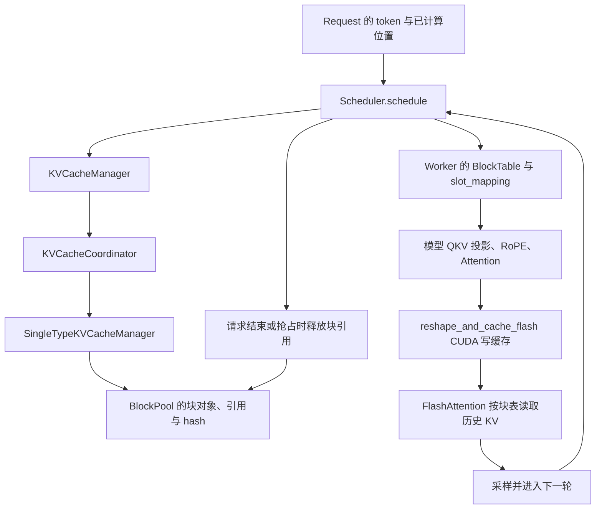

# 第 5 课 源码全景与验证

## 已拉取的版本

| 仓库 | 本地目录 | 锁定提交 |
|---|---|---|
| vLLM v0.11.0 | `upstream/source/` | `b8b302cde434df8c9289a2b465406b47ebab1c2d` |
| vLLM 使用的 FlashAttention fork | `upstream/flash-attention/` | `ee4d25bd84e0cbc7e0b9b9685085fd5db2dcb62a` |

本次沿用仓库已有教程的 v0.11.0，逐行编号对应这份快照。vLLM 和 FlashAttention 目录保留上游目录结构、版权、LICENSE、测试和构建文件。vLLM 的 3027 个文件与 FlashAttention 的 997 个文件均逐文件记录 Git blob 和 SHA-256。

FlashAttention 提交来自 vLLM 的 CMake 锁定值。FlashAttention 的 CUTLASS 与 ROCm composable_kernel 是另外两个子模块，提交号记录在 `SOURCE_MANIFEST.json` 的 `submodules` 中，构建时由原仓库的依赖流程获取。本地化的页表寻址与 KV load 实现在前一课对应的两个仓库中。 [vLLM 构建锁定值](../upstream/source/cmake/external_projects/vllm_flash_attn.cmake#L39)

## 完整调用路径



调度器的块对象管理 CPU 元数据，CUDA writer 和 reader 使用 GPU 张量。两部分以整数 block id、slot mapping、序列长度连接起来。

## 按函数定位主线代码

行号由这份本地源码的 Python AST 生成。展开一个函数后，沿前四课的数值继续代入。

| 本地源码 | 类或函数 | 起始行 |
|---|---|---:|

| [vllm/v1/kv_cache_interface.py](../upstream/source/vllm/v1/kv_cache_interface.py#L58) | `AttentionSpec` | 58 |
| [vllm/v1/kv_cache_interface.py](../upstream/source/vllm/v1/kv_cache_interface.py#L64) | `AttentionSpec.page_size_bytes` | 64 |
| [vllm/v1/kv_cache_interface.py](../upstream/source/vllm/v1/kv_cache_interface.py#L70) | `FullAttentionSpec` | 70 |
| [vllm/v1/kv_cache_interface.py](../upstream/source/vllm/v1/kv_cache_interface.py#L339) | `KVCacheTensor` | 339 |
| [vllm/v1/kv_cache_interface.py](../upstream/source/vllm/v1/kv_cache_interface.py#L348) | `KVCacheGroupSpec` | 348 |
| [vllm/v1/kv_cache_interface.py](../upstream/source/vllm/v1/kv_cache_interface.py#L360) | `KVCacheConfig` | 360 |
| [vllm/v1/worker/gpu_worker.py](../upstream/source/vllm/v1/worker/gpu_worker.py#L222) | `Worker.determine_available_memory` | 222 |
| [vllm/v1/worker/gpu_worker.py](../upstream/source/vllm/v1/worker/gpu_worker.py#L307) | `Worker.initialize_from_config` | 307 |
| [vllm/v1/core/kv_cache_utils.py](../upstream/source/vllm/v1/core/kv_cache_utils.py#L81) | `init_none_hash` | 81 |
| [vllm/v1/core/kv_cache_utils.py](../upstream/source/vllm/v1/core/kv_cache_utils.py#L170) | `KVCacheBlock` | 170 |
| [vllm/v1/core/kv_cache_utils.py](../upstream/source/vllm/v1/core/kv_cache_utils.py#L216) | `FreeKVCacheBlockQueue` | 216 |
| [vllm/v1/core/kv_cache_utils.py](../upstream/source/vllm/v1/core/kv_cache_utils.py#L268) | `FreeKVCacheBlockQueue.popleft` | 268 |
| [vllm/v1/core/kv_cache_utils.py](../upstream/source/vllm/v1/core/kv_cache_utils.py#L301) | `FreeKVCacheBlockQueue.popleft_n` | 301 |
| [vllm/v1/core/kv_cache_utils.py](../upstream/source/vllm/v1/core/kv_cache_utils.py#L334) | `FreeKVCacheBlockQueue.remove` | 334 |
| [vllm/v1/core/kv_cache_utils.py](../upstream/source/vllm/v1/core/kv_cache_utils.py#L376) | `FreeKVCacheBlockQueue.append_n` | 376 |
| [vllm/v1/core/kv_cache_utils.py](../upstream/source/vllm/v1/core/kv_cache_utils.py#L517) | `generate_block_hash_extra_keys` | 517 |
| [vllm/v1/core/kv_cache_utils.py](../upstream/source/vllm/v1/core/kv_cache_utils.py#L547) | `hash_block_tokens` | 547 |
| [vllm/v1/core/kv_cache_utils.py](../upstream/source/vllm/v1/core/kv_cache_utils.py#L576) | `get_request_block_hasher` | 576 |
| [vllm/v1/core/kv_cache_utils.py](../upstream/source/vllm/v1/core/kv_cache_utils.py#L813) | `get_num_blocks` | 813 |
| [vllm/v1/core/kv_cache_utils.py](../upstream/source/vllm/v1/core/kv_cache_utils.py#L1211) | `get_kv_cache_configs` | 1211 |
| [vllm/v1/core/block_pool.py](../upstream/source/vllm/v1/core/block_pool.py#L21) | `BlockHashToBlockMap` | 21 |
| [vllm/v1/core/block_pool.py](../upstream/source/vllm/v1/core/block_pool.py#L118) | `BlockPool` | 118 |
| [vllm/v1/core/block_pool.py](../upstream/source/vllm/v1/core/block_pool.py#L163) | `BlockPool.get_cached_block` | 163 |
| [vllm/v1/core/block_pool.py](../upstream/source/vllm/v1/core/block_pool.py#L188) | `BlockPool.cache_full_blocks` | 188 |
| [vllm/v1/core/block_pool.py](../upstream/source/vllm/v1/core/block_pool.py#L257) | `BlockPool.get_new_blocks` | 257 |
| [vllm/v1/core/block_pool.py](../upstream/source/vllm/v1/core/block_pool.py#L286) | `BlockPool._maybe_evict_cached_block` | 286 |
| [vllm/v1/core/block_pool.py](../upstream/source/vllm/v1/core/block_pool.py#L322) | `BlockPool.touch` | 322 |
| [vllm/v1/core/block_pool.py](../upstream/source/vllm/v1/core/block_pool.py#L338) | `BlockPool.free_blocks` | 338 |
| [vllm/v1/core/block_pool.py](../upstream/source/vllm/v1/core/block_pool.py#L355) | `BlockPool.reset_prefix_cache` | 355 |
| [vllm/v1/core/block_pool.py](../upstream/source/vllm/v1/core/block_pool.py#L393) | `BlockPool.get_usage` | 393 |
| [vllm/v1/core/kv_cache_manager.py](../upstream/source/vllm/v1/core/kv_cache_manager.py#L19) | `KVCacheBlocks` | 19 |
| [vllm/v1/core/kv_cache_manager.py](../upstream/source/vllm/v1/core/kv_cache_manager.py#L85) | `KVCacheManager` | 85 |
| [vllm/v1/core/kv_cache_manager.py](../upstream/source/vllm/v1/core/kv_cache_manager.py#L154) | `KVCacheManager.get_computed_blocks` | 154 |
| [vllm/v1/core/kv_cache_manager.py](../upstream/source/vllm/v1/core/kv_cache_manager.py#L193) | `KVCacheManager.allocate_slots` | 193 |
| [vllm/v1/core/kv_cache_manager.py](../upstream/source/vllm/v1/core/kv_cache_manager.py#L306) | `KVCacheManager.free` | 306 |
| [vllm/v1/core/kv_cache_coordinator.py](../upstream/source/vllm/v1/core/kv_cache_coordinator.py#L15) | `KVCacheCoordinator` | 15 |
| [vllm/v1/core/kv_cache_coordinator.py](../upstream/source/vllm/v1/core/kv_cache_coordinator.py#L226) | `UnitaryKVCacheCoordinator` | 226 |
| [vllm/v1/core/kv_cache_coordinator.py](../upstream/source/vllm/v1/core/kv_cache_coordinator.py#L268) | `HybridKVCacheCoordinator` | 268 |
| [vllm/v1/core/single_type_kv_cache_manager.py](../upstream/source/vllm/v1/core/single_type_kv_cache_manager.py#L17) | `SingleTypeKVCacheManager` | 17 |
| [vllm/v1/core/single_type_kv_cache_manager.py](../upstream/source/vllm/v1/core/single_type_kv_cache_manager.py#L59) | `SingleTypeKVCacheManager.get_num_blocks_to_allocate` | 59 |
| [vllm/v1/core/single_type_kv_cache_manager.py](../upstream/source/vllm/v1/core/single_type_kv_cache_manager.py#L88) | `SingleTypeKVCacheManager.save_new_computed_blocks` | 88 |
| [vllm/v1/core/single_type_kv_cache_manager.py](../upstream/source/vllm/v1/core/single_type_kv_cache_manager.py#L109) | `SingleTypeKVCacheManager.allocate_new_blocks` | 109 |
| [vllm/v1/core/single_type_kv_cache_manager.py](../upstream/source/vllm/v1/core/single_type_kv_cache_manager.py#L133) | `SingleTypeKVCacheManager.cache_blocks` | 133 |
| [vllm/v1/core/single_type_kv_cache_manager.py](../upstream/source/vllm/v1/core/single_type_kv_cache_manager.py#L156) | `SingleTypeKVCacheManager.free` | 156 |
| [vllm/v1/core/single_type_kv_cache_manager.py](../upstream/source/vllm/v1/core/single_type_kv_cache_manager.py#L252) | `FullAttentionManager.find_longest_cache_hit` | 252 |
| [vllm/v1/core/single_type_kv_cache_manager.py](../upstream/source/vllm/v1/core/single_type_kv_cache_manager.py#L304) | `SlidingWindowManager` | 304 |
| [vllm/v1/core/single_type_kv_cache_manager.py](../upstream/source/vllm/v1/core/single_type_kv_cache_manager.py#L529) | `MambaManager` | 529 |
| [vllm/v1/core/sched/scheduler.py](../upstream/source/vllm/v1/core/sched/scheduler.py#L179) | `Scheduler.schedule` | 179 |
| [vllm/v1/core/sched/scheduler.py](../upstream/source/vllm/v1/core/sched/scheduler.py#L1147) | `Scheduler._free_request` | 1147 |
| [vllm/v1/core/sched/scheduler.py](../upstream/source/vllm/v1/core/sched/scheduler.py#L1162) | `Scheduler._free_blocks` | 1162 |
| [vllm/v1/worker/block_table.py](../upstream/source/vllm/v1/worker/block_table.py#L16) | `BlockTable` | 16 |
| [vllm/v1/worker/block_table.py](../upstream/source/vllm/v1/worker/block_table.py#L76) | `BlockTable.compute_slot_mapping` | 76 |
| [vllm/v1/worker/block_table.py](../upstream/source/vllm/v1/worker/block_table.py#L115) | `BlockTable.commit_block_table` | 115 |
| [vllm/v1/worker/block_table.py](../upstream/source/vllm/v1/worker/block_table.py#L118) | `BlockTable.commit_slot_mapping` | 118 |
| [vllm/v1/worker/block_table.py](../upstream/source/vllm/v1/worker/block_table.py#L145) | `MultiGroupBlockTable` | 145 |
| [vllm/v1/worker/gpu_model_runner.py](../upstream/source/vllm/v1/worker/gpu_model_runner.py#L526) | `GPUModelRunner._update_states` | 526 |
| [vllm/v1/worker/gpu_model_runner.py](../upstream/source/vllm/v1/worker/gpu_model_runner.py#L923) | `GPUModelRunner._prepare_inputs` | 923 |
| [vllm/v1/worker/gpu_model_runner.py](../upstream/source/vllm/v1/worker/gpu_model_runner.py#L3758) | `GPUModelRunner._allocate_kv_cache_tensors` | 3758 |
| [vllm/v1/worker/gpu_model_runner.py](../upstream/source/vllm/v1/worker/gpu_model_runner.py#L3797) | `GPUModelRunner._reshape_kv_cache_tensors` | 3797 |
| [vllm/v1/worker/gpu_model_runner.py](../upstream/source/vllm/v1/worker/gpu_model_runner.py#L3914) | `GPUModelRunner.initialize_kv_cache_tensors` | 3914 |
| [vllm/v1/worker/gpu_model_runner.py](../upstream/source/vllm/v1/worker/gpu_model_runner.py#L3974) | `GPUModelRunner.initialize_kv_cache` | 3974 |
| [vllm/v1/worker/gpu_model_runner.py](../upstream/source/vllm/v1/worker/gpu_model_runner.py#L4038) | `GPUModelRunner.get_kv_cache_spec` | 4038 |
| [vllm/v1/worker/utils.py](../upstream/source/vllm/v1/worker/utils.py#L265) | `bind_kv_cache` | 265 |
| [vllm/model_executor/models/llama.py](../upstream/source/vllm/model_executor/models/llama.py#L210) | `LlamaAttention.forward` | 210 |
| [vllm/attention/layer.py](../upstream/source/vllm/attention/layer.py#L263) | `Attention.forward` | 263 |
| [vllm/attention/layer.py](../upstream/source/vllm/attention/layer.py#L598) | `unified_attention_with_output` | 598 |
| [vllm/v1/attention/backends/flash_attn.py](../upstream/source/vllm/v1/attention/backends/flash_attn.py#L78) | `FlashAttentionBackend.get_kv_cache_shape` | 78 |
| [vllm/v1/attention/backends/flash_attn.py](../upstream/source/vllm/v1/attention/backends/flash_attn.py#L422) | `FlashAttentionImpl.forward` | 422 |
| [vllm/_custom_ops.py](../upstream/source/vllm/_custom_ops.py#L1590) | `reshape_and_cache` | 1590 |
| [vllm/_custom_ops.py](../upstream/source/vllm/_custom_ops.py#L1605) | `reshape_and_cache_flash` | 1605 |


## GPU writer、reader 和其他存储路径

| 代码入口 | 在什么时候继续读 |
|---|---|
| [csrc/cache_kernels.cu](../upstream/source/csrc/cache_kernels.cu) | NHD/HND writer、custom writer、MLA writer、块拷贝与交换 |
| [csrc/quantization/vectorization_utils.cuh](../upstream/source/csrc/quantization/vectorization_utils.cuh) | 第 3 课的向量拷贝怎样处理对齐和尾部 |
| [csrc/torch_bindings.cpp](../upstream/source/csrc/torch_bindings.cpp) | Python 算子怎样连到 CUDA |
| [csrc/attention/attention_kernels.cuh](../upstream/source/csrc/attention/attention_kernels.cuh) | custom PagedAttention 的 QK、softmax、AV、split 分区与合并 |
| [vllm/attention/ops/paged_attn.py](../upstream/source/vllm/attention/ops/paged_attn.py) | custom layout 的 Python writer/reader 调用配对 |
| [FlashAttention wrapper](../upstream/flash-attention/vllm_flash_attn/flash_attn_interface.py) | FA2/FA3 参数与 block_table 传递 |
| [FA2 page slice](../upstream/flash-attention/csrc/flash_attn/src/utils.h#L296) | 页号和页内坐标怎样变成指针偏移 |
| [FA2 forward kernel](../upstream/flash-attention/csrc/flash_attn/src/flash_fwd_kernel.h) | 分页 K/V 拷贝如何进入 QK 与 AV 计算 |
| [FA3 page manager](../upstream/flash-attention/hopper/paged_kv.h) | 通用加载、TMA 页表解析及 K/V 指针 |
| [FA3 mainloop](../upstream/flash-attention/hopper/mainloop_fwd_sm90_tma_gmma_ws.hpp) | page manager 与 Hopper pipeline 怎样配合 |
| [MLA 后端目录](../upstream/source/vllm/v1/attention/backends/mla) | 存储压缩 latent KV 和 RoPE 分量时，按 MLAAttentionSpec 与对应 kernel 重新读 |
| [Triton 后端](../upstream/source/vllm/v1/attention/backends/triton_attn.py) | 在该后端被选择时检查布局与 kernel |
| [FlashInfer 后端](../upstream/source/vllm/v1/attention/backends/flashinfer.py) | 追踪 FlashInfer 页表和对应外部算子接口 |
| [CPU 后端](../upstream/source/vllm/v1/attention/backends/cpu_attn.py) | CPU 存储与 attention 调用 |
| [KV transfer 目录](../upstream/source/vllm/distributed/kv_transfer) | P/D 分离、跨实例缓存加载、LMCache、NIXL 和共享存储 |
| [KV offload 目录](../upstream/source/vllm/v1/kv_offload) | GPU 页卸载到 CPU、LRU 与异步搬运 |
| [CacheConfig](../upstream/source/vllm/config/cache.py) | block size、dtype、prefix caching 与显存预算配置 |

其他后端使用各自的存储规格、布局和 writer/reader。上表给出本地入口，Python 层调用的第三方库按对应构建文件追踪。

## 与并发估计怎样接起来

本例 8 个块号中，0 号被保留，还能分配 7 个。同一 KV group 的块号在两层各对应一页。

如果每条请求最多计算到 17 个 token，且请求彼此没有共享页，每条需要 2 块，页容量可容纳 `7//2=3` 条这样的请求，并剩 1 块。它们都增长到 33 个已计算 token 后，每条要 3 块，页容量为 `7//3=2` 条。

如果多条请求共享同一份 16-token 前缀，而且每条只需一个独立尾页，n 条请求共用 `1+n` 个块，满足 `1+n≤7`，此时页容量可容纳 6 条。代码中相应变化就是第一块的 ref_cnt 增加，而后续各有自己的尾块。

这些数字是该画像下的 KV 页容量估计。运行上限还受 `max_num_seqs`、本步 token 预算和生成延迟目标影响。拿容量估计作为候选范围，再实测每条请求的首 token 和后续 token 速度，便能将前面的并发讨论对应到实际代码。

## 本地验证

在仓库根目录运行

```bash
python3 examples/vllm_kv_cache/verify_sources.py
python3 examples/vllm_kv_cache/lifecycle_demo.py
python3 examples/vllm_kv_cache/kv_cache_demo.py
```

第一个命令核对 4024 个上游文件的 SHA-256 和 Git blob，核对课文中每段源码摘录及其行号，还核对原有三份平铺源码与完整快照相同。

第二个命令用 AST 从原始文件加载 BlockPool、BlockHashToBlockMap、KVCacheBlock、FreeKVCacheBlockQueue 和 hash 函数，执行其原有函数体。模块级 GPU 导入被隔离，事件上报关闭，hash seed 固定。每一步断言引用数、队列、NHD/HND 逐元素读回、attention 数值和索引重置。GPU 缓冲区、QKV 投影和 CUDA 执行以 Python 数据模型演示，浮点数使用 Python float，BF16 字节账按目标 GPU 格式计算。

第三个命令运行仓库原有的 custom-layout 地址例子，它使用 block_size=4 作手算模型。第 1～4 课的 FlashAttention 例子使用 block_size=16，对应该后端的页大小约束。

本机为 macOS，当前 Python 环境无 torch/CUDA。上述三个验证命令在 CPU 上完成。完整引擎、显存 profile、GPU kernel 性能与竞态行为需要在具备相应驱动、torch 和 GPU 的环境执行上游测试。

## 上游测试怎样验证这些约束

| 上游测试 | 可对照的问题 |
|---|---|
| [test_prefix_caching.py](../upstream/source/tests/v1/core/test_prefix_caching.py) | 活跃块命中、已释放块命中、重复 hash、缓存重置和对齐 |
| [test_kv_cache_utils.py](../upstream/source/tests/v1/core/test_kv_cache_utils.py) | 空闲队列、hash、页容量与缓存规划 |
| [test_single_type_kv_cache_manager.py](../upstream/source/tests/v1/core/test_single_type_kv_cache_manager.py) | full/sliding-window 等分配语义 |
| [test_scheduler.py](../upstream/source/tests/v1/core/test_scheduler.py) | 分配失败、运行预算与抢占 |
| [test_cache.py](../upstream/source/tests/kernels/attention/test_cache.py) | CUDA 缓存写入、dtype 与地址正确性 |
| [test_attention_backends.py](../upstream/source/tests/v1/attention/test_attention_backends.py) | 不同后端与参考 attention 输出的比较 |

[返回学习入口](../README.md)
