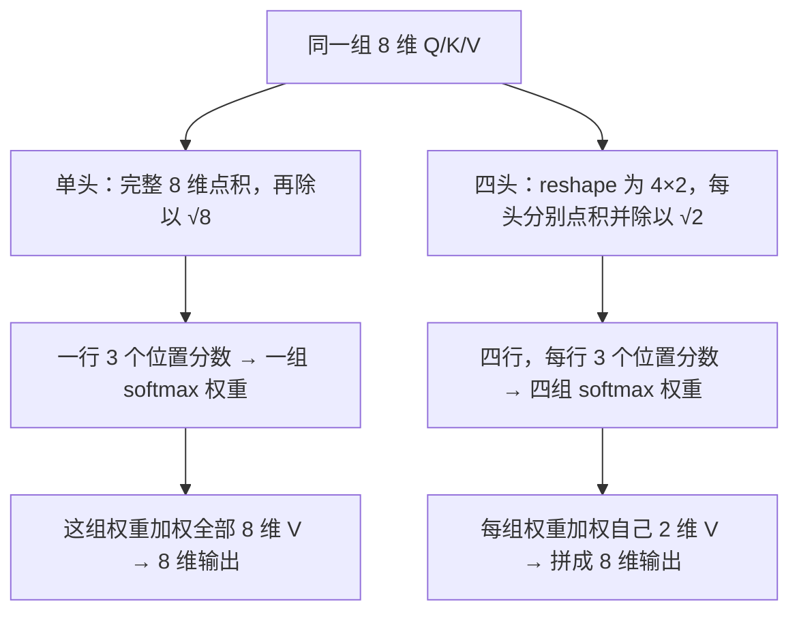

# 多头注意力：从 8 维手算到真实大模型

> 从「投影后做一次 reshape，为什么结果就不同了」出发，完整对比单头和多头，再连接到自回归推理、KV cache 和真实模型。
>
> 本文手算使用 **8 维、4 个 Q 头、4 个 KV 头的普通 MHA**。仓库的 [TinyToy 主线文档](./LLM推理全链路-从玩具模型到GPU水位.md) 使用 **4 个 Q 头、2 个 KV 头的 GQA**，两套配置用于解释不同问题，不要混用。
>
> 数值采用未舍入的中间结果计算，展示时保留四位小数。真实型号的公开资料边界见第 8 节。

## 阅读路线

- 第 1～2 节：token、特征维度和 head 的区别，投影与 reshape 的关系。
- 第 3～6 节：同一组 8 维数据，单头与四头的完整数值对比。
- 第 7 节：真实 decode 的张量形状、KV cache 和融合计算。
- 第 8 节：不同注意力架构、真实模型配置及两个指定型号的证据边界。
- 附录：可直接运行的数值复算代码。

## 1. 先把一句话说清楚

**按投影后的特征维度分头，沿可见 token 位置做 softmax。**

- 单头：当前 token 的所有输出特征维度，共用一组位置注意力权重。
- 多头：当前 token 的每个头各自产生一组位置注意力权重，用来加权该头的 V。
- reshape 本身不计算新特征；改变计算结果的是：拆开后分别点积、分别缩放、分别做 softmax。

这里的「位置权重」表示对各个 token 位置分配多少权重。匹配分数来自 Q/K，取决于内容以及模型采用的位置编码，并不是仅按位置远近分配权重。

### 1.1 token 位置和特征维度不是一回事

假设已经处理两个 token，正在处理第 3 个 token：

| 编号 | 含义 | 本例的数量 |
|---|---|---|
| token 位置 | 序列里的第几个 token | 位置 1、2、3，共 3 个 |
| 特征维度 | 一个向量里面的第几个数 | 每个完整 Q/K/V 有 8 个数 |
| head | 把投影后的特征分成的组 | 4 个头，每组 2 个数 |

「第 3 个 token」不是「第 3 维」。一个 token 在每个头里都有自己的表示，token 数量没有因为分头增加。

## 2. 从 embedding 到 Q/K/V：在哪里分头？

模型先把 token ID 映射成 embedding。到了某一层 attention，实际输入是这一层的隐藏状态，可能先经过归一化；深层输入也已经包含前面各层的计算结果。用 $x_3$ 表示这里用于投影的输入。

采用行向量记法：

$$
q_3=x_3W_Q,\qquad k_3=x_3W_K,\qquad v_3=x_3W_V
$$

本例三个投影矩阵的形状都是 $8\times8$。投影完，再把每个 8 维结果按顺序分成 4 组。

### 2.1 一个可手算的投影

令：

$$
x_3=[1,1,1,1,1,1,1,1]
$$

设 $W_Q$ 的每一行都等于：

$$
\frac{\sqrt2}{8}[1,0,0,1,1,1,1,-1]
$$

得到：

$$
q_3=[\sqrt2,0,\ 0,\sqrt2,\ \sqrt2,\sqrt2,\ \sqrt2,-\sqrt2]
$$

例如，第一个输出分量是：

$$
(q_3)_1=\frac{\sqrt2}{8}\sum_{j=1}^{8}x_{3,j}=\sqrt2
$$

所以 Head 1 虽然只拿到投影结果的前两维，这两维也可以使用完整的 8 维输入信息。实际训练中，不同投影列通常具有不同的学习权重；这里重复矩阵行只是为了方便手算。

令 $W_K=W_V=I_8$，则：

$$
k_3=v_3=[1,1,1,1,1,1,1,1]
$$

本例暂不加入位置编码、投影偏置和其他归一化，只演示 attention 核心。真实模型的 $W_K$、$W_V$ 通常不同。

### 2.2 reshape 的直觉

同一条 Q：

```text
[√2, 0, 0, √2, √2, √2, √2, -√2]
```

重排成四行：

```text
Head 1: [√2,  0]
Head 2: [ 0, √2]
Head 3: [√2, √2]
Head 4: [√2, -√2]
```

元素及顺序都没有改变，只是多了一个 head 维度。实际 API 的 reshape 是否需要复制，取决于底层布局；数学上只是重新解释形状。

从权重角度看，把 $W_Q$ 按输出列切成四块，有：

$$
W_Q=[W_Q^{(1)}\mid W_Q^{(2)}\mid W_Q^{(3)}\mid W_Q^{(4)}]
$$

$$
x_3W_Q=[x_3W_Q^{(1)}\mid x_3W_Q^{(2)}\mid x_3W_Q^{(3)}\mid x_3W_Q^{(4)}]
$$

因此，一次大投影后拆头，与每头使用自己的投影矩阵，在数学上等价。每头投影都能读取完整的 $x_3$。

## 3. 固定同一组数据，比较两种计算

当前 token 的 Q 使用上一节的 $q_3$。三个可见位置的 K/V 如下，本例有意设置 $K_i=V_i$：

| 位置 | $K_i=V_i$ | 来源 |
|---|---|---|
| 1 | $[1,0,\ 0,1,\ 1,0,\ 0,1]$ | 历史缓存 |
| 2 | $[0,1,\ 1,0,\ 0,1,\ 1,0]$ | 历史缓存 |
| 3 | $[1,1,\ 1,1,\ 1,1,\ 1,1]$ | 当前 token 新算 |

要比较的是：

| 方案 | 头数 | 每头维度 | 每个当前 token 产生几组位置权重 |
|---|---:|---:|---:|
| 不分头 | 1 | 8 | 1 组，每组 3 个数 |
| 分头 | 4 | 2 | 4 组，每组 3 个数 |

两边投影结果完全相同，只改变 attention 的分组与相应的缩放因子。比较的是输出投影 $W_O$ 之前的结果，也可认为两边都取 $W_O=I_8$。

这是两个计算方案的对照实验。已经训练好的模型不能随意修改头数并期待保持原有行为。

## 4. 不分头：完整 8 维一起计算

### 4.1 每个 token 位置得到一个分数

先算点积。为看清各组特征的贡献，把每两个维度用括号分组：

$$
\begin{aligned}
q_3K_1^\top
&=(\sqrt2)+(\sqrt2)+(\sqrt2)+(-\sqrt2)
=2\sqrt2\\
q_3K_2^\top
&=(0)+(0)+(\sqrt2)+(\sqrt2)
=2\sqrt2\\
q_3K_3^\top
&=(\sqrt2)+(\sqrt2)+(2\sqrt2)+(0)
=4\sqrt2
\end{aligned}
$$

单头维度 $d_k=8$，所以除以 $\sqrt8=2\sqrt2$：

$$
s=\frac{[2\sqrt2,2\sqrt2,4\sqrt2]}{\sqrt8}=[1,1,2]
$$

注意：这里的 3 个数分别对应 **token 位置 1、2、3**。

### 4.2 对三个位置做一次 softmax

$$
a_i=\frac{e^{s_i}}{\sum_{j=1}^{3}e^{s_j}}
$$

数值实现通常先减去最大分数，结果不变：

$$
a=\frac{[e^{-1},e^{-1},1]}{2e^{-1}+1}
\approx[0.2119,0.2119,0.5761]
$$

权重加起来是 1。位置 3 的系数最大，为约 57.61%。

### 4.3 用这一组系数加权三条完整 V

$$
o_{\text{单头}}=a_1V_1+a_2V_2+a_3V_3
$$

每个系数乘的是一整条 8 维向量，再逐维相加。

单独拿第 7、8 维看：

| 来源 | 混合系数 | V 的第 7 维 | V 的第 8 维 |
|---|---:|---:|---:|
| token 1 | 0.2119 | 0 | 1 |
| token 2 | 0.2119 | 1 | 0 |
| token 3 | 0.5761 | 1 | 1 |

$$
\begin{aligned}
o_7&=a_1\times0+a_2\times1+a_3\times1\approx0.7881\\
o_8&=a_1\times1+a_2\times0+a_3\times1\approx0.7881
\end{aligned}
$$

**两维使用的是同一组系数，区别只在被乘的 V 元素。**其他维度也使用这三个系数。

本例所有维度的结果恰好相同：

$$
\boxed{
o_{\text{单头}}\approx[0.7881,0.7881,\ 0.7881,0.7881,\ 0.7881,0.7881,\ 0.7881,0.7881]
}
$$

「主要关注位置 3」只表示位置 3 的注意力系数最大，不保证它对每个输出分量的数值贡献都最大；贡献还取决于 V 的大小和符号。

## 5. 分成 4 个头：每头独立计算

### 5.1 先把同一组 Q/K/V 拆开

| Head | 负责的维度 | $q_3^{(h)}$ | $K_1^{(h)}=V_1^{(h)}$ | $K_2^{(h)}=V_2^{(h)}$ | $K_3^{(h)}=V_3^{(h)}$ |
|---|---|---|---|---|---|
| 1 | 1、2 | $[\sqrt2,0]$ | $[1,0]$ | $[0,1]$ | $[1,1]$ |
| 2 | 3、4 | $[0,\sqrt2]$ | $[0,1]$ | $[1,0]$ | $[1,1]$ |
| 3 | 5、6 | $[\sqrt2,\sqrt2]$ | $[1,0]$ | $[0,1]$ | $[1,1]$ |
| 4 | 7、8 | $[\sqrt2,-\sqrt2]$ | $[0,1]$ | $[1,0]$ | $[1,1]$ |

每个头仍能看见三个 token 位置，只是使用自己的特征子空间计算。

每头维度 $d_k=2$，统一使用：

$$
s_i^{(h)}=\frac{q_3^{(h)}(K_i^{(h)})^\top}{\sqrt2},\qquad
a^{(h)}=\operatorname{softmax}(s^{(h)})
$$

$$
o^{(h)}=\sum_{i=1}^{3}a_i^{(h)}V_i^{(h)}
$$

### 5.2 Head 1：计算第 1、2 维

$$
s^{(1)}=\frac{[\sqrt2,0,\sqrt2]}{\sqrt2}=[1,0,1]
$$

$$
a^{(1)}=\frac{[e,1,e]}{2e+1}\approx[0.4223,0.1554,0.4223]
$$

$$
\begin{aligned}
o^{(1)}
&=a_1^{(1)}[1,0]+a_2^{(1)}[0,1]+a_3^{(1)}[1,1]\\
&=[a_1^{(1)}+a_3^{(1)},\ a_2^{(1)}+a_3^{(1)}]\\
&\approx[0.8446,0.5777]
\end{aligned}
$$

### 5.3 Head 2：计算第 3、4 维

$$
s^{(2)}=\frac{[\sqrt2,0,\sqrt2]}{\sqrt2}=[1,0,1]
$$

$$
a^{(2)}\approx[0.4223,0.1554,0.4223]
$$

这里权重碰巧与 Head 1 相同，但 V 的内容不同：

$$
\begin{aligned}
o^{(2)}
&=a_1^{(2)}[0,1]+a_2^{(2)}[1,0]+a_3^{(2)}[1,1]\\
&=[a_2^{(2)}+a_3^{(2)},\ a_1^{(2)}+a_3^{(2)}]\\
&\approx[0.5777,0.8446]
\end{aligned}
$$

独立计算不代表各头的结果一定不同；训练也不保证每个头都有清晰、固定的人类语义分工。

### 5.4 Head 3：计算第 5、6 维

$$
s^{(3)}=\frac{[\sqrt2,\sqrt2,2\sqrt2]}{\sqrt2}=[1,1,2]
$$

$$
a^{(3)}\approx[0.2119,0.2119,0.5761]
$$

$$
\begin{aligned}
o^{(3)}
&=a_1^{(3)}[1,0]+a_2^{(3)}[0,1]+a_3^{(3)}[1,1]\\
&\approx[0.7881,0.7881]
\end{aligned}
$$

### 5.5 Head 4：计算第 7、8 维

$$
\begin{aligned}
s^{(4)}
&=\frac{[\sqrt2\times0-\sqrt2\times1,\ \sqrt2\times1-\sqrt2\times0,\ \sqrt2\times1-\sqrt2\times1]}{\sqrt2}\\
&=[-1,1,0]
\end{aligned}
$$

$$
a^{(4)}=\frac{[e^{-1},e,1]}{e^{-1}+e+1}
\approx[0.0900,0.6652,0.2447]
$$

$$
\begin{aligned}
o^{(4)}
&=a_1^{(4)}[0,1]+a_2^{(4)}[1,0]+a_3^{(4)}[1,1]\\
&=[a_2^{(4)}+a_3^{(4)},\ a_1^{(4)}+a_3^{(4)}]\\
&\approx[0.9100,0.3348]
\end{aligned}
$$

这两维现在更偏向位置 2：位置 2 获得约 66.52% 的权重。

### 5.6 拼接四个头

$$
\begin{aligned}
z_3&=\operatorname{Concat}(o^{(1)},o^{(2)},o^{(3)},o^{(4)})\\
&\approx[0.8446,0.5777,\ 0.5777,0.8446,\ 0.7881,0.7881,\ 0.9100,0.3348]
\end{aligned}
$$

随后经过学习到的输出投影：

$$
y_3=z_3W_O
$$

$W_O$ 可以混合不同头的输出。经过它之后，输出的第 7、8 维通常不再只对应 Head 4。本文的逐维对比发生在这个混合之前。

## 6. 把计算差异放在一张表里



| 计算方案 / 头 | softmax 前的分数 | 位置 1 权重 | 位置 2 权重 | 位置 3 权重 | 使用这些权重的 V 维度 |
|---|---|---:|---:|---:|---|
| 单头 | $[1,1,2]$ | 21.19% | 21.19% | 57.61% | 全部 8 维 |
| 多头 Head 1 | $[1,0,1]$ | 42.23% | 15.54% | 42.23% | 第 1、2 维 |
| 多头 Head 2 | $[1,0,1]$ | 42.23% | 15.54% | 42.23% | 第 3、4 维 |
| 多头 Head 3 | $[1,1,2]$ | 21.19% | 21.19% | 57.61% | 第 5、6 维 |
| 多头 Head 4 | $[-1,1,0]$ | 9.00% | 66.52% | 24.47% | 第 7、8 维 |

展示百分比四舍五入后可能有 0.01 个百分点的和差，实际未舍入权重之和为 1。

| 输出维度 | 单头输出 | 多头拼接输出 |
|---|---|---|
| 第 1、2 维 | $[0.7881,0.7881]$ | $[0.8446,0.5777]$ |
| 第 3、4 维 | $[0.7881,0.7881]$ | $[0.5777,0.8446]$ |
| 第 5、6 维 | $[0.7881,0.7881]$ | $[0.7881,0.7881]$ |
| 第 7、8 维 | $[0.7881,0.7881]$ | $[0.9100,0.3348]$ |

### 6.1 不只是缩放因子不同

单头点积会把四组特征的匹配贡献先加起来。用本例已经除以 $\sqrt2$ 的四行分数表示，单头分数恰好满足：

$$
s_{\text{单头}}=\frac{s^{(1)}+s^{(2)}+s^{(3)}+s^{(4)}}{2}
=\frac{[2,2,4]}2=[1,1,2]
$$

分母的 2 来自 $\sqrt8/\sqrt2=2$。

单头在这些贡献合并后才做 softmax；多头在各组贡献合并之前，分别对三个位置做 softmax。softmax 是非线性操作，先合并分数再归一化，与保留多组独立分布并加权各自的 V，通常不等价。

本例单头对位置 1、2 的总分相同，但 Head 4 明确偏向位置 2。单头的一个分布无法同时保留各头的全部偏好。

### 6.2 是否任何情况下结果都不同？

不一定。例如只有一个可见 token 时，每个 softmax 都是 $[1]$；给定相同的 V 和输出投影，两种方案会产生相同结果。多个位置时，某些特殊数据也可能得到相同输出。

多头增加的是独立位置分布的表达方式，并不意味着头越多一定越好。固定总投影宽度时，头数增加也会使每头维度变小。

## 7. 真实推理中的张量和 KV cache

### 7.1 普通 MHA 的逻辑形状

设 batch 大小为 $B$，本轮处理的 query token 数为 $T_q$，包含历史的可见长度为 $L$。本例形状为：

```text
本轮输入 X                    [B, Tq, 8]
Q = X @ WQ                    [B, Tq, 8]
reshape                       [B, Tq, 4, 2]
transpose                     [B, 4, Tq, 2]

完整 K cache                  [B, 4, L, 2]
完整 V cache                  [B, 4, L, 2]

Q @ transpose(K, -1, -2)       [B, 4, Tq, L]
除以 √2，加 attention mask     [B, 4, Tq, L]
softmax，沿最后的 L 维          [B, 4, Tq, L]
权重 @ V                      [B, 4, Tq, 2]
transpose + 合并各头            [B, Tq, 8]
输出投影 WO                    [B, Tq, 8]
```

**softmax 沿 $L$ 维做：每个 batch、每个头、每个 query 位置，都分别在可见 key 位置之间归一化。**不沿 head 维归一化，也不沿每头的 2 个特征维度归一化。

这些是便于理解的逻辑布局。实际引擎可能使用不同的维度顺序、连续批处理、分页存储或分片布局。

### 7.2 缓存两个 token 后，处理第 3 个 token

本例 $T_q=1$：

1. 只对当前 token 计算新的 $q_3,k_3,v_3$。
2. 历史 $k_1,k_2,v_1,v_2$ 从当前层的 KV cache 读取。
3. 把当前的 $k_3,v_3$ 纳入本轮可访问的 K/V，并保留下来供后续 token 使用。
4. 每头的 $q_3^{(h)}$ 与位置 1、2、3 的 K 匹配，得到 3 个分数。
5. 各头对自己的 3 个分数做 softmax，再加权对应 V。

```text
当前 Q                        [B, 4, 1, 2]
历史 + 当前 K/V               [B, 4, 3, 2]
分数和注意力权重               [B, 4, 1, 3]
各头输出                      [B, 4, 1, 2]
合并后                        [B, 1, 8]
```

对于标准因果 attention，第 3 个位置能看位置 1、2、3，包含自己；没有未来位置。若批次中存在 padding、滑窗或其他限制，还要应用相应 mask。

每层维护自己的缓存。旧 token 的 Q 通常不需要保留，也不需要重新计算旧 token 的输出。若本轮输入的是位置 3 的 token，经过全部层和词表输出层后，预测的是位置 4 的 token。

### 7.3 实际代码一定逐行执行这些操作吗？

数学上遵循相应的注意力定义，实现上经常融合：

- 用一次线性投影同时产生 Q/K/V，再拆开。
- 在 Q/K 上应用 RoPE，可能还有 Q/K normalization 等步骤；取决于模型架构。
- 用批量矩阵运算一次处理所有头，而不是用四次串行循环。
- 使用 FlashAttention 一类 kernel，分块计算分数、在线 softmax 和加权结果，避免把整个分数/权重矩阵写回显存。

因此，「每头独立 softmax」是数学上的独立分布，不代表一定启动四个独立 kernel，也不代表一定保存完整注意力矩阵。融合实现通常只有浮点运算次序等数值差异，不改变目标公式。

本例固定总宽度为 8，单头和四头的 QK、AV 矩阵乘主项计算量相同；softmax 的行数、内存访问及 kernel 效率可以不同，不能把多头理解为实际运行完全没有额外成本。

### 7.4 这里的 softmax 与词表 softmax 不同

本例每头的 attention softmax 只有 3 个元素，对应 3 个可见 token 位置。它的输出用于混合 V，不直接决定下一个 token 是什么。

经过所有 Transformer 层后，模型还会通过词表输出层得到每个候选 token 的 logit。转换为概率时，再沿词表维度做 softmax；实际采样还可能使用 temperature、top-k、top-p 等处理。

```text
一层 attention 内：沿历史/当前 token 位置归一化 → 用来加权 V
模型最终输出端：沿词表候选 token 归一化 → 用来选择下一个 token
```

## 8. 真实模型：先区分 MHA、GQA、MQA、MLA

### 8.1 分头不等于 Q/K/V 的头数都相同

| 机制 | Q 头 | K/V 组织 | 是否仍有每个 Q 头的位置权重 |
|---|---|---|---|
| MHA | 多个 | 每个 Q 头对应自己的 K/V 头 | 是 |
| GQA | 多个 | 一组 Q 头共享一个 K/V 头 | 是 |
| MQA | 多个 | 全部 Q 头共享一个 K/V 头 | 是 |
| MLA | 多个 | 使用低秩潜变量等方式组织 K/V；细节依论文和实现 | 是，不能仅由缓存形状推断完整计算 |

以 **4 个 Q 头、2 个 KV 头**的 GQA 为例：

```text
Q head 1 ─┐
           ├─ 使用 K/V head 1，各自算分数和 softmax
Q head 2 ─┘

Q head 3 ─┐
           ├─ 使用 K/V head 2，各自算分数和 softmax
Q head 4 ─┘
```

共享 K/V 不等于共享注意力权重：两个不同的 Q 与同一套 K 点积，通常得到不同分数。

本例宽度下，GQA 的投影和缓存形状会变成：

```text
WQ                            [8, 8]  → 4 个 Q 头 × 2 维
WK / WV                       [8, 4]  → 2 个 KV 头 × 2 维
Q                             [B, 4, Tq, 2]
K / V cache                   [B, 2, L, 2]
逻辑注意力权重                 [B, 4, Tq, L]
```

优化实现可以直接读取共享的 K/V，并不需要在显存里真的复制成四份。

本例的 $8=4\times2$ 是一种常见设计约定。更一般的 MHA/GQA/MQA 可以分别指定隐藏宽度 $D$、Q 头数 $H_q$、KV 头数 $H_{kv}$、Q/K 每头宽度 $d_k$ 和 V 每头宽度 $d_v$：

$$
\begin{aligned}
W_Q&\in\mathbb R^{D\times(H_qd_k)}\\
W_K&\in\mathbb R^{D\times(H_{kv}d_k)}\\
W_V&\in\mathbb R^{D\times(H_{kv}d_v)}\\
W_O&\in\mathbb R^{(H_qd_v)\times D}
\end{aligned}
$$

所以「每头维度永远等于 hidden_size 除以头数」并不是通用定律；要看投影输出宽度和该模型配置。上式使用数学上的右乘矩阵记法，框架保存线性层权重时也可能采用转置布局。

MLA 则不能简单画成「完整 K/V 投影出来，各存一份小向量」：例如 DeepSeek-V2 的设计把 K/V 信息压到联合低秩潜变量，并为位置编码保留相应分量；优化推理可通过矩阵吸收等方式使用缓存。用于点积的 Q/K 维度与 V 的维度也不必相同。

无论采用哪种变体，都要根据该型号的正式定义判断实际公式、缩放和缓存结构，不能只用模型名字推导。

<!-- 精确型号核实结果和一手来源将在资料核对后补充。 -->

## 9. 回看时只检查这五件事

1. 这是第几个 token，还是向量的第几维？先分清编号。
2. Q/K/V 是投影后的向量，还是原始 embedding？分头通常作用在投影结果上。
3. softmax 沿哪一维？这里沿可见 token 位置，不沿特征或头。
4. Q 头数与 KV 头数是否相等？MHA、GQA、MQA 的缓存成本不同。
5. 模型的精确架构有没有公开证据？不能把同厂商其他型号的机制直接套过来。

## 附录：用 JavaScript 复算本文数值

以下代码只使用 Node.js 内置能力，无第三方依赖。输出单头分数、权重和结果，以及四个头的对应值。未舍入结果参与后续计算。

```javascript
const q = [Math.SQRT2, 0, 0, Math.SQRT2,
           Math.SQRT2, Math.SQRT2, Math.SQRT2, -Math.SQRT2];
const kv = [
  [1, 0, 0, 1, 1, 0, 0, 1],
  [0, 1, 1, 0, 0, 1, 1, 0],
  [1, 1, 1, 1, 1, 1, 1, 1],
];

function softmax(scores) {
  const max = Math.max(...scores);
  const exps = scores.map(s => Math.exp(s - max));
  const sum = exps.reduce((a, b) => a + b, 0);
  return exps.map(e => e / sum);
}

function attend(query, keys, values) {
  const scores = keys.map(key =>
    query.reduce((sum, x, j) => sum + x * key[j], 0)
      / Math.sqrt(query.length)
  );
  const weights = softmax(scores);
  const output = values[0].map((_, j) =>
    weights.reduce((sum, w, i) => sum + w * values[i][j], 0)
  );
  return { scores, weights, output };
}

const single = attend(q, kv, kv);
const heads = Array.from({ length: 4 }, (_, h) => {
  const query = q.slice(2 * h, 2 * h + 2);
  const slices = kv.map(v => v.slice(2 * h, 2 * h + 2));
  return attend(query, slices, slices);
});

console.log(JSON.stringify({
  single,
  heads,
  multiOutput: heads.flatMap(h => h.output),
}, null, 2));
```
